# Agentic retrieval

This page is the workflow contract for the in-house retrieval stack that replaced
LightRAG. Prefer it over guessing from code when changing ingest, search, chat,
or generate behaviour.

The pipeline test inventory lives in [test-catalog.md](test-catalog.md). Storage
quota and who may create materials live in
[authorization-permissions-lifecycles.md](authorization-permissions-lifecycles.md)
and [backend-storage-quota.md](backend-storage-quota.md).

## Architecture

The Python services share one Postgres schema owned by Go migrations
(`server/migrations/0001_init.sql` plus the forward-only files after it):

| Process | Entry | Role |
| --- | --- | --- |
| Parse coordinator | `python -m pipeline.ingest.parse_worker` | Supervises eight isolated one-job coordinator processes. They validate and hash document sources, reuse an exact donor when possible, wait for the parser, then atomically enqueue an immutable artifact handoff |
| Ingest worker | `python -m pipeline.ingest.worker` | Claims only post-parse and direct-route jobs, then reads a parse bundle's text-less page renders with the VLM, chunks (with heading retention and extraction confidence), captions standalone images, embeds, and writes the file descriptor. Each replica runs one job at a time |
| Retrieval service | `uvicorn pipeline.retrieve.service:app` | `/chat/stream`, `/generate`, `/plate-ai/*` over the same index |
| Parser service | `uvicorn parser/app.py` | OpenDataLoader 2.5.7 (Java) with the refined native repairs (`parser/odl/`); seven parse children over one FIFO, depth 8; renders text-less pages as JPEGs for the ingest worker's VLM; normalizes Office through LibreOffice |
| Host sampler | `python -m pipeline.ingest.host_sampler` | Persists compact whole-host and parser admission/resource samples without document identity |

The Go gateway is the public face: it authenticates the user, proxies chat and
generate to the retrieval service, and owns material persistence (including the
internal materials endpoint the chat agent calls). Retrieval HTTP is
Go-only: every route except `/healthz` requires `X-Pipeline-Secret`. User
provider keys stay ciphertext on that hop; retrieval decrypts them with
`LLM_CREDENTIALS_KEY`.

Public workspace landing pages use a separate live metadata projection from Go
at `GET /api/public/workspaces/{token}/summary` (the share token, not the bare
id). It returns workspace metadata and
chapter/file names for link/public workspaces, with `Cache-Control: no-store`.
It never calls retrieval or returns source text, material bodies, file-content
summaries or download URLs. Reading full workspace/study content requires a
session. There is no summary generation job, KV or R2 cache for this endpoint;
see [the authorization contract](authorization-permissions-lifecycles.md#anonymous-workspace-summaries).

```mermaid
flowchart LR
  Upload[Upload / move file] --> Plan[Go format policy builds processingPlan v2]
  Plan --> Route{Contract route}
  Route -->|PDF / modern Office| ParseJob[(parse job)]
  ParseJob --> Coordinator[Parse coordinator]
  Coordinator --> Download[One B2 download + trusted SHA]
  Download --> Parse[Netcup OpenDataLoader + text-less page renders]
  Parse --> Artifact[Immutable local artifact]
  Artifact --> IngestJob[(ingest continuation)]
  Route -->|direct route| IngestJob
  IngestJob --> Worker[Ingest worker]
  Worker -->|image| ImageCaption[Captioning-slot VLM]
  Worker -->|CSV / TSV / text| DirectText[Direct normalization]
  Worker -->|parsed document| VlmPages[Text-less pages read by the captioning-slot VLM]
  VlmPages --> Chunk[Heading-aware chunker + heading retention + confidence]
  ImageCaption --> Chunk
  DirectText --> Chunk
  Chunk --> Index[Embed + file descriptor]
  Index --> Store[(rag_chunks / summaries)]
  Store --> Search[Hybrid search RRF]
  Search --> Agent[Chat agent loop]
  Agent -->|capture_page| Capture[PyMuPDF page render from the source PDF, or the image bytes]
  Search --> Workflows[Generate workflows]
  Agent --> Gateway[Go /api/internal/materials]
  Gateway --> Materials[(materials)]
```



There is no dual-running period with LightRAG. Apache AGE is gone; the database
image is stock `pgvector/pgvector:pg16`.

### Where prompts live

Every prompt this system sends sits in `pipeline/prompts/`, one module per model
slot. A function there takes the surrounding context and returns what goes into
the request — the message list for most calls, a bare string where the caller
owns the wrapping. Nothing in that package opens a connection, reads the
database, or resolves a model, so a prompt can be built in a test with no
network and no pin.

| Module | Slot | What it builds |
| --- | --- | --- |
| `chat.py` | `chat` | Agent system prompt (one prompt for every turn, library rules appended only with Library on) and full message list; the checkpoint compaction prompt |
| `generate.py` | `generate` | Material grounding rules, plus the flashcards / mindmap / diagram / quiz instructions |
| `editor.py` | `editor` | Plate menu prompts: generate, edit, comment, table cells |
| `ingest.py` | `ingest` | File descriptor |
| `captioning.py` | `captioning` | Whole-image captions for standalone image uploads |
| `retrieval.py` | `retrieval` | The Qwen3 instruct prefix for embedding queries |
| `preferences.py` | `chat`, `generate` | The learner's study preferences as build instructions, rendered into the turn context; `/generate`'s count when the request omits it |
| `skills.py` | `chat` | The skills `read_skill` returns: `editing` (plan, output rules, budget, write precautions, excerpt crediting, the quiz, flashcards, mindmap and diagram formats), `note_building` (note structure, knowledge checks, the note format, library practice) and `deck_building` (decks) |
| `locale.py` | shared | The account-locale rule appended by chat, generate, and editor |
| `sources.py` | shared | The `<source>` block that source and library text is shown in, and the rule that its text is data, stated once by chat, generate and ingest (Source blocks, under Tools) |

Agent tool descriptions come from the shared contract
(`retrieval/contract.py`) alone; `tools.schemas_for` only appends the
library's subject list to `search_knowledge` and the skill list to
`read_skill`, and drops
`excerpt_ids` from the write tools when the library is not a source this turn
(the model otherwise fills it with workspace passage ids). Curate mode's prompt module
(`prompts/curate.py`) was deleted on 2026-10-04. Almost nothing model-facing is
written in `retrieval/`: `LANG_RULE` lives in `chat.py`, and `retrieval/`
keeps tool results and refusal strings, which the model reads as data rather
than instruction, plus the turn context's fixed lines
(`retrieval/turn_context.py`) and the stall-guard allowance in `agent.py`.

## Schema ownership

The retrieval index is application schema, not pipeline-owned:

| Table | Purpose |
| --- | --- |
| `rag_contents` | Canonical parsed content per workspace, unique by parsed-text hash |
| `rag_file_contents` | Logical file → canonical content aliases |
| `rag_chunks` | Canonical passages: text, heading path, pages/regions, `tsvector`, `halfvec(2560)` |
| `rag_content_summaries` | The ~50-word `descriptor`, its running `change_share` and when it was written (`updated_at`, kept when a refresh reuses it); shared by files with identical content, carried forward across a note's reindexes |

All of these FK-cascade from `workspaces` / `files` / `chapters`. Deleting a
logical file removes its alias; a trigger removes canonical content only after
its last alias disappears. Deleting a workspace deletes its index; there is no
`rag_teardown` job.

`files.content_hash` is the sha256 of parsed chunk text plus page and bounding-box
geometry when the parser supplies it. Two uploads of the same document in one
workspace stay as two independently selectable/deletable file rows, both mapped
to one canonical index. Text-identical documents with different layouts remain
separate so one file cannot inherit another file's citation coordinates. Search
chooses one in-scope alias for each content item, so duplicates do not repeat
passages. Deleting either upload leaves the other searchable and citable under
its own file id and name.

`files.doc_id` is gone. Identity is always `files.id`.

## The embedding model belongs to the workspace

Every chunk in a workspace lives in one model's vector space, and a query is
only meaningful against the space it was embedded in. A query embedded by a
different model than the chunks returns confidently ranked nonsense — no error,
no type mismatch, just worse answers. So the model is not a setting either
process resolves; it is a property of the workspace:

| Column | Meaning |
| --- | --- |
| `workspaces.embedding_provider_slug` / `embedding_model_slug` / `_version` | the space this workspace is in, fixed at creation |
| `workspaces.embedding_dim` | its width, which selects the vector table |
| `rag_contents.embedding_provider_slug` / `embedding_model_slug` / `_version` / `_dim` | the model that actually produced the vectors under this content |

The workspace columns are what ingest and query both read (`ingestJobPayload`
does *not* snapshot embedding onto the job; the worker installs the workspace's
pin into `JobPins` itself, and `retrieval.search` reads the same row). The
`rag_contents` columns are the observed value rather than the intended one:
they agree by construction, and recording both is what would make a
disagreement findable instead of leaving it to show up as poor retrieval.

Retargeting the registry's embedding default therefore applies **only to
workspaces created afterwards**. Existing workspaces keep resolving the row
they were pinned to. Embedding rows cannot be disabled, deleted, stripped,
or rewritten onto a different `model_slug` / `params`
(`protect_embedding_model_configs`). A later model, including another
2560-d one, is a new catalog row and a new vector table. Changing the
upstream id means a new exact `model_slug` and a new immutable version.

This replaced a process-start freeze of the embedding default in both the Go
and Python registries. The freeze stopped a 30-second poll from mixing spaces
mid-process, but it made the model a query was embedded with a function of when
each container last booted, so two replicas could legitimately disagree and a
redeploy could silently change the answer. Nothing is frozen at process start
now.

New workspaces take the live default through `newWorkspaceEmbedding`
(`CreateWorkspace` always calls it). Clone copies the source pin.
Fixtures that `INSERT INTO workspaces` skip the helper and land on the
column default, which is kept equal to the seeded `qwen-embed` row.

### Vectors are stored one table per embedding pin

`rag_chunks` holds the passage. The vector lives beside it in that pin's
table (`rag_chunk_vectors_2560` for `qwen-embed` v1). The width is part of
the `halfvec` column type, so a second width needs a second table. A
second model at the same width also needs its own table. Two geometries
must not share an HNSW index.

The lexical half of hybrid search (`text`, `indexed_text`, `search`,
`regions`, pages) does not depend on the model and stays in `rag_chunks`.
`store.vector_table` in Python and `vectorTable` in Go map
`(provider_slug, model_slug, version)` to a table name from a fixed allowlist, because
that name is interpolated into SQL.

Adding a model means a new vector table (in `0001_init.sql` until the first
kept database exists, then a new numbered migration), a new allowlist
entry in both languages, and `params.vector_table` on the catalog row.
Removing a table is not supported.

### The workspace embedding model stays fixed

There is no job that re-embeds a workspace into a different model, and
nothing in the product changes a workspace's embedding pin after
creation. Source editing can reindex a complete file within that existing
pin, staging replacement chunks before publishing them. Donor copy may also
re-embed when the only ready donor uses another embedding space.

Re-embedding is proportional to total corpus size rather than to what
changed. Until a workspace model-migration job exists:

- a workspace stays in its original space for life;
- cloning inherits the source's pin (`CloneWorkspace`) because
  `cloneRetrievalIndex` copies vectors verbatim rather than re-embedding.
  A clone that took the current default would query one space against
  chunks in another;
- an embedding model in use has to stay reachable. The row itself cannot
  be disabled, deleted, or rewritten onto a different model. See
  [deployment-runbook.md](deployment-runbook.md). Prefer an open-weight
  model so the same weights can be self-hosted if a vendor drops them.

## Ingest workflow

### Job types

| Type | Enqueued by | Does |
| --- | --- | --- |
| Parse | Go upload finalization for `document_parse` plans | Validate → download/hash once → exact-vector donor reuse or parser artifact publication → atomic ingest handoff |
| Ingest | Go for direct routes; parse coordinator for documents | Extract a completed document artifact or normalize a direct source → chunk (heading retention, extraction confidence) / caption a standalone image → embed → two-tier file summary |

Both stages get one retry (two total attempts), exponential backoff
(`not_before`), a per-type wall-clock timeout, and a heartbeat lease so a dead
process does not leave the row `running` forever. Unknown errors retry;
`TerminalError` (missing file, unresolvable pins, locked account, confirmed
parser quarantine) does not. Policy lives in `pipeline/jobs.py`, not on the row.

A reclaimed lease does not stop the old worker: cancellation is cooperative and
a heartbeat can simply fail. So `attempts` doubles as a fencing token — it is
written only by a claim — and every heartbeat, requeue and terminal transition
requires the attempt it claimed (`db.claim_is_current`). A run whose claim moved
on logs and discards its outcome rather than overwriting its successor's row.

An attempt is live only while its lease is non-null and later than database
time. Heartbeats and final-write fences reject an expired lease even if the
reaper has not changed the job from `running` yet. An expired worker cannot
renew that row or commit its outcome.

Enqueue snapshots `{actorUserId, ingestProviderSlug, ingestModelSlug,
captioningProviderSlug, captioningModelSlug}` (and versions)
onto the job: the actor who will be billed, and the two model slots whose
defaults are hot-reloadable and could move while the job is queued. Embedding is
not among them — the worker reads it from the workspace, as above.

Both sides fail closed. `ingestJobPayload` returns an error and its caller rolls
back the upload if the actor or either pin is missing, and a job that reaches the
worker without resolvable pins is failed rather than run on the worker's own
defaults. A transient database error while *reading* those pins retries with the
normal attempt budget; only a missing or invalid pin is terminal. See
[observability-metering.md](observability-metering.md) §8.

### Parse route

The Go gateway resolves every upload into a versioned `processingPlan` when it
enqueues the first stage. The plan names the exact format route, parser route, caption
mode (`none`, or `standalone` for image uploads), Office format flag,
ordered stages, and required capabilities.
The Python worker rejects unknown versions and executes this plan; it does not
reconstruct orchestration from `kind`, `parseMode`, or the extension. Those
legacy top-level fields may describe the saved upload choice but are not worker
route selectors. Validation is exact: format/route, Office format, caption
mode, stage order, and resource list must agree with the version-2 contract.
A malformed or manually fabricated combination fails terminally rather than
silently taking a nearby route.

| Source | Worker route | Searchable output | Page model |
| --- | --- | --- | --- |
| PDF / DOCX / XLSX / PPTX with `fast` | OpenDataLoader parser service on the ingest host; text-less pages rendered there and read by the ingest worker's VLM | `content_list.json` (+ `vlm/<page>.jpg` renders) | Yes — `page_idx` + `bbox` |
| txt / md / json and other accepted text/code formats | Raw text | original text | No |
| CSV / TSV | Delimiter/header normalization | explicit row/field text, including formulas | No |
| supported image | Captioning-slot pin call (DeepSeek V4.1 Flash 1017 through OpenRouter) | faithful searchable caption | No |
| supported audio | Store-only (playable in the viewer) | none | No |
| unknown or legacy DOC/XLS/PPT | Store-only | none | No |

HTML, RTF, XML, and source-code extensions have no dedicated handlers. They use
the same raw-text chunking/indexing route as other text. CSV/TSV remain the one
format-specific text exception.

The parser is OpenDataLoader 2.5.7 (a Java jar, `--table-method cluster
--include-header-footer`, one thread) followed by the refined native repairs
ported from the `bench/parsers` lab into `parser/odl/`: font `ToUnicode`
repairs, picture triage, table-cell styles, column reading order, hidden-OCR-layer order, heading
and table context, footer ancestry, list geometry and text-overprint repair,
exponents, column continuations, source-geometry table recovery and negation
composition, and formula pictures retyped with a `[formula]` placeholder.
Before Java, dense vector figures are flattened in the parse copy
(`flatten.py`; parser v17, decision 2026-10-16, tuned in v18, decisions
2026-10-18): plotting tools draw scatter markers, image pixels and curves as
thousands of tiny paths, and OpenDataLoader keeps an object per path segment
for the whole document, so plot-heavy books exhausted its 1 GiB heap (the five
largest library books did). Only pages with at least 800 path segments are
worked on, a rotated page at rotation 0 (restored after; its regions are
reported as the page shows them). First, ruled answer blanks drawn as ticks
are merged: one-segment butt-capped strokes at most 2.5 widths long, side by
side one width apart, become one filled rectangle of their colour per run of
at least 20 (overlapping run boxes are merged before the redaction, or MuPDF
leaves the second run's ticks), so they stay vector and make no picture. Then
each path's segments count toward the 12 pt cell under its centre; touching
cells with at least 15 segments form a core, kept from 300 segments. Paths
wider and taller than half the page (frames, backgrounds) never join one, and
a core whose words cover more than 15% of it (a ruled table, a text box)
stays vector. A core of filled paths nearly all under 12 pt, under 3% of the
page and with no figure-sized drawing within 30 pt, is quiet: a formula drawn
as glyph outlines. Every other core grows to the drawing clusters it meets
(`pictures.Drawings`, plus 2 pt), stopping at the outermost rectangle drawn
around it (plus 8 pt for ticks outside a frame; not at one panel's frame when
another core in the grown box lies outside it); a grown box that is
page-sized, over 15% text, holds a whole text line of 8 or more words, cuts
across such a line half of whose words have letters (a run of axis ticks is a
label), or takes in 30 words keeps its core. Each region is rendered at
150 dpi, the vector art it fully covers is removed (text and images stay, as
text) and the render goes beneath the remaining content. The upload is
unchanged; the flattened copy is what Java and the repairs read and the
bundle's `parsed.pdf`. After picture triage, `pictures.flattened_figures`
makes each figure region one `image` block with
`_source_role: flattened-figure` in the region's box (ODL's picture of the
render, or a new one), drops pieces ODL read as pictures or formulas, and
folds the text inside and short labels beside it (at most six words, no `=`,
within 30 pt, as for vector figures; a heading above or below the region only
when centred on it) into `figure_labels` (a source line into
`image_footnote`); a sentence stays in the body. A quiet region makes no
figure and takes no labels: its pieces go and an `equation` block carrying
`[formula]` takes the place of ODL's picture of it, as for formula pictures
(below) with two differences: it is spliced inline
only where the picture rule finds it in a text line and is otherwise its own
block (after the table it sits in, if any), and words over it are no
precision test (they belong to the formula). Outline logos get one too
(accepted, as v12's logos were). On a blind set of 40 books against v17,
Java reads 12% fewer path segments, the book at the heap limit falls from 53
to 19 full collections and the whole parse is 9% faster; real headings lost
against an unflattened parse go from 94 to 91 and 13 fewer figure labels are
headings; 148 tables are lost, none real among 126 viewed; 56 regions are
quiet, none a chart, and tick merges change at most 0.042% of a page's
pixels ([v18 report](../bench/parsers/reports/2026-10-18-flatten-tuning.md),
[v17 report](../bench/parsers/reports/2026-10-16-element-limit.md)). Pages
with fewer than 40 kept characters (blank pages included) are text-less
(`textless.textless_pages`); the parse renders each as a grey JPEG and the
ingest worker's VLM reads it ([VLM page read](#vlm-page-read)). The parser holds
no OCR model. History: until 2026-10-15 RapidOCR (PP-OCRv6 small, with
PP-DocLayoutV3 region ordering) read these pages inside the parser and kept a
box per OCR line.
Mixed-text table recovery uses repeated source row geometry, ruled header
scope and source-character coverage. Wrapped cells require consecutive lines
in the same PDF text block with matching font/style and aligned, adjacent boxes;
an intervening rule or uncertain row ownership causes abstention. Its replacement area covers the body;
captions and units expand citation bounds without consuming adjacent prose.
Existing supported numeric/native tables are protected. Ambiguous headers,
partial emphasis and unsupported background scope leave the original text.
Font repair abstains for an encoding containing an unsupported glyph name. The parser identity is
`odl-2.5.7-refined-vlm-v19` plus the release SHA (the donor key uses the first
part alone, see Donor reuse), and the bundle schema `capy-parser-bundle-v6`.
Parser v7 (decision 2026-09-24; evidence in
`bench/parsers/reports/2026-09-23-odl-thin-images-and-accuracy.md`, gate in
`bench/parsers/reports/2026-09-24-parser-v7-gate.md`) adds:

- **Glyph-name repair** (`fonts.repair_named_glyphs`, before Java). A simple
  font's `ToUnicode` entries that contradict its own `/Differences` glyph names
  are rebuilt from the names. An entry contradicts when it is a control
  character, private use or U+FFFD, or when a maths or Greek glyph maps to
  plain ASCII; quotes and dashes mapped to ASCII stay. A font needs two such
  entries, or one mapped to a control character or left out. This fixes Quartz re-saves of
  TeX output, whose NULs and ASCII letters stood for −, ≥ and Greek.
- **TeX negation.** `negationslash` maps to U+0338, with the entry added where
  the map leaves it out. After table recovery `fonts.compose_negations` joins
  each slash with the relation after it into ≠, ∉, ∌, ≢ and the other
  precomposed negations; without it the relation read un-negated.
- **Wide ranges** (`fonts.split_wide_ranges`, before Java). Two-byte `bfrange`
  entries that cross a last-byte block, such as mPDF's `<0000> <FFFF>`, are
  split into per-block ranges, since veraPDF maps nothing past the first block.
  A block with any entry the split cannot read stays as written.
- **Nested tables.** `adapter.node_text` walks table rows, so a table that ODL
  nests in a list item or a table cell keeps its cells: one line per row, cells
  split by `|`.
- **Picture triage** (`pictures.classify`, right after adaptation). An image
  block with a side under 1 pt, or a short side under 1% of its long side, is
  dropped: rules and spacer pixels drawn as images. Other pictures stay image
  blocks until v12 retypes formula pictures (below). The same stored image on 5
  or more pages becomes `discarded` furniture: ODL reports the object each
  picture draws (`capy-images.json`), and its identity is a SHA-256 of that
  object as the PDF stores it: its dictionary without `/Length`, each object
  it references (palette, soft mask) hashed the same way by content, then its
  still-encoded stream read 64 KiB at a time, so no pixels are decoded and a
  badge each page stores as its own copy still matches. The stream alone is
  not enough: tiny one-colour pictures share their compressed bytes and
  differ only in size or palette. Until v16 the test was MuPDF's pixel
  digest, which also caught inline images and the same pixels stored with
  different bytes (decision 2026-10-16).

Parser v8 (decision 2026-09-24; gate in
`bench/parsers/reports/2026-09-24-parser-v8-gate.md`) adds:

- **TeX maps** (`fonts.map_tex_fonts`, before Java). An embedded Type1 font
  named after a Computer Modern or AMS family (`CM*`, `MSAM`, `MSBM`) with no
  `ToUnicode` and no `/Encoding` gets a map from the literal encoding array in
  its program. Names come from a checked TeX list where pypdf's value is not
  the glyph TeX draws (`turnstileleft` ⊢, `circlecopyrt` ◯, `triangleright` ▷,
  CMMI `phi` ϕ, `lscript` ℓ, Greek Δ and Ω), else from pypdf's list; unknown
  names stay unmapped, and picture or Cyrillic fonts are left alone.
- **Margin-paragraph banners.** The banner rules in `headings.correct_roles`
  also see text blocks ODL typed as paragraphs in the margin band (top
  `y1 < 100`, bottom `y0 > 900`), so a running head is removed however ODL
  typed it. A paragraph banner gets no scope boundary, since it never opened a
  scope; the other role rules and the outline roots still see headings only.
- **Body-style demotion.** A native heading that ends with sentence
  punctuation and whose main font and rounded size equal the page's (weighted
  by characters) becomes body text (`body-style-heading`), outline titles
  excepted.
- **Capitals headings** (`headings.promote_capitals`, at the end of
  `correct_roles`). A one-line text block in capitals (2 words and 10 letters,
  no final full stop), with a gap of 0.8 of its height above and below and a
  lower-case letter in the next block's first 40 characters, becomes a
  heading one level below the heading in force; consecutive ones are
  siblings. Title pages (up to the first native heading's page), lines with
  '=', a folio (a Roman one only in the margins), a label repeated on 3 or
  more pages, and the capitals form of a heading or outline title stay text.
- **Outline headings** (`headings.insert_outline_headings`, after the outline
  roots and before capitals headings). A PDF outline entry that no heading on
  its destination page matches becomes a heading when a running head on that
  page, discarded as a banner, carries the same title with its folio removed
  (College Research prints its chapter titles only there). The heading takes
  the most common level of the entry's matched sibling headings (same parent
  entry), else one below the parent entry's heading, else level 1. It is
  inserted before the page's first block with the running head's box and
  `_source_role: outline-heading`; a body paragraph repeating the title stays.
  v11 places it at the outline destination (below).
- **Split ligatures** (`source_text.join_split_ligatures`, before furniture is
  frozen). A space the PDF draws inside the ligature glyph before it (The
  Science of Sleep's "benefi ts") is dropped when the block's glyphs prove it,
  and only where the text holds no more such sequences than the glyphs prove.
- **Furniture.** A repeated text is furniture only when at most half its
  occurrences sit in the page interior (`furniture.repeated_across_pages`), so
  a citation or credit repeated mostly inside pages keeps its edge copies.

Parser v9 (decision 2026-09-24; evidence in
`bench/parsers/reports/2026-09-24-heading-levels-and-fragments.md`, gate in
`bench/parsers/reports/2026-09-24-parser-v9-gate.md`) re-levels headings in
`parser/odl/levels.py`, after `mark_page_numbers` and the v8 heading rules and
before furniture is frozen. No block is added, removed or reordered, and a
heading the PDF outline lists on its page is never demoted:

- **Fragments** (`demote_fragments`). A heading becomes body text when it is a
  formula fragment (no run of three ordinary letters, and a maths symbol or
  letter, a private-use glyph, no ordinary letter, or only one- and
  two-character tokens; a single letter and a dotted section number stay), a
  run-in label ("Example 9.1.2: Let", "Proof."), one label numbered three or
  more times with dotted, restarting or page-tracking numbers (structural words
  such as chapter or appendix excepted), a page footer or a bare number. A bare
  number or chapter label set above its title is discarded and becomes the
  title's `_chapter_label`. `_source_role` names the case.
- **Contents lines** (`demote_contents_lines`). Headings on printed contents
  pages (a run from a contents title in the first fifth of the book, each page
  with 4 or more lines, half ending in a page number or a leader) become body
  text, except the contents title and titles such as "List of Figures".
- **Backbone** (`backbone_levels`). Only in a book whose outline is not usable
  (under 5 entries, or under 30% found as headings on their page; v8's outline
  headings count) or, from v10, broken (below). The longest run of chapter
  labels, else bare depth-1 numbers, rising by 1 to 3 from chapter 1 or 2 over
  at least 20% of the pages becomes level 1 (level 2 under rising parts set at
  least as big); numbered sections that continue their chapter take chapter
  level + depth − 1. A chapter label after up to four words of a part tab ODL
  merged into the same heading ("Habitat-Focused Techniques Chapter 8 -
  Restoration") counts. Front
  matter never parents chapter 1; preface, index, glossary and similar rank
  with chapters; other headings take the level of numbered headings they are
  styled like, else nest under the section in force. A chapter label ODL left
  as body text at the top of its page is promoted (`chapter-opener`), and
  removed banners' `_heading_boundary_level` is rescaled the same way.

Parser v10 (decision 2026-09-24; evidence in
`bench/parsers/reports/2026-09-24-outline-levels-and-running-heads.md`, gate in
`bench/parsers/reports/2026-09-24-parser-v10-gate.md`) adds:

- **Outline levels** (`outline_levels.relevel`, where v9's backbone ran). One
  test picks the rule for each book: a usable outline (as above) that is not
  broken takes outline levels, and every other book takes `backbone_levels`.
  An outline is broken when an entry that is not Part-like spans over half the
  book while most of its matched children are typed larger (a change log
  holding every chapter), or a front-matter entry does so with children typed
  as large. Entries drop exporters' wrappers with children ("Main Body"),
  machine bookmarks, the deeper copy of a title bookmarked twice on one page,
  and author tags (a title repeated verbatim 3 or more times, mostly on the
  page of the sibling before it). Entries match headings in reading order on
  the destination page or a neighbour; a running head never matches an entry
  that lacks its page number, an entry listed out of order still matches on
  its own page, and two same-level entries whose headings follow each other
  with no body between read as one title. Walking the headings as the chunker
  does, a level changes only where the stack contradicts the outline. A listed
  heading closes the listed headings whose span has ended and sits directly
  under its outline parent; a top-level one closes unlisted front matter, but
  an unlisted Part heading stays above it. An unlisted heading or a banner
  boundary cannot close a listed heading that is an outline ancestor of the
  next listed heading, unless it is numbered as that heading's peer ("4.
  Images" after "3. Organizing Content"). A same-level heading the outline
  leaves out closes the listed section before it and becomes its sibling. A
  changed heading carries its subtree by the same step. Only `text_level` and
  banner `_heading_boundary_level` change.
- **Running-head band.** The banner family scan and v8's margin paragraphs
  use the top and bottom fifth of the page (`y1 < 200`, `y0 > 800`). A banner
  found only through the wider band stays when its group (folio kind, page
  offset, top or bottom, height in hundredths) covers 5 or more pages and a
  tenth of the book's pages: Java, Java, Java's heads at y = 0.107, Compressible
  Flow's at 0.123. Capitals headings keep the narrow band.
- **Book-title headings** (`outline_levels.mark_book_titles`, after the
  levels). The book title is the PDF metadata title (file names, "Microsoft
  Word - …" and "Untitled" skipped), a single top-level outline entry spanning
  90% of the pages, or the most prominent heading of the first page with
  headings (within 5 pages) when it is at the bottom of the heading stack for
  half the body. The title pages run from the first page to the last of the
  first 10 that carries a heading with that title, past pages with body text
  (ReStorying Education prints its title again on its introduction page). Their
  unnumbered headings that the outline does not list under another title
  (title, subtitle, author, series and publisher lines) get
  `_source_role: book-title` and keep their level; v11 narrows this on later
  body pages (below). Chunker v12 closes the
  heading stack at that level without pushing them, so they never enter a
  path, and keeps their text in the chunk; the gate leaves them out of anchors
  and roots.

Parser v11 (decision 2026-09-25; evidence in
`bench/parsers/reports/2026-09-25-heading-rules-after-v10.md`, gate in
`bench/parsers/reports/2026-09-25-parser-v11-gate.md`) changes four heading
rules; the chunker stays at v12:

- **Book titles on later body pages** (`mark_book_titles`). A page with more
  than 150 characters of body text (text blocks that are not headings) is a
  body page. Past the first body page, a body page keeps the book-title mark
  only on headings that match a title source, so Census Income 2024's
  "INTRODUCTION" and ReStorying's, printed under a repeated title, stay
  headings. A title page repeated after a series page (the Language Science
  Press grammars) and a title page with its own body text (NIST FIPS 203) keep
  their marks.
- **Outline headings at the destination** (`insert_outline_headings`). The
  heading goes where the outline points: the page's first block that is not
  discarded and whose top is at or below the destination minus 5 is promoted
  (`_source_role: outline-heading`, printed text kept) when it is a body line
  whose title key equals the entry's; otherwise the heading is inserted before
  that block, or after the page's last block when none is that low. A
  destination without a height (a named destination) keeps the place before
  the page's first block. Such a body line also makes the heading when no
  running head carries the title, if `outline_levels._entries` keeps the entry
  and its parent entry points to another page: ReStorying's chapters that open
  under the book-title running head get headings, while Media Studies' author
  tags and a byline listed under its parent on the same page do not.
- **Either folio reading** (`_family_banners`, `_wide_only`). A margin line
  with a decimal at both ends is also read with the last number as its folio
  when it is larger ("4 • Chapter Review 521" is page 521), and the banners of
  both readings are kept, so OpenStax's end-matter heads form families while
  "12 • MEDIA STUDIES 101" keeps its own.
- **Folio-less running heads below the margin band**
  (`_additional_banners`). Top candidates and seeds reach `y0 < 100`,
  `y1 <= 100` (was 65). A seed set below the old 0.065 edge counts only when
  every line repeats a body title printed earlier in larger type, or its text
  recurs on max(5, a quarter of the) pages: Papuan Malay's "1 Introduction" at
  y = 0.069-0.086 and Accounting Principles' licence line are banners, a label
  such as "Example" at the top of a few pages stays a heading.

Parser v12 (decisions 2026-09-25 and 2026-09-28; evidence in
`bench/parsers/reports/2026-09-23-odl-thin-images-and-accuracy.md`, gate in
`bench/parsers/reports/2026-09-28-parser-v12-formula-gate.md`) adds the
formula-picture rule to picture triage; the chunker stays at v12:

- **Formula pictures** (`pictures.classify`). A picture that is not a sliver,
  on a page without `/Rotate` (rotated pages are skipped, as in the other
  refinement stages) and at most 2.5 body lines tall (the page's median line
  height), is inline when it overlaps a line of at most two body lines by half
  its height, is no taller than 1.8 times that line and either has the line's
  text within 1.5 line heights beside it or lies within the line's width; it is
  display when it sits alone between two body lines within 3
  body lines above and below. Lines taller than two body lines never count:
  MuPDF merges a diagram's labels into one tall line (MIT Strang). Six
  precision tests, each on a detected picture, keep it an image: a caption
  line ("Figure 3", "Fig. 2.19", "Table 1") among the first two lines just
  below, a side under 3 pt, a word whose centre lies on the picture, or, in a
  render of its box, under 0.3% dark ink (blank), over 45% mid-tone or darker
  (key caps, badges) or over 35% of its non-white pixels coloured. A repeated
  picture stays a formula only when it is at most 1.6 times the page's median
  font size and its neighbouring words differ in most placements (counted on
  unrotated pages with text); otherwise it is furniture as before. Page text is
  read one page at a time. A detected formula becomes an `equation` block
  with `_picture: inline` or `display`. A display formula's text is
  `[formula]`.
- **Inline placement** (`pictures.place_inline`, after table recovery). The
  placeholder is spliced into the one text or list block holding the
  picture's centre, between the words beside the picture on its line, when
  that pair (or the one word, at a line end) occurs once in the block as whole
  words; spaces are tidied only at the splice. Otherwise the picture carries `[formula]` as its own block (decision
  2026-09-29): right after its one host paragraph, or where it sits in reading
  order when no single paragraph holds it (a table cell, a diagram).

The placeholder is indexed as printed, with no tokenizer change, and the
figure stage reads only `image` and `chart` blocks, so a formula picture
leaves the figure list. Parsed books keep their chunks; only new parses gain
placeholders. Nothing transcribes formula pictures at parse time: the chat
prompt says `[formula]` marks a formula printed as a picture, to be
read from a page capture when a question needs it and never presented as
content, and the generate prompt (flashcards, quizzes, diagrams, mindmaps)
says never to copy it into a generated item and to skip items whose answer
needs that formula. Known gaps, accepted (decision 2026-09-29): the detector is about 76%
precise on the regression set (Rice logos, grey calculator key caps and a few
real figures pass the tests), and music notation and score excerpts are not
caught by the six tests, so they can lose their figure records. Stencil-mask
rewriting and ODL's `--content-safety-off tiny` are not in v7 to v12; the
tiny-text filter stays on.

Parsers v13 (2026-10-12; evidence in
`bench/parsers/reports/2026-10-12-v12-vs-mineru-unseen-books.md`) and v14
(2026-10-13; evidence in `bench/parsers/reports/2026-10-13-fresh-batch-and-next.md`),
both timed by the parser budget in `bench/parsers/scripts/budget.py`, add
fourteen native repairs; the chunker stays at v12. v13 has symbol fonts,
calculation lines, vector figures, depth levels, label-only bookmarks,
front-matter and folio-less running heads. v14 adds the figure guards, margin
runs, list and layout headings, line joins, captions, formula structure and
empty tables, plus the speed work and the Java entry point:

- **Symbol fonts** (`fonts.map_symbol_fonts`, before Java). A font named
  Symbol or SymbolMT whose `ToUnicode` sends codes to U+F020–U+F0FF (Word's
  export: × at U+F0B4, π at U+F070) gets the Symbol encoding's values, with
  the bracket, brace and integral pieces as their Unicode pieces. Simple and
  Identity-H fonts both; a map with array destinations is left alone.
  Wingdings bullets are not Symbol and keep their private-use code points.
- **Calculation lines** (`levels.demote_fragments`). A heading holding a
  relation followed by a number (`=`, `≈`, `≠`, `≤`, `≥`) and at least two
  numbers is body text (`_source_role: calculation`): Word's worked solutions
  promoted lines such as `Pipe Volume = 0.785 × D² H = 7,418.3 ft³` into every
  later chunk's section path. A lone Greek or mathematical letter is a formula
  fragment, no longer an index letter.
- **Vector figures** (`pictures.add_vector_figures`, after picture triage).
  veraPDF chunks placed images only, so a diagram drawn with paths reached the
  index as loose labels. Drawing paths within 8 pt of each other form a
  cluster (page-wide rules, frames and white fills excluded): each path in
  turn joins every cluster whose box its own box, grown by 8 pt, meets, then
  clusters whose boxes meet merge until none do. Since v16 a grid of 16 pt
  cells holds each cluster's box and union-find tracks the merges, so a path
  is compared only with the clusters in the cells it covers and nothing is
  rescanned (the grouping is the earlier all-pairs one, checked page for page
  on the bench corpus and 288 library books; decision 2026-10-15). A cluster
  spanning more than 64 cells stays out of the grid and is compared with every
  path, as is every cluster for a path whose grown box spans more cells than
  there are clusters. Clustering stays near linear in the paths: 5,000
  separate strokes take 0.13 s where the all-pairs scan took 94 s, and the
  288 library books' clustering time fell from 215 to 84 s. Drawings off the
  page get cells of their own like any other; a path whose box has a NaN or
  infinite coordinate (content under a huge matrix) is left out, as the
  all-pairs test never let such a box meet anything. A backstop of 20 million steps
  per document (`VECTOR_MAX_STEPS`: a grid cell read or written, a box
  compared, paid before the cells are touched; the costliest library book
  takes 10.6 million) ends clustering for
  the rest of a document past it, with one log line naming the page, the steps
  and the fingerprint; the receipt's `_drawing_steps` counts the steps
  (decision 2026-10-16). Layout heading recall reads the same
  clusters (`Drawings`, each page's computed once per document). A cluster of at
  least 3% of the page and 12 path segments, with words covering at most 25%
  of it and clear of image, table and equation blocks, becomes an `image`
  block with `_source_role: vector-figure`. Text blocks inside it, and short
  ones (at most six words, no `=`) within 30 pt, become its `figure_labels`
  and leave the body: never body text or headings; a source or note line
  ("Source:", "Data source:", "Quelle:", "出典：") becomes its `image_footnote`.
  A cluster holding any other sentence (25 characters ending in . ? ! 。？！),
  code (two of `{ } ; := >>`) or table rows ODL merged into one block (twelve
  tokens mixing three words and three amounts) is a callout, a listing's frame
  or a table and stays text; a chart's tick run ("2000 2001 …") is a label.
  On 30 unseen documents this cut false figures in a financial statement
  (14 → 3) and a code-heavy book (252 → 100) while keeping the charts of the
  agency reports and white papers. A cluster of only
  axis-aligned lines and boxes holding six or more text blocks is a ruled
  table ODL missed and stays as it was. The chunker indexes a picture's
  caption, footnote and labels on its `[Figure]` line (only v13 blocks carry
  labels, and the parser identity is in every chunk fingerprint, so the
  chunker version stays v12); capture renders the page.
- **Depth levels** (`outline_levels.depth_levels`, after negation
  composition, the last stage that reads or removes headings). ODL's `heading
  level` is a document-wide style rank and `relevel` changes a level only
  where the outline contradicts it, so unplaced headings kept ranks up to 68
  (Lessons in Industrial Instrumentation). Each heading's level becomes its
  depth in the chunker's stack; banner boundaries and book-title headings pop
  without pushing, as in the chunker. Section paths are unchanged by
  construction; a heading without text loses its level.
- **Margin runs** (`headings._margin_runs`). The folio rules need span
  evidence and a folio at either end; many running heads and feet have
  neither (letter-spaced or CJK text, "February 2022 Page 2 of 159",
  "– 2 – Drucksache", "特殊學校課程指引 1-2", "270CHAPTER 10."). Blocks in the
  margin band are grouped by side and their text with digits folded; a group is
  furniture when one of its numbers, at any position, keeps one offset from
  the page index on three pages, or when it covers a fifth of the document. A
  top group also needs eight pages and a twentieth of the document, so a
  page-top "Exercise N" series stays a heading. On 49 documents (30 unseen)
  it removed 841 heads and feet, all running furniture by inspection
  (including Marine Ecology's one-sided Tufte heads), and changed no section
  path except to drop such a head from it.
- **Headings folded into list items** (`list_headings.split_headings`,
  before the level stages). ODL reads a numbered section heading ("1.5 Noise
  models", "5.10 Examine system telemetry data", "（3）社会教育施設…",
  "Artículo 18. Organización.") as a list item, alone or with its paragraph,
  so later chunks kept the previous section's path. Source rows inside a list
  block (a number set apart from its title is one row) that open with
  section numbering are headings when the number is larger or heavier than
  the page's body (weight read from the bold flag or the font name: CMBX,
  -Medium, -DeBold) and most of the row is too, italic included. The list
  splits into the items before, a heading (`_source_role: list-heading`,
  level from a sibling with the same numbering, else the dotted depth), and a
  paragraph after. Not headings: a bare integer ("3 Anaphase I"), a lower-case
  letter (exercise parts), a question, a title of three or more words ending
  in a full stop (instructions), a run-in label ("9.4. Corollary. Under…"),
  contents leaders, more than ten words; a list whose heading is followed by
  another heading or by short entries only (a contents list, a bold numbered
  list) stays whole. On 49 documents it split 455 headings in 21 of them
  (Caltech's 52 sections, the Spanish law's 143 articles) and changed 1,143 of
  10,512 chunk paths in those documents, by inspection corrections apart from
  a flow-chart box label.
- **Formula structure** (`scripts.restore_structure`, after exponents). ODL
  flattens what the page draws in two dimensions (`ft3`, numerator and
  denominator run together, interleaved error bars). From the text layer's
  geometry the stage writes plain linear math: a smaller glyph run raised or
  lowered against its base glyph is a script (`ft^3`, `H_2O`, `Ca^{2+}`,
  `0.09^{+0.03}_{−0.04}`); a drawn bar with text centred above and below is a
  fraction (`(num)/(den)`); a radical stroke meeting a bar is a root; TeX
  big operators carry their limits. Display rows replace the ODL text holding
  exactly their glyphs, script words replace their flattened form only when
  every occurrence on the page agrees; otherwise it abstains. Superscript
  digits after prose words or punctuation (footnote and citation markers),
  ordinals and ™ stay untouched. Graded blind on 47 formula pages (269
  formulas): good 46 → 180, none worse, no prose damaged. Fractions without a
  drawn bar (Perelman) and formulas set as images still need recognition.
- **Headings by the document's own styles** (`layout_headings.recall_headings`,
  after list headings). ODL reads many headings as paragraphs or list items.
  No model: a style census over up to 300 pages (size, weight from the flag or
  font name, capitals, colour) finds the body style and line gap; a heading
  line is in a rarer, larger or heavier style (capitals or colour only with
  numbering), short and alone on its row, below a gap larger than the body's,
  and not a running head (exact text in a margin band on three pages, or a
  number tracking the page), caption, formula, code, bullet, contents entry
  or label inside a picture or near a drawing without body text after it. A
  block of such lines becomes a heading (`_source_role: layout-heading`), a
  mixed block or list splits; blocks an earlier stage gave a role are left
  alone; levels follow the parser's headings in the same style, numbering
  depth, or the style's rank. On 12 held-out books with teacher labels,
  line-level heading F1 0.77 → 0.81 (the trained line model of the same
  experiment: 0.85); on 72 blind-review pages 0.82 → 0.84 at precision 0.97.
- **Line joins** (`joins.repair_joins`, before page numbers). ODL joins a
  block's lines with a space and drops line-end hyphens. Checked against the
  page's source lines: a CJK line that wraps (it reaches the block's right
  edge) joins the next CJK line without the space; a short line keeps it (a
  list of names). A dropped hyphen returns when the document prints the
  hyphenated form elsewhere more often than the joined one, or, with no such
  evidence, before a digit or a capital ("mid-1950s") or inside an address
  ("merriam-webster.com"), unless the first part is camel case (code). On 49
  documents: 2,484 CJK spaces removed (the Hong Kong guide and the MEXT white
  paper) and 996 hyphens restored ("long-term" 84 times in the CDC guideline).
- **Captions and note labels are not headings** (`levels.demote_fragments`).
  A heading that is a figure or table label with a number ("Figure 4.10:",
  "Table A-2.", "Abbildung 3:", "Übersicht 2:", "圖 2.1") or a bare "Notes:" /
  "Sources:" becomes body text (`_source_role: caption`), unless the outline
  lists it; "Table of Contents", "Tableaux" and "Chart Gallery" stay.
- **Figure captions** (`pictures.attach_captions`, after inline formulas). ODL
  attached a caption to none of 5,841 pictures on 49 documents. A paragraph
  starting with a figure label and number (not "Figure 2.18 illustrates…"),
  right after the picture in reading order (or right before it), on its page,
  within 6% of the page height and overlapping it, becomes its
  `image_caption`, indexed on the picture's `[Figure]` line: 832 pictures.
- **Label-only bookmarks** (`outline_levels._match`). An outline entry whose
  title is only a label ("UNIT 3") matches by its whole title; Waterworks'
  units 3 to 14 had sat under "UNIT 2: GEOMETRIC SHAPES".
- **Front-matter running heads** (`headings._wide_only`). A wide-band banner
  group under five pages or a tenth of the book stays a banner when a group
  that passes shares its top or bottom and height: Lessons' Roman "viii
  CONTENTS" heads on the body's running-head line. Measured on 10 books, it
  changes only those front-matter chunks (63 of 5,449).
- **Folio-less running heads** (`headings._repeated_heads`). The page's first
  (or last) line in the top (or bottom) fifth, no larger than the page's body
  text, whose exact text recurs in the same place on three pages, two of them
  at most two pages apart, in a band where another text does the same or
  covering a quarter of the book, is a banner: LaTeX's "CHAPTER 8. DERIVATION
  SYSTEMS" at y = 0.117 with its folio in a separate block. A title whose
  number rises with the page stays with the folio rules, so "Exercise N" and a
  label atop three pages stay headings. On 19 books it removed 448 heads in
  Open Logic (708 of 2,169 chunk paths lose a "› CHAPTER 1. SETS" tail), one
  "Preface" head elsewhere, and changed no other path.
ODL runs as a library under `parser/java/CapyMain.java` (built by
`parser/java/build.sh`, in the image by a JDK build stage; the runtime keeps a
JRE): the same options and JSON as ODL's CLI, plus `capy-images.json`, the PDF
object of the image each picture element draws, which veraPDF resolves while
parsing: picture triage hashes that object's stored bytes for repeats. One document per JVM, which
exits without ODL's static cleanup.

Speed (same output). Inside `parse_pdf`, `page_text.session` extracts each
page's text once: the first stage to read a page takes MuPDF's `rawdict` and
keeps it for the rest of the parse in columns (integer and float32 arrays, the
characters as one string, styles shared by index; 74 MiB for the 1,400-page
budget book, all of it dropped when the session ends; past 6M kept characters,
about 200 MiB, pages are read from MuPDF on each call). `page_dict` and
`page_raw` rebuild MuPDF's `dict` and `rawdict` from it key for key, and
`page_words` keeps words the same way, so every stage reads the page without
MuPDF. Text-less page detection reads plain text only for pages whose kept
characters fall short of its 40. Only the facts two stages need from the text
trace are kept; drawings and image placements are still read from MuPDF where
a stage needs them. `ParseOutput.stages` (the receipt's `_stages`) records
the seconds of each stage. ODL writes JSON only, with no image files (above):
the figure-heavy textbook's whole parse fell from 189 s to 87 s, its Java step
from 127 s to 8 s. ODL's `--threads` gave identical output and no speed, so it
stays at 1.

Heading roles need source evidence: the PDF spans whose centre lies in the
heading's box must spell its text. Only when they do not is a second test
tried, for ODL boxes shorter than their glyphs: spans whose horizontal centre
lies in the box and whose vertical overlap covers half the smaller height.
Before table recovery, margin headings (top `y1 < 100`, bottom `y0 > 900`;
v10 widens the band, above) that carry a leading or trailing decimal or Roman folio are grouped by folio
kind, folio minus page index, top or bottom, band, font and size, whatever
their title. A group on three or more pages becomes discarded running banners
when some title, with digits and Roman numerals stripped, repeats on two
pages. Bare folios join with an empty title. A page-top group must also show its
page offset elsewhere in the book, in one of two ways. One is a margin block
outside the group with the same folio kind and offset that is a bare page
number or carries a title the group does not use; front matter numbered apart
therefore keeps its own proof. The other is group members on both the left and
right halves of the page, as on facing pages. Another part of the same numbered
series proves nothing, even when ODL typed it as a paragraph, gave it no span
evidence or split it into another band or font size. So a one-sided page-top
Exercise N, Question N or Step N series stays a heading unless the book prints
page numbers at the same offset; the residual is a series that alternates page
halves, which geometry cannot tell from facing-page heads. Bottom-margin groups
need no such proof: centred or full-width footers are often a book's only page
numbering. Numbered slide titles with no repeated title also stay headings. A
repeated literal title in a narrow margin band
also establishes a running-banner family; alternating titles in that band
require each rendered line to match an earlier or same-page body heading in
larger type. Every discarded banner retains its former heading-level boundary
without adding its text to ancestry. Both chunking paths clear that level and
deeper levels, so removing a banner does not extend a chart label into later
pages. This boundary behavior is part of chunker v11.
Headings that start with a bullet glyph, numbered captions and widely
separated, unbold diagram labels lose heading status while retaining literal
text and geometry. PDF outline
matches are protected; rotated pages and ambiguous source matches abstain.
Source-confirmed outline roots become level 1 only when every root has a unique
literal match. This ends stale front-matter ancestry while preserving real
Contents and Preface headings. Duplicate titles require a unique direct outline
destination match; incomplete roots leave all root levels unchanged.
Promotion also requires proof across existing heading boundaries. A uniquely
matched outline child or split-title continuation can remain inside the root;
an unmatched peer, a shallower heading or a neutral banner boundary otherwise
causes all root promotions to abstain. An existing level-1 heading already ends
the root's scope. Banner-role correction remains independent of this guard.
The Java reader's `unknown type of page tree node` error permits one rewrite
of the attempt-local PDF with `PDF_ENCRYPT_KEEP`, then one retry in a fresh
output directory. Both calls and the rewrite share the original Java budget;
timeouts and other Java failures are not retried here. The original upload
remains the capture source. Changed PDF bytes travel as `parsed.pdf` so later
heading/confidence checks use the parser's measured copy. Phase receipts expose
`pdf_structure_rewrite` and `java_structure_retry` when used.
The lab corpus (`/opt/capy-odl-third-pass-20260909/refined-final-r1`) checks
port compatibility, with reviewed bug fixes checked separately. It does not
establish accuracy on unseen layouts. Each successful attempt reports total
pages, text-less pages (still under the key `_ocr_page_count`), `_parse_lane`
(`vlm` when the document has a text-less page, else `digital`), elapsed phases
(the renders as `vlm_render`) and the parser implementation string. The parse
charges 0.4 credits per page with a text layer (`digital_parse_page`;
`db.credits_for_parse_pages` leaves the text-less pages out); a text-less page
costs 1.0 credit (`vlm_ingest_page`) only when the ingest worker's VLM reads it
([VLM page read](#vlm-page-read)). The receipt still carries
`_slice_count: 1` and zero slice health keys so Go and the ops dashboard keep
their shape; there are no slices.

### Parse capacity

`CAPY_PARSE_WORKERS` (7) persistent parse children each take one document at
a time from one FIFO and run all of it: LibreOffice for an Office source, the
page count, `parse_pdf`, the page-1 thumbnail and the text-less page renders.
`CAPY_PARSE_QUEUE_DEPTH` (8) counts documents in a parse child and waiting, and
must be at least the worker count (checked at startup); one more concurrent request is answered
`429` and the coordinator returns its job to `pending` as a capacity wait
without spending an attempt (`YIELD_BACKOFF_S`, 2 s). There is no Redis
admission gate and no page slicing: a 610-page textbook is one Java run plus
the repairs, about 7 s of which is table recovery. The eight coordinator
children are the outer cap.

| Route | Host | Parser admission | Deadlines | JVM heap |
| --- | --- | --- | --- | --- |
| fast | one 8-core / 16 GiB VM | depth 8, 7 parse children, at most 500 text-less pages per document | 600 s per document | `CAPY_PARSER_JVM_MAX_HEAP` (1g) |

The v16 recalibration on the ingest host
([`2026-10-16-parser-v16-recalibration.md`](../bench/parsers/reports/2026-10-16-parser-v16-recalibration.md),
14 GiB, 8 CPUs, 1g heap) set seven children: a 1,400-page book uses about one
core, so seven saturate the CPUs (eight would not help), and each running book
adds about 1.2 GiB, mostly its JVM. Seven 1,400-page books at once took
294–307 s and peaked at 10.8 of 14 GiB with no swap; an eighth waited one
round (293 s). Office files are light: three 705-page workbooks, two decks and
two handbooks beside a book peaked at 4.3 GiB, LibreOffice at 0.88 GiB of its
2 GiB address-space cap. The host is shared with the UAT stack, which is light.

A new document upload lands `files.status=pending` with a pending `parse` row.
Eight coordinator children claim only parse rows and flip the file to
`processing` when the parser accepts the request. While the parser runs, no
ingest worker slot is occupied.

`parse_pdf` lists the parsed PDF's text-less pages (`textless.textless_pages`:
fewer than 40 kept characters, blank pages included). A document with more
than `CAPY_PARSE_OCR_PAGE_CAP` (500; the env name is older than the VLM read,
the constant is `SCANNED_PAGE_CAP`) fails as the terminal
`parse_too_many_scanned_pages`. Otherwise the child renders each text-less page
as a grey JPEG with a 1,280 px long edge at quality 80 (`textless.render_jpeg`,
timed as the `vlm_render` phase) and writes the renders into its result file.
The parser has no OCR stage, OCR backlog or capacity gate for these pages: a
scanned document holds its parse child only for the parse and the renders, and
the reading happens in the ingest worker ([VLM page read](#vlm-page-read)).

Pages are counted once, in the parse child at the start of its parse (an
Office source right after LibreOffice), before the Java run: a document with
more than `CAPY_PARSE_MAX_PAGES` (1,400) pages fails as the terminal
`parse_too_many_pages`, a PDF that cannot be counted (broken, no pages, an
open password) as the terminal `parse_unreadable`, and a count that hangs runs
into the parse deadline (`parse_hard_timeout`, quarantined). There is no count
at admission, and the API process opens no source with MuPDF.

The parse child also checks element limits (`odl/elements.py`), cheap counts
that refuse floods of figures, shapes or table rows as the terminal
`parse_too_many_elements` before the costly work. A DOCX or PPTX is counted in
its package XML before LibreOffice, tags of any namespace prefix: more than
2,000 table rows (`tr`) or 2,000 pictures and drawings (`drawing`, `pict`) in a
DOCX, more than 2,000 shapes and pictures (`sp`, `cxnSp`, `pic`) in a PPTX.
Every PDF, an Office file's conversion included, is counted after the page
count: more than 250,000 image placements in the file or 40,000 on one page
(each `Do` and inline image, a form XObject counting what it draws times its
draws), or more than 2,000,000 path-painting operators in the file. Legacy
`.doc`/`.ppt`/`.xls`, XLSX and packages that don't open are not counted (the
conversion timeout and the page cap hold them). The thresholds come from a
census of 418 real PDFs and synthetic floods
([report](../bench/parsers/reports/2026-10-16-element-limit.md)); the check
takes about 3 ms a page.

The coordinator maps the page and element codes to an input limit
(`scanned_page_limit`, `page_limit`, `element_limit`) carrying the parser's
reason (no quarantine, no retry): the file ends ready and unindexed, see Ingest
limits below. The API serves the same two env
values in the upload policy (`parseModes[fast].maxPages`, `maxOcrPages`) and
refuses a fast-parse reservation whose claimed `pageCount` exceeds `maxPages`;
the browser checks both caps before upload (see
[frontend/office-files.md](frontend/office-files.md)), and the parser stays
authoritative for files that bypass it.

A source that fails the same way on every attempt answers `422
parse_unreadable` (no quarantine): an unsupported format, a PDF MuPDF cannot
open, has no pages or needs a password to open (an owner-password-only PDF
parses), a LibreOffice conversion that exits non-zero or leaves no PDF, and a
converted PDF over `CAPY_OFFICE_PREVIEW_MAX_BYTES`. The worker fails the file
without the automatic retry, as it does for a parse that yields no indexable
content. A Java crash or any other child crash keeps the one retry; a
LibreOffice timeout is final like the parse deadline (below).

A document has a 600-second hard deadline (`CAPY_PARSE_DOCUMENT_TIMEOUT`)
that starts when it leaves the queue, before LibreOffice normalisation of an
Office source and the Java run, and ends when the API has read the child's
result, renders included; queue wait does not spend it. The Java subprocess itself runs under the same timeout. If a
document crosses the deadline, the parser atomically writes a quarantine marker
keyed by source fingerprint and exact parser implementation, returns
`parse_hard_timeout` for that file, and kills only that document's parse child
with its session (Java and LibreOffice); the child is respawned before its slot
takes the next document. The other children and the queue keep running. The offending parse is terminal and later submissions of that exact
fingerprint fail immediately while that parser version is live. A parser-version change (`PARSER_IMPLEMENTATION` in
`parser/app.py`, mirrored by `PARSER_IMPLEMENTATIONS` in
`pipeline/parse/parser_client.py`) creates a new fingerprint and is the
deliberate automatic way to retry the file after parser code changes.

The whole-document parser request has a 1,320-second bound (`PARSER_TIMEOUT`:
one wait for a parse child and the parse itself, 600 s each with eight
admitted over seven children, plus a 120 s margin) and the parse job a
1,500-second bound (`CAPY_PARSE_JOB_TIMEOUT`); the independent ingest
continuation, which includes the VLM page reads, has a 1,200-second bound.
The 600 s deadline is twice the slowest parse and the longest wait measured
at seven children (about 300 s each, a 1,400-page book among seven). Until the
OCR stage left the parser the bounds were 4,420 s and 4,600 s, with 500 OCR
pages at up to 5 s inside the request. A later attempt for the same
fingerprint joins the parse already in flight. A timed-out coordinator or
ingest process records its retry and exits; the supervisor or Docker replaces
only that process, so a cancelled blocking thread cannot overlap a later job.

The API process owns the FIFO and the parse deadlines. Each
persistent spawned parse child owns LibreOffice, Java and the repairs for one
document at a time, in its own session (`setsid`; LibreOffice and Java each run
in their own process group inside it) with Linux `oom_score_adj` 1000 and a work directory
`slot-N` under `CAPY_PARSE_WORK_DIR` that is wiped when the child is respawned.
Right after its `setsid` the child confines itself with the decoder sandbox
(`pipeline/capy_sandbox.py`, deployment-runbook §7.5): it reads its own code
and what LibreOffice and Java load, writes only its slot folder (its temporary
files, the API's source and result transfers and every job folder are there),
opens no network socket, cannot leave its session, and has 256 descriptors,
512 MiB files and no core dumps. LibreOffice (`soffice.bin` itself, with
process creation denied; a fresh profile's first run exits 81 and the
conversion runs again) and Java start through the same sandbox with explicit
environments, so no child holds `PARSER_TOKEN`, which the API keeps in a
constant and refuses to start without.
The child runs under a 2 GiB soft address-space limit (`RLIMIT_AS`,
`PARSE_CHILD_MAX_BYTES`), which LibreOffice inherits; Java starts with it lifted,
its heap bounded by `-Xmx` (decision 2026-10-15) and the rest by a 2 GiB data
cap. The
container sets `MALLOC_ARENA_MAX=2` and the parse child starts LibreOffice with
it too, so the multithreaded LibreOffice and JVM reserve far less address
space: LibreOffice's peak on the 224k-cell gradebook fell from 2.18 to
0.52 GiB, and without the setting that workbook fails to convert under the
limit. A parse child reached 0.64 GiB on a 1,400-page book. A parse that needs more address space fails in the child (Python's
`MemoryError`, an OS call refused with `ENOMEM`, or MuPDF's failed `malloc`)
and answers `parse_oom`: its fingerprint is quarantined and the child replaced
before the next document. LibreOffice past the limit fails its conversion,
which is final (the terminal `parse_unreadable`, no retry; decision
2026-10-16).
Mode-0600 temporary files carry the source and the result (JSON, then the
repaired PDF and page-image bytes, then one JPEG per text-less page, each after
its length); small pipe messages carry only status and paths. Children answer in JSON (an answer over 16 MiB ends that
child), and the API never unpickles anything a child writes; it refuses a
result file larger than a bundle may expand to, or one listing more text-less
pages than the cap. The errors it classifies (a
Java timeout or kill, a failed or timed-out LibreOffice conversion, a format
mismatch, both page caps, an unreadable source, a parse past the address-space
limit) keep their kind by name; any other arrives as a runtime error naming
its type. The API opens nothing a child wrote with MuPDF: an Office source's
page evidence is computed in the parse child from its own parse, without the
VLM-read pages (their text arrives later, in ingest). The API process makes
itself non-dumpable at startup, so no other process of the parser user can
trace it or read its memory and environment; PID 1 is the image's
execute-only `tini`, which the kernel runs non-dumpable as well. After each document the child drops the result,
runs `gc.collect()` and glibc `malloc_trim(0)`, which brings it from about
1.4 GiB of retained heap back to about 0.55 GiB. Startup empties the work
directory: abandoned transfer, document and slot files, and the temporary
files of anything using `TMPDIR`, which the image points there. Cancelling an executing caller leaves the
runtime-owned future, admission slot and deadline active. Cancelling waiting
work removes it from the queue.

An OOM kill is attributed to the document whose parse child, or the Java run
inside it, died by SIGKILL while the cgroup's `oom_kill` count rose above its
value when that document started. The kernel picks the process with the highest
`oom_score` (the largest parse child or JVM), so that document is the one using
the memory; with several slots it can be a large document rather than the one
whose allocation tipped the cgroup over. It gets a `parse_oom` quarantine
marker, its child is respawned, and the other documents continue. LibreOffice's
launcher hides the signal its `soffice.bin` died by, so any failed conversion
while the count rose is that document's `parse_oom` too; without a counted OOM
kill it stays an ordinary failure. The window is the whole conversion (up to
180 s), so a conversion that fails for another reason (a damaged file) while
another process in the cgroup is OOM-killed is quarantined as `parse_oom` as
well; such a file would fail its retry anyway. A conversion past
`CAPY_OFFICE_CONVERT_TIMEOUT` (180 s) is final like the parse deadline: the
document answers `parse_hard_timeout`, its fingerprint is quarantined and its
parse child replaced, unless an OOM kill was counted meanwhile, which makes it
`parse_oom`. A SIGKILL without a counted OOM kill, or any
other child crash, is a `parser_runtime_failed` with one ordinary retry. An
Office file whose bytes are not its suffix's container (ZIP for OOXML, OLE2 for
the legacy formats) is refused before LibreOffice as the terminal
`parse_format_mismatch`; the coordinator fails the file without a retry. A completed artifact takes
precedence over a late marker. Hard timeout and OOM markers are terminal
without a retry. Only a process-wide failure (a slot's runtime task that
exits) marks `/healthz` failed and exits so Docker
replaces the parser.

After an artifact is published, OOM, timeout, worker death, and other
post-processing failures never create a parser quarantine. The ingest
continuation gets one retry from the same artifact. If that retry also fails,
that job becomes terminal, but a later re-ingest is allowed. If extraction
finds a missing, corrupt, or release-incompatible bundle, the worker deletes
that exact fingerprint-addressed file and returns it to parsing once; a second
invalid handoff fails instead of looping.

The parse coordinator downloads the raw B2 object once while calculating its
trusted SHA-256, writing a job-scoped source file into the shared volume.
The parser reads that local key and atomically writes
`artifacts/{parse_fingerprint}.zip` to the same volume. The worker extracts that
file directly. That local atomic ZIP is the required parser-to-ingest handoff
(`capy-parser-bundle-v6`: `manifest.json` with the receipt and the SHA-256 of
the source bytes parsed, `content_list.json`,
`refinement.json` with frozen furniture and Office page evidence, and
`parsed.pdf` only for repaired native PDF sources, an optional
`page1.png`, page 1 of the PDF the parse held, 200 px wide, for the file's
thumbnail, [thumbnails.md](thumbnails.md), and `vlm/<page>.jpg` for each
text-less page, by 0-based page index, stored uncompressed and at most 4 MiB
each, which the parser checks before writing and the client's entry limit
enforces again). The bundle carries only what
ingest reads: image blocks keep their geometry and caption but no file, since
figures are reached at question time by rendering the source page
(`capture_page`). ODL runs with `--format json --image-output off`: it writes no
image files or Markdown (decoding and re-encoding every picture was 85% of its
time on a figure-heavy textbook), and picture triage identifies repeats by the
stored bytes of the image object ODL reports instead. The worker rejects any
other entry. Office bundles contain no PDF. The parser freezes page text and visible-heading proofs before
discarding the temporary conversion, preserving downstream confidence/heading checks.
The evidence leaves out the VLM-read pages, so a heading on an image-only page
indexes as text without becoming a section heading.

After the coordinator verifies the local ZIP's size, checksum, archive bounds,
manifest identity (schema, parser release, source fingerprint and the SHA-256
of the source bytes it sent), content list, refinement, and Office evidence on
its own private copy of the ZIP, it atomically
enqueues the ingest continuation with that local descriptor. No document parse
output is uploaded to B2. Ready database donors reuse indexed chunks and
compatible embeddings independently of the local artifact. When neither a usable
donor nor a matching local artifact exists, the retained source is parsed again.
Migration `0038` releases the retired B2 parse caches through the existing
deletion outbox with its 15-minute reader grace, then removes that cache kind.

The bundle exists only for the handoff. It stays on disk through the ingest
continuation's retries and provider or capacity waits, and the continuation
deletes it once its job row is terminal: after committed success (indexing,
identical-content reuse, donor reuse or source publication), terminal failure,
supersession, or final lease reaping. Before that, a retry of the creating
parse job gets it from the parser with its receipt, and a concurrent job for
identical bytes gets it without one. The parser serves a cached ZIP only as it
wrote it: it keeps each published ZIP's digest and receipt in memory and
deletes and parses again anything else in the spool, including every ZIP after
it restarts. The coordinator never reads the spool file itself: it copies the
ZIP into its own temporary directory, hashes the copy against the parser's
answer and reads only that copy. A ZIP whose manifest names other source bytes
counts as missing, is deleted, and the job parses again. The source SHA-256
binds a bundle to the bytes it was parsed from; it is not a check against a
parse child itself. A parse child still serves one document after another; one
child per document, which waits on its cost measurement, stops a child
carrying state into later documents in its slot. Keeping a child out of other
documents' files needs it confined from the spool and the other slots, a
follow-up. If the parser's answer is lost to a dropped connection (never a
timeout), the coordinator sends the same request once more at once, and the
parser answers for the bundle it published, with its receipt. Spool files a
parse child can reach (bundles, sources, quarantine markers) are opened only
as regular files within their size bound, never through a link or by waiting
on a FIFO, and a bundle's link is discarded as the link itself. Because the key is fingerprint-addressed, the
deletion skips a bundle another pending or running job still names; that job
deletes it when it finishes. A bundle deleted under a concurrent job anyway
takes the one-time return to parsing above.

Only the ingest job's payload names the bundle (`parseArtifact`); files and
refresh candidates keep no parse reference (migration `0041` dropped
`files.parsed_*` and `source_refresh_candidates.parse_artifact_*`). Between the
parser's publication and the handoff commit nothing names it, which the sweep's
age check covers. A job stores its checksum-verified local source descriptor
in its payload and retains that file across parser-capacity, external-provider,
and retry requeues. This prevents another source-object download for the same
job. It is deleted only after committed success or terminal cleanup. The ingest
worker's idle five-minute sweep is the backstop for both: it removes sources
and bundles older than `CAPY_PARSE_SPOOL_TTL_HOURS` (two hours) that no pending
or running job names, such as a bundle whose parse job ended before handoff.

`files.indexed` is true only after retrieval chunks are written, or reused from
identical canonical content. Direct image/CSV/TSV routes get an ingest job
even though they do not use the parser. Audio, unknown and legacy store-only uploads finish
`ready` with `indexed=false`: the original blob stays viewable/downloadable, and
chat/generate cannot search it. A failed ingest keeps the original blob and
lands `failed`/unindexed; the UI shows a banner rather than replacing the
viewer.

#### Ingest limits

Six limits are checked on the real content during ingest. A file over one is
not failed: the worker raises `InputLimitError(code)`, the job and its attempt
fail with that `error_code` (logged at info, no Sentry event), and the file
ends `ready`, `indexed=false`, with `files.index_limit` set to the code
(migrations `0072`, `0081`, `0089`). It opens, downloads, edits and clones like any file; only
search, chat and generate skip it. The file banner and the upload panel say it
is too large to index (`files_not_indexed_too_large`; for `element_limit`,
`files_not_indexed_too_many_elements`, and the upload panel also raises one
warning toast per file, `source_transfer_too_many_elements`), Retry processing is not
offered (that is for `failed` files), and the Indexing tab counts it as not
indexable. A new published source (a source refresh or a maintenance
republish) clears `index_limit`. An edited source over a limit is a refused
refresh like any other: the published version and its index stay, and the
Indexing tab lists the change as failed.

| Code | Measures | Limit | Checked before upload |
| --- | --- | --- | --- |
| `page_limit` | Pages in a fast-parse PDF/DOCX/PPTX/XLSX | `CAPY_PARSE_MAX_PAGES` (1,400) | Browser analysis blocks submit; the reservation refuses a claimed `pageCount` over it. Imports and edited Office sources are only checked by the parser. |
| `scanned_page_limit` | Text-less pages in one document | `CAPY_PARSE_OCR_PAGE_CAP` (500) | Browser blocks a PDF estimated over 105% of it and warns from 95%; Office only warns. The server does not check. |
| `element_limit` | Image placements, vector paint operators (PDF); table rows, pictures, shapes (DOCX/PPTX) | `odl/elements.py`: 250,000 placements a file and 40,000 a page, 2,000,000 paints; 2,000 each in Office | No |
| `image_pixel_limit` | Decoded pixels of an image, all frames of an animated one | `CAPY_IMAGE_MAX_PIXELS` (100M) | No |
| `tabular_column_limit` | Columns in one CSV/TSV row, counted as raw delimiters (quoted ones too) before the row is parsed | 1,000 | No |
| `tabular_text_limit` | Estimated tokens of rendered CSV/TSV row text, counted while rendering, before chunking or embedding | 1,000,000 | No |

### Provider source imports

Login/signup uses Clerk's baseline identity scopes. Explicit cloud-import
connection actions request Google `drive.readonly` or Microsoft `Files.Read`
and `offline_access` through Clerk per-user `additionalScopes`. The integration
status reports linked accounts separately from `googleDriveReadonly` and
`microsoftFilesRead`; each picker checks its file grant and requests consent
when missing, including for accounts originally linked through login. OAuth
returns to the current page, where the user can reopen the importer. OneDrive's
separate MSAL picker authorization remains scoped to opening the picker.

Google Picker and OneDrive Picker accept multiple files and folders. OneDrive preserves selection across folders. Inspection recursively expands provider folders into a flat list of files, including subfolders, with pagination and deduplication; shortcuts are not followed. The workspace file limit bounds each folder selection's file count and total list requests. Empty, over-limit, unreadable or incompletely listed folder selections fail explicitly. The chooser deduplicates overlapping selections across inspection batches and applies the remaining workspace room before showing source details. Folder names do not create chapters. The subsequent import still submits file ids in batches of 20 through the existing quota/reservation gates. OneDrive expansion retains drive ids, deduplicates by drive and item id, and only follows pagination URLs on the same Graph children endpoint. Remote-item shortcuts are rejected. Its existing delegated `Files.Read` permission covers folders in the user's OneDrive. Google folder expansion requires an actual `drive.readonly` or `drive` token grant; per-file grants are asked to reconnect.

Google Drive and OneDrive imports keep one durable request row per actor and
client request id. The gateway establishes that row before reading provider
metadata, while no job exists. The accepted/rejected response then commits in
the same transaction as its upload sessions, byte reservations, import rows,
and pipeline `import` queue jobs. A committed request always replays that stored response
without querying provider metadata again. Replay still checks current
actor/workspace mutation authorization and the request fingerprint, but it does
not rerun mutable admission checks for import-worker availability, file room,
chapter membership, provider access, or credits. A failed response write rolls back
every job and reservation it would have named.

The same transaction enqueues an `import` job on the pipeline queue. The
ingest host's import worker acquires an attempt from the gateway, streams the
provider file into that attempt's incoming key with its own B2 credentials, and
completes through the gateway, which promotes the object to the stable source
key, finalizes the file, and enqueues the parse or ingest job. Concurrent
completion of the same attempt may lose that promotion race; the loser accepts
the winner only when the stable object has the expected size and a non-empty
matching content type. Provider 408/425/429/5xx, TLS/connect/timeouts, and
interrupted bodies retry against the import attempt budget; 401/403/404/410,
an oversize body, or a refused download host are terminal and fail the import.
A `too_many_ingest_leases` answer at completion returns the queue claim without
spending an attempt (the gateway lease is released and the row waits out
`Retry-After`), import upload sessions expire after one hour, and one request
carries at most 20 files.

The explicit binary-replacement upload endpoint replaces the source under the same logical
`files.id`. Completion uses an expected `files.revision` compare-and-swap,
increments the revision, removes the old `rag_file_contents` alias, clears
source/parse artifacts, and enqueues the correct first stage with the saved
parse policy. The orphan cleanup trigger removes canonical retrieval content only
when no other alias uses it. Store-only replacements return ready and unindexed.
Collaborative Office saves use the durable checkpoint path instead. Their
refresh candidate keeps the readable source/index until atomic publication,
as described under source editing below. Both routes process a complete source
through the normal donor/parse/index path.

The ingest payload carries the exact source revision and ETag that created it.
Every source-derived file mutation and retrieval attachment locks and verifies
that pair in the same transaction. Replacement also terminally supersedes older
pending/running parse or ingest rows and releases their credit reservations, so
an old parse cannot publish content, geometry, status, or citations for the
new blob. A stale worker that merely lost its lease exits without closing the
shared reservation used by its successor attempt. Provider-call admission also
uses the durable ingest-attempt id to lock and verify the current source plus
the exact live claim before a request may leave the worker. This closes the
interval where deletion or replacement committed after skipping a locked job
but before the heartbeat thread delivered cancellation to the coroutine.
Lifecycle and authorization cancellation fail a file only when that same
revision and ETag remain current. On the final attempt, lease reaping fails the
exact file revision, removes the processing retrieval claim, closes the credit
reservation, and marks the job and attempt terminal in one database transaction.
A delayed reaper cannot overwrite a newer replacement. Its post-commit progress
event and local-spool cleanup are best effort. Neither is a correctness step.

A source stored without a provider ETag carries the empty string as its
source fence. Heartbeat cancellation, final lease
reaping, and account-deletion cancellation compare that normalized value rather
than treating a missing SQL value as an unfenced wildcard.

Nothing calls a third-party parsing API. The former service could not return
bounding boxes or images, needed polling, and capped files at 10 MB / 20 pages.

### Direct image and delimited-text ingest

The Go gateway never processes source media. It enforces the plan byte limit,
stores the object, resolves the processing plan, snapshots the model pins, and
enqueues the job. The Netcup ingest worker downloads the B2 object once and
performs the planned work:

- images are normalized under a decoded-pixel cap, with bounded representative
  frames for animated images, then captioned with the pinned vision model. The
  prompt asks for every visible label, table cell, number, unit, formula,
  diagram relationship, and uncertainty rather than a short visual summary.
  The worker process imports no image decoder: Pillow runs in the sandboxed
  decode helper (`pipeline/ingest/decode.py`, deployment-runbook §7.5), which
  answers the JPEG the model reads. A frame at least twice
  `CAPY_CAPTION_MAX_EDGE` both ways shrinks while it decodes (a JPEG at a
  reduced DCT scale, any other image by a whole factor before a full-size
  copy), so the helper fits its 768 MiB; smaller images decode exactly as
  before. A format the helper's Pillow cannot read goes to the model as its
  original bytes, as before;
- CSV/TSV is decoded as text, detects a likely header, and emits deterministic
  row text with explicit field names (`Row N: Header=value | …`), one paragraph
  per row, so the chunker packs whole rows and never splits a table-sized
  block. Tables chunk with no overlap (`chunk_markdown(…, overlap_tokens=0)`):
  every row carries its own headers, so a carried row would only repeat. A
  row longer than the chunk budget is still cut by `_split_long`, and its
  tail chunk has no `Row N` label.
  Whitespace inside a cell, line breaks included, collapses to one space.
  Formulas remain literal source values. A row stops before it is parsed
  when it holds 1,000 or more raw delimiters (quoted ones count too), and
  rendering stops once the row text passes about 1M estimated tokens, before
  anything is chunked or embedded (see Ingest limits). A table at the cap is
  2,500 to 5,000 chunks: about 2,700 for 11 short columns, and one chunk per
  row once a row passes half the 400-token budget.
  `CAPY_TABULAR_TEXT_VERSION` (v2) names this row text in the
  pipeline identity, so after a bump an upload or reprocess chunks the table
  again instead of reusing a donor's old chunks; tables already indexed keep
  theirs until they are reprocessed.

Image captions use the containing-resource associations described below.

These B2 objects are reuse caches, not ingest success conditions. Each cache
write is one `put_object` through the pipeline's S3 client, which gives every
call 3 attempts in all (botocore standard mode, its own retries included;
`pipeline/pipeline/store/blobstore.py`). If all three fail, the worker logs the
failure and continues indexing from the provider result already in memory. It
does not register an artifact key. Database registration has the same
best-effort rule. Updating `files.caption_blob_path` is diagnostic and follows
the same best-effort rule; a failed pointer write cannot fail chunking or
indexing. Caption association ownership and live reuse authorization are
described below. Document parsing uses only its validated local handoff.
Derived-cache reads and donor `HEAD` checks are optional too: a B2 read failure
is a cache miss and the worker runs the transformation from the required source
instead. Source-object downloads remain strict. Office ingest and donor reuse
require no preview publication or B2 parse cache.
If full validation rejects a fingerprint-addressed local parse bundle before
handoff, only that exact bundle is discarded; the existing second parse attempt
then asks the parser to rebuild it instead of failing on the same sticky cache file.

An ordinary ingest actor must remain the owner or an explicit workspace editor
through claim, heartbeat, provider admission, handoff, and final writes. Those
checks lock workspace, ordered account rows, membership, file, job, then the
exact attempt when one exists. Go file, workspace, ownership, and membership
mutations take the same prefix. Claim transitions lock job before attempt.
Revocation, provider admission, and lease reclamation therefore serialize
without a job-to-workspace, file-to-user, or job-to-attempt deadlock. Cleanup uses the same job-attempt fence.

The Plate live-dictation feature and its temporary-audio route have been removed.

### Figures are read at question time, not captioned

Embedded figure captioning was removed (decision 2026-09-12, `human/agentic-retrieval.md`):
no caption stage in the document plan, no upload toggle, no `caption_images`
column, no `figure_caption_call` rate. Image and chart blocks index their
parser caption and footnote text only. The chat agent reaches figures through
`capture_page` (below), which renders the cited page for the model when the
passage text is not enough. Library books are the exception: the builder's transcribe
stage describes each figure (what it visibly shows) into
`library_figures.description` and the search text of the first chunk of the
excerpt that lists it (decision 2026-09-20). During the 2026-09-23 intake
cleanup, book agents record each figure's printed label and caption, a
one-sentence description, its printed credit and licence and a decorative flag
in a `figures.json`, which `knowledge_base_pilot.apply_figure_notes` writes onto
the corpus (bound to the corpus hash and covering every figure record once);
`refresh-figures` carries the four fields over by figure id. It must not run on
a repaired book and refuses one whose chunks carry source repairs: it rebuilds
excerpts by grouping chunks on their section paths, so after path corrections it
would renumber them. Figure changes on a repaired book go through
`intake.py exclude-figures` and `apply_figure_notes` instead. The loader
publishes them to `library_figures.label`, `description`, `credit` and
`decorative`. Decorative figures add nothing to the search text; excluded
figures keep their note there. `read_knowledge` lists the excerpt's figures
after its text, leaving out decorative and excluded ones and those boxed as
the whole page (`deck.WHOLE_PAGE`, which a note write refuses), so a model can
pick one before capturing its page; the `figures:` ids that read, search and
browse print leave the same figures out. In the intake cleanup, `intake.py
figure-notes` applies a book's `figures.json` after `exclude-figures`, then
rebuilds every chunk's search text (chunk text, excerpts and `content_hash`
unchanged), so a figure-only cleanup republishes correct search text. It backs
up the bound corpus first, and a rerun after an interrupted write recognises
the applied corpus and records its receipt. After a publish, `intake.py`
verification compares each live figure's notes and excluded flag, each
excerpt's `figure_ids` and the book's `figure_exclusions` with the run.

A library book's figure records come from `knowledge_base_pilot.figure_records`
and `drawing_records`, which `parse` and `refresh-figures` (the builder's
figures stage) both run. There are three kinds:

- `parser_image`: the parser's image and chart blocks. Blocks 2 units or
  thinner on the 0-1000 grid are left out; they are formula bars and rules
  drawn as images (decision 2026-09-23). Parser v7 already drops images under
  1 pt and types pictures repeated on 5 or more pages `discarded`, and v12
  retypes formula pictures `equation`; this stage reads neither. The 2-unit
  rule stays for older parses.
- `caption_page_reference`: `Figure N:` caption lines with no image block and
  no vector drawing they label, boxed as the whole page.
- `vector_drawing`: drawings in the source PDF that the parser does not report
  (decision 2026-09-23). The source PDF must match the book's sha256.

For `vector_drawing`, PyMuPDF clusters each page's visible paths with an 8 pt
gap. A cluster becomes a record unless any of these holds:

- Its shorter side is under 30 units.
- It lies wholly in the top or bottom 100 units.
- Over a fifth of its area is inside a parser table block or image record.
- It frames text: word boxes cover over 20% of its area, or over 2% when a
  rectangle frame spans it or it is all level lines. This catches callouts,
  code blocks and ruled tables.
- Apart from its frame, it holds only fills no taller than 45 pt and
  hairlines: formulas and logos set as glyph outlines, and empty boxes.

The id is `fig_<source14>_p<page>_<x0>_<y0>` (the rounded top-left corner), so
it never collides with the block-index ids of the other kinds. `block_index` is
the last block that starts above the drawing, and the record takes that block's
section path. Excerpts link these records the way they link parser images.

A captioned drawing is one record (decision 2026-09-24,
`knowledge_base_pilot.caption_pairs`). A `Figure N:` caption line labels a
drawing on its page when the line starts at most 115 units below the drawing's
bottom (or up to 30 units inside its box) and either overlaps it horizontally
or, as a short left-aligned line, ends left of a drawing that spans the page's
middle. Closest pairs go first, one caption per drawing. The drawing keeps its
id and box and takes the caption's text, `caption_bbox`, block index, section
path and excluded flag, and no `caption_page_reference` record is made for that
caption. The record then links to the excerpt holding the caption, and
`intake.py exclude-figures` names it by its caption box, which is the box the
excluded flag comes from on a refresh. Captions beside or above a drawing, and
captions whose figure got no drawing record, keep their whole-page record. A
multi-panel figure's caption labels one panel. The measurement is in
`bench/rag/reports/2026-09-24-captioned-drawings.md`.

The box covers the drawn paths only; axis labels set as text can fall outside
it. Published books keep their records. Thresholds, the sample measurement and
the known misses are in `bench/rag/reports/2026-09-23-vector-figures.md`.

Standalone image uploads (`captionMode: standalone`, route `image_caption`) are
still described once with the pinned vision model so the file is searchable,
and `capture_page` shows the image itself (decision 2026-09-21): an upload is
one page, page 1, its bytes normalised with Pillow and attached directly, with
no PDF conversion. The caption chunk carries no page, so it counts as citing page 1.
That path and the [VLM page read](#vlm-page-read) are the only users of
`parse/caption_cache.py`, and every lookup and write runs inside the file's own ingest job or source refresh (its source and attempt
fenced). A refresh inserts its associations unpublished and adds each digest to its candidate's `image_sha256s` instead of publishing, as a donor copy into a refresh does; Go's publication publishes exactly those and deletes the file's other associations, and a discarded refresh publishes nothing. The lookup identity is the exact image SHA, the payload lives under
`image-captions/<imageSHA>/<payloadSHA>.json`, and reuse follows the donor
file's workspace privacy (a private workspace reuses within itself, a link or
public one globally). The provider receives only image bytes and the caption
prompt, never a source name or nearby text. Those calls bill their tokens only.
The caption call follows the summary's attempt rule (decided 2026-10-15,
parts design Q7): an empty or cut-off answer settles and takes the next of the
three attempts, a transient error retries, and a definitive client error (400,
401, 403, 404, 422) ends the call; with no caption the job's retry runs.

Caption calls never inherit a user's chat reasoning level. The captioning
default is `openrouter/deepseek/deepseek-v4.1-flash-1017`, held on DeepInfra
with fallbacks and reasoning off (decision 2026-10-19, after GLM-5.3-Flash on
Relace stopped reading its input; the provider pin is described in
[Model registry and pinning](observability-metering.md#model-registry-and-pinning)).
Its catalog and capacity rows
are UAT data. The caption prompt rides as the system message and the image as
the user turn (decided 2026-10-15, when Relace, GLM's host then, refused image
input with no conversation context).
On the `zai/glm-5.3-flash` row (served by Z.AI), which cannot turn thinking
off, captioning sends `reasoning_effort: low`.

### VLM page read

Text-less pages (a scan, a blank page, a slide that is one picture) reach the
ingest worker as `vlm/<page>.jpg` renders in the parse bundle. After extracting
the bundle, `_read_vlm_pages` (stage `vlm_pages`) reads each with the captioning
slot's pinned model through `models.read_page`:
`VLM_PAGE_PROMPT` (`pipeline/prompts/captioning.py`, the developer's wording
plus a last sentence asking for the page's content alone, since DeepSeek
sometimes opens with "Here is the text extracted…", which would be indexed)
as the system message and the image as the user turn, reasoning off (`low` on
the routed GLM row), at most
2,000 output tokens (`VLM_PAGE_MAX_TOKENS`; a page is about 460). A page gets
one read (decided 2026-10-15, replacing the second read of the same day's OCR
decision): the ingest retry policy's three calls. An empty answer, one that
stops at the cap (finish `length`, both settled at 0 credits) and a transient
provider error (5xx, a connection reset) take the next call, as for the file
descriptor (parts design Q7); after the third, or at once on a definitive
client error (400, 401, 403, 404, 422), the page is unread. A busy provider
past its budget raises `ProviderBusy` instead and the job re-pends once; pages
already read are cached. On the re-claim (`last_wait`: the job's
`provider_waits` at `PROVIDER_WAITS_MAX`) a page still busy is unread instead,
so the file ends partial rather than failing `provider_busy` (parts design
§6). One job reads at most 10 pages
at once (`VLM_PAGES_PER_JOB`), and all ingest workers share a gate of
its own: capacity leases under the fixed key `vlm_page`, at most 20 calls in
flight (`VLM_PAGE_CAPACITY`), taken in place of the captioning model's `model_capacities` row,
so page reads neither need that row nor count against its ingest share.

On the OpenRouter pin, reads use the ingest worker's `OPENROUTER_API_KEY`; a
slot pointed at GLM uses `ZAI_API_KEY`, the one Z.AI key chat also uses
(decision 2026-10-20, replacing the second Relace account ingest had). GLM's
quality against RapidOCR on Relace, the 1,280 px render size, per-page speed
and cost are in
[`bench/parsers/reports/2026-10-15-glm-ocr.md`](../bench/parsers/reports/2026-10-15-glm-ocr.md).

Reads go through the caption cache keyed by the SHA-256 of `vlm-page\0` plus
the JPEG bytes, with the image captions' donor rules and storage under
`image-captions/`, so a page read before for this file, or by an eligible
donor, costs nothing; an Office refresh reads only its changed text-less pages
(1.0 credit each, paid by the owner). Page reads pass `exclusive=False`: they take no
per-image lock (it would hold a pooled connection through each model call), so
two uploads racing on one page may read it twice. Content with unread pages is
attached with no `pipeline_identity`, so it is never a donor: neither for the
file's own Retry processing, which would otherwise finish ready with the pages
still missing, nor for another workspace (decided 2026-10-15, parts design Q10).

Each read page becomes one `text` block inserted after that page's own blocks,
with `_recovery: vlm-page` and a whole-page box `[0, 0, 1000, 1000]`. There
are no per-line boxes; a citation opens and highlights that page, even when
its chunk spans pages. VLM-read pages score extraction confidence 1.0 (see
Chunking). An Office file's frozen page evidence leaves them out.

A page read is charged 1.0 credit (`vlm_ingest_page`) when it succeeds; a
cached page and a failed read cost nothing, and the parse does not charge
these pages the digital rate as well. Unread pages are a missing part (see
"Parts" under Indexing one file): the readable pages are indexed and
searchable, but the file ends `failed` (still `indexed`) and the job note
names the unread pages (the first 20, then a count). Retry processing parses
the file again, with no digital page fee once it parsed successfully (`parseFee`
follows `ever_parsed_successfully`, Q6), and only the unread pages reach the
VLM; the others come from the cache. Its new content attaches beside the old one, which keeps serving search
and lends its vectors until the new content publishes. A document with no
indexable content besides its unread pages fails terminally with the same note.

On UAT, `CAPY_UAT_FAIL_PARTS` fails every page read of a file named with
`[uat-fail-pages]`, and `INGEST_UAT_SCRIPTED_VLM` reads each text-less page of
a file named with `[uat-scripted-vlm]` as `UAT scripted page <n>: <token>`
(the token is the file name without its extension and the markers), both with
no provider call (`pipeline/ingest/uat.py`, see Configuration surface). A
scripted read opens and settles its `vlm_page` call at the page rate, so it
writes the same `vlm_ingest_page` usage row as a real read. A marked file's
reads use a cache key salted with the marker (and the token), so no real read
is served from a scripted one or the other way round.

### Chunking

`pipeline/retrieval/chunking.py`:

- Groups blocks under the heading hierarchy (`text_level` or markdown `#`).
- Packs by estimated-token budget (`CAPY_CHUNK_TOKENS` 400, overlap 50 except
  0 for CSV/TSV tables, min 40; `estimate_tokens` counts ~4 Latin characters or 1 CJK character per token)
  without splitting a block unless one block alone exceeds the target. Packing
  by characters made a Chinese chunk carry ~4x the tokens of an English one,
  so five CJK hits alone filled the tool-output cap. A block over the target
  is cut at the last sentence end or line break in each window (`_split_long`),
  looking at most `4 × CAPY_CHUNK_TOKENS + 1` characters ahead, so the split is
  linear in the block's length: it used to re-estimate and copy the whole
  remainder per cut, quadratic on one long paragraph.
- Flattens parser table HTML to one pipe-separated line per row
  (`flatten_table`): cell text and order survive, `rowspan`/`colspan`
  attributes and embedded `` tags do not. On the lab corpus that markup
  was a fifth of a textbook chapter's indexed characters.
- Strips `<sub>`/`<sup>` tags but keeps their content (`H<sub>2</sub>O` →
  `H2O`, which is also how a student types it) and collapses the parser's
  spacing inside inline LaTeX (`clean_inline`). Formulas are otherwise left as
  written. The exception is a numeric superscript glued to a word of three or
  more letters or to a CJK run (`Mayor-Rocher<sup>1</sup>`, the affiliation
  and footnote markers of a paper's author line): that marker is dropped,
  because kept it indexes `rocher1`, a token no query contains. Units and
  variables are one or two letters, so `m<sup>2</sup>` and `10<sup>15</sup>`
  keep their exponent.
- Finds furniture candidates (`_repeated_across_pages`) from non-heading text
  recurring on three or more pages. Deletion is occurrence-specific: a block
  wholly inside x=50–950 and y=100–900 in page-1000 coordinates survives even
  when its text is a frozen candidate. This preserves recurring formulas and
  table labels in the body. Margin occurrences and blocks without valid boxes
  retain the previous deletion rule; explicit discarded/footer types stay omitted.
  This guard can also retain repeated body boilerplate.
- Marks a reference list (`Chunk.reference`): a `list` block in which at
  least 80% of five or more items are citation-shaped (`_CITATION_RE`: a
  `[n]` marker, a year, "et al.", pages, a DOI or arXiv id). On the lab
  corpus real bibliographies arrive as one such block (14/14, 22/21, 18/18
  items) and body lists that cite something do not (10/3). A reference chunk
  is embedded, cited and readable like any other, but indexing gives it an
  empty lexical vector, and the donor re-embed path keeps it empty. Citation
  titles repeat a topic's exact vocabulary, so on a Chinese paper an English
  question lexically matched the English-tagged bibliography ahead of the
  Chinese body that answers it; with the list out of the lexical leg the
  English-on-Chinese set went 5 to 7 of 9 and no other set moved.
- Carries every source block's page + bbox into `regions`, with
  `space: page-1000-topleft` so a future highlight overlay does not guess the
  coordinate system.
- Builds `indexed_text` = heading breadcrumb + body, never a logical file
  name. Renaming a file must not change `content_hash` or fork canonical
  content. `text` is what the model and citations show.
- Includes page and region geometry, extraction confidence and its reasons in
  `content_hash` when present. Documents with identical words cannot inherit
  another upload's citation coordinates or higher extraction confidence.
- Indexes image and chart blocks by their parser caption and footnote only;
  there is no model-written description.

Document bundles are packed by `retrieval/packing.py`, the lab's `pack_odl`
folded into production (`CHUNKER_VERSION` v10; `tests/test_packing.py` pins all
204 `hongkong-figures` chunks from the pre-implementation recovery experiment,
including 76 restored interior occurrences; the original 200-chunk lab artifact
is retained separately as historical evidence):

- Unique short prose survives section boundaries and final tails. A tail
  containing only carried overlap is omitted. `CAPY_CHUNK_MIN_TOKENS` is removed.
  Source-matched isolated decimal/Roman folios, below every other line at the
  page bottom or above every other line at the top, are classified as page
  numbers only after font, location and page offset agree across at least
  three pages.

- **Frozen furniture.** The parser decides the running headers and footers on
  the block list *before* source-geometry table recovery and ships the texts
  in the bundle's `refinement.json`; the packer applies the interior-occurrence
  guard to those candidates and never infers recurrence again on the replaced list. Otherwise a header that sat
  inside one recovered region falls below the three-page threshold on the
  remaining pages and is indexed as body text. The parser's copy of the rule
  (`parser/odl/furniture.py`) is pinned equal to the chunker's by test; since
  parser v8 it also leaves out a text with more than half its occurrences in
  the page interior, so its edge copies stay in the chunks too.
- **Native tables.** A table with explicit native column headers
  (`_native_table_supported`) becomes its own chunk(s): the title and header
  row repeat per row group under the token budget, merged source cells are
  noted from `_table_spans` ("[one merged source cell, rows 1-2; columns
  Plot]"), and the adjacent caption (`_native_table_title`) is the section
  path. If the context consumes the chunk budget, context and annotated rows
  pack once in source order through the ordinary bounded splitter. This keeps
  all text but cannot repeat oversized headers on each fragment. Prose between
  tables packs normally under the heading stack.
  Source-proven bold and gray cell styles travel as checked row/column metadata;
  packing adds literal `[bold in source]` / `[gray background in source]` notes
  to those values. Captions, units and footnotes remain source text. The notes
  describe appearance and do not infer that a highlighted value is best.

Two post-passes then run in the ingest worker. Native PDF sources use the repaired
`parsed.pdf` when present, otherwise the spooled upload, read only by the
worker's sandboxed decode helper (`pipeline/ingest/decode.py`): it answers each
page's text and which heading blocks the glyphs prove visible, the same
evidence the parser freezes for Office files (`parser/odl/evidence.py`). Office
sources use that evidence from `refinement.json`, so cache hits need no PDF or
repeated conversion. The worker process itself imports neither MuPDF nor
Pillow:

- **Heading retention** (`retrieval/headings.py`): a `text_level` block only
  survives as the section path of the body after it, so a heading with no body
  on its page (a figure title, a heading whose body starts on the next page)
  vanished from the index. Each such heading becomes its own small chunk when
  the page's glyphs prove it is real visible text, including short English and
  CJK labels. Numeric-only labels, invisible text and repeated margin furniture
  remain excluded. Existing chunks are not changed. Ported from
  `bench/parsers/scripts/experiment_odl_heading_retention.py`.
- **Extraction confidence** (`retrieval/confidence.py`, stored as
  `rag_chunks.confidence` / `confidence_reasons`): agreement of the chunk's
  tokens (words for spaced scripts, characters for CJK) with the cited pages'
  text layer, a 0.35 floor for pages with no text layer, a penalty for
  pipe-table rows with uneven column counts. A chunk that spans a page the
  VLM read (a block marked `_recovery: vlm-page`) scores 1.0 (`VLM_SCORE`)
  with no reasons, since that page has no text layer to agree with (decision
  2026-10-15, replacing the fixed 0.5 of RapidOCR pages). Passage headers show the score and
  reasons below `CAPY_CONFIDENCE_NOTE_BELOW` (0.9); the chat prompt ties
  `capture_page` to that note. Ported from the playground's `chunk_quality.py`.

Each chunk carries a language tag (`rag_chunks.lang`, one of
`en fr de es zh ja ko und`) from `lang.detect_lang`: script counts pick the
CJK language (kana share → `ja`, hangul → `ko`, else `zh`), a function-word
tally picks the Latin one, and a chunk with neither signal (a table, a
formula block, a language outside the list) is `und`. The tag selects the
Postgres text-search configuration the chunk's `search` tsvector is built with
(`lang.TS_CONFIG`: `english`/`french`/`german`/`spanish`, `simple` for CJK and
`und`). Detection is per chunk, not per file, because a bilingual textbook
switches language between passages and the stemmer has to follow. The
`english` configuration on French text was measured actively harmful: `les`,
`des`, `du` became index terms and `plante` never matched `plantes`.

CJK runs are bigrammed in the application (`tokenize_for_search`) and indexed
under `simple`, which keeps every bigram as written. Non-CJK text is carried
through as whole segments: an earlier version emitted it character by
character whenever the chunk held any CJK, so one OCR'd table dash read as
`一` removed every English word of that chunk from the lexical index. The same
tokenizer must run on queries (`search_query_terms`), or the lexical half of
hybrid search silently returns nothing for Chinese/Japanese/Korean. The
query's words go to `websearch_to_tsquery` OR-joined with websearch syntax
taken out (`_WEBSEARCH_SYNTAX`): every `-` not between two word characters,
every `!` and every `"` are stripped, so no word yields a NOT or a phrase
wherever it sits. The parser skips `( ) ! & | <` before an operand, so `-5`,
`(-5)`, `f(-x)` and `&-5` were each a NOT that matched every passage without
the term, and a quote opened a phrase that swallowed the `or` joiners (hints
eval and its review, 2026-10-20). A hyphenated word ("cost-push") stays. Changing
a configuration or the detector is a `CHUNKER_VERSION` bump: rows indexed
under another config do not match stemmed queries.

The tokenizer also maps the typographic ligatures `ff fi fl ffi ffl ſt st`
(U+FB00–U+FB06) to their letters (decision 2026-09-24). Postgres indexes them
as written, so a PDF's `find` or `effect` never met a typed `find` or
`effect`; on 2026-09-24, 21,168 non-reference chunks across the shared
library's current and then-retained versions carried one. Only the lexical input
changes; `text`, `indexed_text`, embeddings and `pipeline_identity` stay the
same, so quotes and citations still match the printed PDF. Rows indexed
before the mapping are rebuilt in place by
`pipeline/scripts/reindex_ligatures.py` (`app` for `rag_chunks`, `library`
for every stored version in `library_chunks`, `pilot` for the builder's pilot
database the loader copies from; runbook §8) instead of a `CHUNKER_VERSION`
bump, which would re-parse every donor and every library book. It rebuilds
each row with its own `lang` configuration and keeps a reference list's empty
vector.

Printed sub- and superscripts fold the same way (decision 2026-09-24): every
BMP character whose Unicode decomposition is `<sub>` or `<super>` maps to its
plain character, so `H₀`, `s²` and `Hₐ` index as `H0`, `s2` and `Ha`.
Postgres drops `₀` and `²` from a word, so a printed `H₀` had indexed as `h`
and `s²` as the stopword `s`. Two cases stay as printed: `™` and `℠`, which
would fold to several letters (`Java™` becoming `javatm`), and the Kanbun marks
`㆒`–`㆟`, which would fold to ideographs. The same reindex script covers these
rows; on 2026-09-24 it rewrote 3,239 library chunks and 2,270 pilot chunks.

### Donor reuse

Before parsing, the worker hashes the uploaded bytes (`files.source_sha256`) by
streaming the object and digesting it. The object's stored
`x-amz-checksum-sha256` is deliberately not trusted, however convenient: the
browser PUTs through a presigned URL that signs only host and content-type, so
that header is uploader-controlled, and a hash the uploader chooses would let
anyone claim the hash of a document they do not have and be handed its chunks
and summary. One GET per ingest is the price. It then looks for a
**ready** `rag_contents` row with the same
`(source_sha256, pipeline_identity)`. `pipeline_identity` is
`plan-v{version}:{route}:{parser implementation}:{CHUNKER_VERSION}` — anything
that feeds chunk text. The parser implementation is the generation string
alone (`PARSER_IMPLEMENTATIONS`, matching `parser/app.py`), without the release
SHA, so a donor stays reusable across deploys; the release SHA stays in the
artifact version the pipeline and parser check against each other. Any change
to parse output, including the ingest worker's VLM page read
(`VLM_PAGE_PROMPT`), bumps that string, as any change to packing bumps
`CHUNKER_VERSION`; output that changes without a bump is served to later
uploads of the same bytes. Swapping the captioning model that reads the pages
is no such change (decided 2026-10-15): the key does not name it, so earlier
reads stay in use until a file is reprocessed. Content an ingest left with unread VLM pages has a
NULL `pipeline_identity`, which the lookup never matches.

A hit copies that donor's `rag_chunks` (and, when the embedding pin matches,
its vectors), plus its descriptor, into a new per-workspace
`rag_contents` row. Isolation stays `workspace_id` on the chunks; user B is
not billed for user A's original ingest. If the pins differ, chunk text is
copied and re-embedded into the target workspace's space. A re-ingest's new
row attaches beside the file's ready content and replaces it only when it
publishes, as in Indexing one file.

A donor whose descriptor is pending (no `rag_content_summaries` row) is still
used (decided 2026-10-15, parts design Q9): the copy carries no row, and the
receiving job fills the descriptor for its file, paid by the uploader. An
ingest worker fills it inline (`indexing.fill_descriptor`); a parse
coordinator, which holds no provider keys, finishes its claim and hands off a
`partsOnly` ingest continuation (`_handoff_parsed_artifact` with no bundle)
that an ingest worker runs through `_process_parts_bound`. A receiver never
waits for the donor's own descriptor.

Office donor reuse copies or re-embeds canonical content without a preview
lookup. Caption associations and derivative work retain their existing ownership
and publication checks.

`pipeline_identity` covers only what feeds chunk *text*, so it is not an
invalidation lever for model prose: changing the ingest or captioning default,
or their prompts, leaves existing descriptors and standalone image captions in
place, and a later upload of already-seen bytes is served the older output.
This is deliberate: regenerating costs credits (a book's descriptor rereads the
whole book) and the old prose stays usable. Neither slot is user selectable
(the job snapshot exists to pin billing and to survive a hot reload mid-queue),
so nobody's choice is being overridden.

A parser or chunker version bump invalidates every donor and re-parses.
Delete-and-re-upload with identical parse params re-parses unless a donor row
exists; the local bundle is gone once the first ingest finished.

### Indexing one file

`pipeline/retrieval/indexing.py` is idempotent per file:

1. Attach the logical file to canonical workspace content by parsed-text hash.
  If ready content already exists, the file's alias moves onto it and it is
  reused without parse or embedding (a pending descriptor is still filled; see
  "Parts" below). New content attaches without moving an alias that serves
  ready content: a re-ingest keeps the previous index searchable, lending its
  vectors and descriptor to steps 2 and 4, until step 5 publishes, and a
  failed re-ingest leaves it in place (parts design R5, 2026-10-15). A first
  ingest's alias points at its processing content at once.
2. Embed all canonical `indexed_text` values in provider-sized batches. These
  use heading breadcrumbs but not a mutable logical file name.
3. Replace that content's `rag_chunks` (delete-then-insert so a shorter
  re-ingest does not leave a stale tail).
4. The file descriptor (~50 words, one call on the ingest pin, DeepSeek V4
  Flash 0731 through OpenRouter on Reka, then DigitalOcean, then StreamLake); upsert
  `rag_content_summaries`. Like compaction's summary, the call asks for plain
  text (one dense sentence of about 50 words, no JSON, no preamble, starting
  with the subject rather than "This document…", in the source's language or
  its main language when mixed) and the
  stripped reply is stored as written, with no parser, under `max_tokens` 400
  (assuming thinking off, which the operator-set ingest pin is expected to
  have). Within the call's three attempts (parts design Q7, 2026-10-15), an
  empty reply or one cut off at that cap is a failed attempt, a transient
  provider error (5xx, a connection reset) takes the next attempt, and a
  definitive client error (400, 401, 403, 404, 422) ends the call at once.
  The descriptor is a part (see "Parts" below): a failure writes no row and
  never fails the file. A reindex of a file with a ready descriptor first measures the net text change between the
  published chunks and the candidate (`text_change_tokens`: chunk overlap and
  retained headings dropped, lines aligned, then words inside each changed
  range; spans that differ only in spacing or glyph forms count nothing; a
  range over 1,000 words on either side counts whole, because the word diff goes
  quadratic on repetitive text such as a renumbered CSV or a sorted table and
  grows with the larger side of a pasted or deleted block, and the upper bound
  can only regenerate earlier). Its
  share of the document's estimated tokens adds to the stored `change_share`,
  and the published descriptor is kept while that sum stays under 2%
  (`SUMMARY_REUSE_SHARE`), with its `updated_at` (when it was written). At 2%
  or more, or with no previous descriptor, the descriptor is regenerated
  and the share resets to 0. The call reads `descriptor_excerpt`: the whole
  content up to `DESCRIPTOR_INPUT_TOKENS` (8,000 estimated tokens), else the
  heading outline (halved until it fits 1,200), the opening chunks up to half
  the budget, then the first ~130 tokens of evenly spaced later chunks. A
  book therefore costs the same as a long chapter (about $0.15 per 1,000
  files on 2026-10-15 list prices); the change share still measures the whole
  document. The estimator counts Latin script with diacritics (Vietnamese)
  at about 1.6× under, so those excerpts run a little over. A regeneration
  that fails keeps the published descriptor with its accumulated share, so the
  next run tries again (a present, stale descriptor is not a missing part;
  decided 2026-10-15, Q4); with no previous descriptor it is pending: no row,
  never a blank one (Q10), since a blank would be copied to future donors and
  never refilled. A fill (below) reads the same excerpt of the stored chunks.
  A descriptor carries no prompt version: rewording
  the prompt or swapping the ingest model leaves stored descriptors in place.
  An accounting error is not a part failure: `_descriptor` and
  `summarize_file` propagate `AccountingError` (a rejected receipt,
  `SettlementError`, among them) unchanged: a configuration or settlement
  failure fails the job without its retry (another attempt fails the same);
  it is not a missing part. A blank published descriptor
  is not kept over a failure: the descriptor is then pending.
5. Publish: `store.publish_file_content` marks the content ready and moves the
  file's alias onto it in one transaction, fenced to the job's file revision;
  the orphan trigger then drops the previous content. A source refresh's
  candidate is only marked ready (Go's publication aliases it).
6. Stop. There is no concept or entity index, no chapter/workspace content-summary
   tree and no rollup job. The public metadata outline described above is read
   directly from workspace/chapter/file rows and is separate from this pipeline. Cross-document reasoning happens at query time,
   conditioned on the question: the agent reads the first hits and searches
   again for the names it finds there. Concept extraction (one LLM call per
   ~12 chunks, names only, rendered as a footer on every search result) was
   removed on 2026-09-04: on the lab corpus 910 of 1,663 concepts were named
   in a single chunk and could only point back at the passage already shown,
   and no chat trace showed the model following a footer name into another
   document. A 13-question two-document set (`bench/rag/fixtures/questions-*-bridge.json`)
   run twice against each build reached and cited the target passage in 24
   of 26 turns with the footer and 23 of 26 without, with every turn on both
   builds answering across the documents. See `human/agentic-retrieval.md`
   for the decision and the telemetry that would reopen it.

**Parts.** A part is a provider output the index does not depend on: the
file descriptor and each text-less page's VLM read (decided 2026-10-15, parts
design). A missing part never fails the file: its content is published and
searchable, and `_finish_ok(missing=Missing(...))` ends the file `failed`
with `indexed` true and the job `done` with a note from `_missing_note`:
`summary pending (<reason>)` and/or `N pages could not be read (p. …)`, joined
by `; ` and ending `; retry processing fills them in`. The state lives where
the part lives (no migration, Q10): a pending descriptor is a missing
`rag_content_summaries` row, and content with unread pages has a NULL
`pipeline_identity`.

- A busy summary provider past its in-call budget re-pends the job once
  (`PROVIDER_WAITS_MAX`) after the content is published; the re-claim finds
  the same content ready and only fills the descriptor. Busy again, the
  descriptor is missing. A busy VLM page re-pends the job the same way
  before anything is published; on the re-claim the cached pages are free and
  a page still busy is unread.
- The content-reuse path (step 1's ready content) and an ingest worker's donor
  path fill a pending descriptor inline with `indexing.fill_descriptor`: the
  stored chunks, one summary call, no parse or embedding, and an insert that
  does nothing when another job or a refresh wrote the row meanwhile
  (`store.fill_content_summary`, fingerprint the content hash).
- A `partsOnly` ingest job (`_process_parts_bound`) only does that fill for
  the file's published content (a refresh's candidate when one is bound),
  then finishes the file. Content with a NULL `pipeline_identity` keeps its
  unread pages missing (the note says `some pages could not be read`, since
  this job never saw which), so such a file is never marked ready. The parse
  coordinator's donor path sends one (and leaves `ever_parsed_successfully` to
  the continuation's `_finish_ok`, as any donor reuse does); Retry processing
  sends one for a file whose only missing part is its descriptor.
- Retry processing (Go `RetryFileProcessing`) routes a partial file by its
  missing parts. Partial means `failed` with `indexed` true, its alias on ready
  content whose `content_hash` equals `files.content_hash` (every revision
  bump drops or moves the alias), and that content's `pipeline_identity`
  naming the route of the file's own `parse_mode` (or NULL; a processed
  store-only upload's `none` counts as `fast`, as in `reprocessTx`). With a NULL
  identity (unread pages) it queues a parse job with `parseFee` set to
  `!ever_parsed_successfully` (Q6; `_parse_fee` honours it for every job
  type); with an identity and no summary row, a `partsOnly` ingest job; with
  both parts present it sets the file ready and queues nothing. These jobs run
  in the file's own mode and leave `indexed` and `parse_mode` as they are; the
  file is `pending` meanwhile. The requested mode is no choice for a partial
  file, so a `none` request routes the same way instead of storing it
  unindexed. Anything else is a full retry in the requested mode, which resets
  `indexed`. The job's revision, blob path and ETag are read with the file
  locked. A parse, ingest or `source_refresh` job pending
  or running for the file answers 409.
- `_finish_ok` checks, under `FOR UPDATE`, that the file still aliases the
  content the job published (else the job ends superseded and statuses stay),
  and once the content is complete, by the job and by its row (a summary row
  and a non-NULL `pipeline_identity`), it sets every other file aliasing it
  that is `failed` with `indexed` true to `ready` in the same transaction, so
  one fill completes duplicate uploads.
- A job that fails (`_finish_fail`, the lease reaper's
  `fail_pipeline_file_if_current`, or account deletion's
  `cancel_user_async_work`, migration 0087) leaves `indexed` true exactly when
  the file's alias still serves ready content (`db.SERVES_INDEX`): a failed
  retry of a partial or indexed file keeps answering search with its previous
  index. The terminal progress event carries the `indexed` written. A file over an ingest limit drops its alias instead, so it is
  `ready`, unindexed and carries its `index_limit`.
- On UAT, `CAPY_UAT_FAIL_PARTS` fails the descriptor of a file named with
  `[uat-fail-summary]` with no provider call. It bites only when the file has
  no published non-blank descriptor: a regeneration failure keeps an existing
  one (Q4).

Once the job has committed, before the local source is cleaned up, the worker
captures the file's list-card thumbnail (page 1 as a small WebP) or, for a text
source, its opening characters; best effort, never retried, never failing the
ingest ([thumbnails.md](thumbnails.md)).

Concurrent duplicate jobs coordinate on the canonical content row. The creator
indexes it; other workers wait for its ready marker. A failed creator removes
the processing claim so a waiting upload can retry.

The claim names its owner (`rag_contents.claim_job_id`, cleared on ready) and
that ownership is load-bearing, because a waiter's file points at the creator's
row: only the owner's heartbeat refreshes the claim, and only the owner's expired
lease drops it. A waiter that has waited `CONTENT_CLAIM_WAIT_S` may steal a
`processing` row, but only when `updated_at` is older than `CONTENT_CLAIM_STALE_S`
**and** the owning job is not `running` with a live lease — a missed heartbeat
write is not enough. `replace_content_chunks` takes that row `FOR UPDATE` and
raises `RetryableError` if the claim has moved, so a stolen creator discards its
write instead of failing on a foreign key. Refreshing or dropping by file instead
would let a live waiter mask a dead creator forever, and a dead waiter cascade a
live creator's chunks away mid-write. A waiter returns from the wait only once the
content is ready or it has taken the claim over itself.

### Upload and import notifications

The actor gets one `system` notification per upload or import, never per file
(`{"code":"source_batch","source":"upload"|"import","done","failed"}`, href
`/workspaces/{id}`). A `source_batches` row (migration 0061) counts the batch:
the browser sends `batchId` and `batchTotal` (files or picked items of one
AddSourceDialog submission) with every upload reservation and every
`POST /sources/import` request. Each picked import item holds a placeholder of
one in the total until its request commits, which swaps it for that request's
accepted jobs plus rejected refs (the rejected ones count failed at once), so
the batch cannot settle before every request has arrived. Database triggers settle
it in the transaction of each terminal change, so Go and pipeline paths need no
call: a file reaching `ready` (indexed, duplicate or stored-only) counts done
and `failed` counts failed (`files.batch_id` is cleared, so a file counts
once); an upload session expiring without a file (abandoned PUT, failed import)
counts failed, as does an upload reservation or import request the handler
refuses (other than the statuses the browser retries, 3 attempts in all: 429
for uploads; network errors, 408, 429 and 5xx for imports; a request whose
attempts run out is left to the idle sweep). The settle that reaches `total` writes the notification. The
API's `runSourceBatchWorker` polls every second: it closes batches idle for an
hour (unsent or unsettled files count failed), then deletes notified rows and
publishes their notifications to `notif:{userId}`.

### File descriptors (no tree)

Descriptors are shared by identical files. Moving a file between chapters
does **not** re-describe it. There is no chapter or workspace rollup: at a
100-file workspace cap, `list_sources` can put every name and ~50-word
descriptor into one tool result (~7k tokens), and the model has the question
that an embedding index would not. There is no detailed tier; the model reads
passages with `read_document` or `search_workspace` (`describe_documents` was
removed on 2026-09-25). Descriptors are never embedded or cited — citations
always point at document passages.

## Search workflow

`pipeline/retrieval/search.py` + `store.hybrid_search`:

1. Embed the query. Search reads the workspace embedding pin (the same
   row ingest used). When that pin is Qwen3-Embedding, the query is sent as
   `Instruct: …\nQuery:…`; documents stay raw. Lexical terms use the
   unprefixed query. Other embedding pins get the query unchanged.
2. One SQL statement runs vector (cosine / HNSW) and lexical (`tsvector`)
   candidates, fused with reciprocal rank fusion (RRF). Ranks are fused rather
   than scores because cosine distance and `ts_rank_cd` share no unit. The
   lexical query is parsed once per language configuration
   (`unnest` over `lang.TS_CONFIG`) and each parse is matched only against
   chunks of that language, so nothing guesses the language of a three-word
   query; a French question against English chunks is parsed by the English
   stemmer and misses, and the vector leg carries the cross-language case.
   Lexical ranks carry half the weight of vector ranks (`store._LEX_WEIGHT`):
   on the lab corpus equal weights let stopword-dense passages outvote the
   embedding's clear first choice; at 0.5 hybrid matched vector-only recall
   while keeping exact-term matches for names and identifiers. Lexical
   candidates match any query term, but those matching **every** term rank
   first, then by `ts_rank_cd`: for `Figure 3.20`, frequency alone ranked each
   passage that repeats "figure" above the one that says "3.20". At half
   weight a lexical-only candidate can never enter the top five (0.5/61 is
   below any vector candidate's 1/(60+n)), so an all-terms match of a two- or
   three-term query counts at full weight: those are lookups, and the passage
   that contains "Figure" and "3.20" is the answer. Terms are counted as
   typed, before any stopword list and independent of language, with each
   CJK run counting once however many bigrams it became (`光合作用` is one
   term, not three; `标准差 计算` is two; `图1 CIL` is two), and the query
   must carry no function word of the chunk's language (the configuration
   leaves as many lexemes as `simple` does). A lookup is content only;
   a question has function words. Counting after stopword removal instead
   let `What is CamemBERT trained on?` shrink to two terms under the
   `english` configuration and promote English bibliography rows on a
   French corpus. Longer all-terms matches stay at
   half weight — a passage that repeats every word of a question is echoing
   its phrasing (measured: "What is convergent evolution? Give an example" at
   full weight pulled up a cladogram passage over the definition). On the lab
   identifier set this took answerable questions from 13 to 14 of 14 with no
   change on the semantic set. Rows come back with per-leg evidence
   (`vec_rank`, `vec_dist`, `lex_rank`) and `flat_score`, the fusion with no
   exact tier, so `search()` can flag hits the tier alone put in the result
   (`Passage.tier_only`) for telemetry.
   Every ordering in the statement ends on the chunk id: lexical scores tie
   constantly (35 of 44 adjacent candidates on one pilot question), and
   without the key the candidate cut and the order inside a tied block
   followed physical row order, so a copied or rebuilt index returned a
   different top five for the same query.
3. Optional `file_ids` filter is applied **in SQL** and intersected with the
   request scope. The agent cannot widen a scope the user narrowed.
4. `search.rerank` reorders the first 20 fused candidates
   (`RERANK_CANDIDATES`) with the `rerank` slot's default, DeepInfra
   `Qwen/Qwen3-Reranker-4B` (decision 2026-09-25). It scores each row's
   `indexed_text` (heading context and text) against the raw query, without
   the embedding instruct prefix; candidates 21 to 40 follow in fused order.
   The 5-second bound (`models.RERANK_TIMEOUT_S`) covers the whole wait a
   search sees: admission and the provider request, busy retry included; the
   zero-credit `rerank` settlement finishes in the background once the
   scores arrive. An error, a busy provider or the bound keeps fused order
   and logs a `capy.search` warning, so search never fails because of the
   reranker. An unassigned rerank slot skips the call: it is the operator off
   switch, and the only slot whose missing default is not an error. Library
   search (`search_knowledge`) runs the same step before the excerpt fold,
   holding no pooled library connection while the reranker runs. When a
   search was reranked, `Passage.tier_only` marks a hit the exact tier put
   among the 20 candidates the reranker scored (in the fused first 20 but not
   the first 20 by `flat_score`); unreranked searches keep the counterfactual
   below. Migration `0030` rolls out only after pipeline code that knows the
   `rerank` slot runs on every ingest-host lane (see
   [deployment-runbook.md](deployment-runbook.md)). The library study measured MRR@10
   0.782 → 0.941 at 20 candidates
   (`bench/rag/rerank/reports/2026-09-25-library-rerank.md`); workspace
   quality was not measured.
5. Cap how many passages any one file may contribute (`CAPY_SEARCH_PER_FILE_CAP`,
   default 4 of `CAPY_SEARCH_TOP_K` 5). A tighter cap measured worse: with 3 the
   file holding the answer lost correct passages to other files' noise.
   The hit chunk is what the model sees. A packing cut is a `read_document`
   follow-up, not automatic neighbour expansion.

Tool results with passages include each citation's `file_id` and starting chunk
index, so the model can call `read_document` directly from a hit. Filenames are
display labels, not valid file IDs. Paged reads retain their next-start marker.

When at least half of a search's hits were already shown earlier in the same
turn (any prior search or read), the result also carries an overlap line
(`tools._overlap_footer`): how many were repeats, and that the workspace has
nothing closer for this wording, so the model should say what the sources do
not cover rather than search again. Measured motivation: a plausible topic the
corpus never mentions (Hardy-Weinberg in a workspace without it) drew three or
four rewordings per turn, each returning the same passages, before the model
gave up on its own.

### Search telemetry

Every `search_workspace` call records one `rag_search_events` row when the turn
reaches `done` (`agent._record_searches` → `store.record_search_events`).
Features and ids only — no query text, no passage text: the majority language
of the hits (`hits_lang` — detected from the question instead, 30 of 42 short
French/German/Spanish questions came back `und`, blind exactly where language
support was added), term counts, scope size, embed and SQL latency, and
position-aligned arrays over the
hits for chunk/file ids, chunk language, vector rank/distance, lexical rank,
`tier_only`, `prior_overlap`, and `cited` (whether the final answer referenced
the hit's `[n]`). The `cited` column is the label that makes ranking changes
measurable without a graded set: the cited rate of tier-only hits says whether
the exact tier surfaces answers or noise, and `lex_ranks` all null for a
language says the lexical leg is dead there. Rows are pruned after 90 days by
the writer itself; a failed write is logged and never fails the turn. Turns
that error out or lose their client are not recorded.

## Knowledge library

`pipeline/retrieval/library.py` is the reader side of the shared textbook
library, a separate database (`deploy/docker-compose.library-db.yml`, runbook
§7.3) holding one live set of books. The module owns `LIBRARY_SCHEMA`; the
loader (`bench/rag/scripts/knowledge_base_library.py`) and the tests create
exactly that schema. The index tables mirror the workspace ones (`workspaces`,
`files`, `rag_contents`, `rag_file_contents`, `library_chunks` behind the
`rag_chunks` view, `rag_chunk_vectors_2560`), so `store.hybrid_search` runs its
one statement unchanged against the library connection with a `chunk_filter`
predicate. That statement ranks note chunks in the same pool as file chunks,
so the mirror also carries empty `materials` and `rag_material_contents`
tables: notes never enter the library, and the statement still runs unchanged.
The library-owned tables carry books, subjects, topics, excerpts with tag
outcomes, figures and model-run receipts.

The taxonomy has three levels (decision 2026-09-19). Areas and subjects are
one committed fixture, `lab/knowledge/subjects.json` (12 areas, 121 subjects
with learner aliases, assembled from the Open Textbook Library, OpenStax and
LibreTexts subject menus); areas only group subjects on the builder dashboard
and are a column on `library_subjects`, never a filter. Topics are derived per
book from its table of contents by the builder's topics stage (at most 96 per
subject), carry `subject_id`, and live library-wide: a publish upserts the
topics its book uses under the book's subject, then drops every topic no
tagged excerpt references. The same publish has already deleted the previous
version's excerpts, so a topic only that version carried goes with it; `remove`
runs the drop after deleting a whole book. The pilot's 32 topics all sit under
`statistics`.

Topic ids are unique library-wide (decision 2026-09-23). A book may tag its
excerpts with another subject's topic without redefining it: its owner's
proposal lists the id under `shared`, and the merge records the topic in
`topics.json` as `shared` with its live subject and definition. A proposed new
topic whose id another subject holds is refused. The loader never upserts a
shared topic (it must be live under its recorded subject) and refuses any
publish that would move an existing topic to another subject, so an id clash
fails loudly instead of flipping the topic between subjects, as
`business-models` did between Business Fundamentals and Entrepreneurship. A
shared topic stays under its own subject when browsing, so the borrowing
book's excerpts appear there.

Versions are per book, not per dataset. There is one workspace row, the
constant `library`, and one file per book. Publishing a book loads its content
under a new content id, records version n+1 in `library_book_versions` with the
receipts of that publish (source run, corpus identity, parser release and
fingerprint, chunker, `object_key`, note), retires the previous version and
swaps `rag_file_contents` in one transaction. Retiring deletes that version's
chunks, vectors, excerpts and figures and keeps its version row and model-run
receipts (`retire_current`). No older version is kept (decision 2026-10-19,
which also retired the 420 versions retained until then), so a bad publish is
undone by republishing from the book's saved run. The book's
`descriptor` (the manifest attribution line) and `summary` (its top-level
section titles joined with " · ", clipped to 1,000 characters; no model writes
prose here since the summary stage was dropped on 2026-09-19) are written with
that content, so they sit on the version row too. Excerpts, figures, chunks,
vectors and model runs are keyed by content id; subjects and topics are
library-wide. Every read here follows `rag_file_contents` to the current
content, exactly as workspace search does. UAT and production read the same
live library; nothing is pinned. `remove` takes a
book out of the library (decision 2026-09-25, first used for Modern Philosophy,
whose own text is CC BY-NC-SA): in one transaction it deletes every version's
content rows and model runs, the version rows, the book's `rag_file_contents`,
`files` and `rag_contents` rows and its `library_books` row, then drops the
topics only it kept. The source PDF stays in the knowledge-base bucket
(`books/<sha256>.pdf`), so a republish from the book's saved run restores it.

- `search(query, subject, roles)`: hybrid search restricted in SQL to chunks
  whose excerpt carries a verified tag (evidence quote found in the body,
  confidence at least `CAPY_LIBRARY_TAG_MIN_CONFIDENCE`) matching every
  requested facet; `subject` keeps excerpts carrying any of that subject's
  topics (`library._IN_SUBJECT`). The first 20 fused chunks are reranked
  (search step 4), then hits fold into excerpts by best chunk and into one hit
  per book section (book and `section_path`, the best-ranked chunk kept,
  decision 2026-10-06), so `top_k` counts sections rather than chunks or
  sibling micro-excerpts, each returning with a compact reviewed teaching
  description and scope, roles, pages, figure ids (without decorative or
  excluded figures) and the hit chunk; the card names the book's title and id
  and shows no topic ids. Non-teaching excerpts are excluded. Repeated
  identical hit text within one book is collapsed; similarity alone does not
  collapse different books. An empty result under a role filter carries the
  verified counts by role for the same subject, so the model relaxes on
  purpose — only when a subject was given, because without one those counts
  are the whole library's and say nothing about the query. Search filtered by
  topic ids from a `browse_knowledge` subject browse, with `book` and `section`
  filters, until 2026-10-14 (Epo), when guessed topic ids were its only
  refused searches (`bench/rag/reports/2026-10-14-library-flow.md`).
- `catalog(conn)`: the subjects that hold at least one searchable verified excerpt on a
  current book version, `[{id, label, aliases, area, excerpts}]` sorted by
  label, for `search_knowledge`'s description, whose `subject` takes those
  ids. It is read once per turn with Library on, before the first model call,
  which is also how a configured but unreachable or empty library leaves that
  turn on the workspace instead of failing on the first tool call. The loader
  keeps topic ids apart from subject ids: a topic whose id is a subject id
  refuses the publish naming both. `pool()` takes a lock so two turns
  starting together cannot each build a pool, and waits at most ten seconds
  for a connection.
- `read_excerpt(excerpt_id, start, count)`: the excerpt's own chunks from chunk
  index `start`, `count` of them (1 to 12, default 12, `read_knowledge.count`),
  with `next_start` (the last chunk shown plus one) when more remain — chunk
  indexes of the book, exactly the unit `read_document` pages a workspace file
  in. The read header shows the excerpt's own chunk range. The last page also
  carries the excerpts before and after it in the book's chunk order, which
  `read_knowledge` prints after "(end of excerpt)" as id, section path and
  pages, so a chapter reads on without a search per excerpt.
  `read_knowledge` includes the full reviewed synopsis on the first page and
  shows scope and source-context links, one line each with the linked
  excerpt's section path and pages (fetched with the excerpt in the same
  query; a link the current version lacks stays a bare id). A link can be
  conditional on a particular exercise or claim, as explained by scope; it is
  not a prerequisite. Every page ends with the excerpt's figures, one line
  each (id, label, description, credit, ordered by page), read in one query
  that skips decorative and excluded figures; a figure without a label or
  description shows its id alone. A page holds only the chunks that fit the
  8,192-token tool-output limit (`_fitting`), so its next start names the
  first chunk the model did not see and the tail says the page was cut,
  instead of the output clip dropping chunks silently; when one chunk with
  its header still overflows, the tail goes first, ahead of the clip. Packing carries a
  chunk's trailing blocks into the next one (Chunking); when consecutive
  chunks share a page, the read drops a chunk's leading words that repeat the
  previous chunk's tail (`chunking.strip_carried`: the longest such run on
  whitespace-collapsed words, at least 40 characters). Stored text keeps them.
- Section reading (a book outline through `browse_knowledge(book)` and
  ordered section reads through `read_knowledge(book, section)`, behind
  `CAPY_LIBRARY_SECTION_TOOLS`, built for the 2026-10-06 intake comparison)
  was removed on 2026-10-14 (Epo): neither that comparison nor the
  2026-10-14 runs showed a gain over excerpt reads, and the agent guessed
  section names from memory.
- `CAPY_LIBRARY_REQUIRE_TAGS=0` (default 1, the comparison's untagged arm)
  drops the verified-tag condition from eligibility: untagged excerpts are
  searched and counted; non-teaching ones stay out.
- `provenance(excerpt_ids)`: one entry per source book (id, title, authors,
  edition, licence, licence url, source url, the book version read and the
  excerpt ids used), which is what a curated material stores and its
  attribution footer renders.
- `capture_target(excerpt_id)`: the book's stored object
  (`library_book_versions.object_key`, `books/<sha256>.pdf` in the
  knowledge-base bucket), its byte size and the pages the excerpt and its
  figures cover less the book's `withheld_pages` — the guard and the source for
  `capture_knowledge_page`. The
  loader records the key only after a `head_object` on that bucket succeeds,
  and refuses the publish otherwise (`knowledge_base_library.py publish`).
  An approved privacy-edited copy can be a book's capture object (decision
  2026-10-03, Lessons in Industrial Instrumentation and the American criminal
  justice book); its key is then the copy's hash, while `library_books.sha256`
  keeps the source's identity and the source PDF stays in the bucket.
- Measured motivation (`bench/rag/reports/2026-09-17-knowledge-base-retrieval.md`):
  plain search lands on the expected topic for every first hit but reaches
  an expected role 58 of 110 times; role wording in the query does not move
  that; tag predicates do, and expose gaps. The chat offers these as
  `search_knowledge` and `read_knowledge` on turns with the
  Library switch on (Build flow and the Library switch, below).

Delegated Sol reviews follow `lab/knowledge/review.md`. The optional `retrieval`
object holds a description of at most 400 characters, applicability of at most
600 characters, and up to eight same-book context IDs. These supplement full
notes sent to topic generation. The builder indexes the description and scope
with the source passage in both the embedding and lexical inputs, preserving
the quoted source text. Publishing refuses an index that does not match the
reviewed inputs and versions context links with their book. Unreviewed metadata
is explicitly unknown. `non_teaching` is a successful role classification used
alone and excluded from search and retrieval coverage counts. Classification
confidence and extraction quality remain separate.

With Library on, the model searches with the learner's subject or without one,
and keeps the learner's constraints when a subject search misses and it
searches again without the subject. The library rules (`LIBRARY_RULES` in `prompts/chat.py`)
require explicit applicability and distinguish source exercises from adapted
practice. Once a write lands the turn context shows the responses left under the
stall guard. Search continuation caching is absent.

The loader (`bench/rag/scripts/knowledge_base_library.py`) publishes a
completed run. It runs from a developer checkout: the retrieval image carries
the other `bench/rag/scripts` diagnostics but not the loader (`.dockerignore`,
developer decision 6c). `schema` creates `LIBRARY_SCHEMA` and loads the subjects
fixture; every `publish` refreshes it first (upsert by id; a subject gone from
the fixture is deleted only when no topic references it, otherwise the publish
refuses naming the subjects). The default manifest is `lab/knowledge/books.json`
(the builder's export; its first three entries are the pilot books under
`statistics`) and every book entry names a `subject_id` that must be in the
fixture. `--book` names the books to publish; without it the loader publishes
every manifest book whose `books/<id>/corpus.json` the run holds. Topics come
from `<run>/topics.json` (`{"subject_id", "topics"}`, the builder's topics
stage, refused when its subject differs from the book's) or, when the run has
none, from the manifest's `topics` under the book's subject, which is how the
pilot run publishes with `--manifest bench/rag/fixtures/knowledge-base-pilot-books.json`;
a topic whose id is a subject id is refused before any database work, naming
the topic and the subject. The corpus identity a publish is refused on covers
the parse, the embedding pin and each excerpt's tag outcome, so a retag or a
topic rename over an unchanged parse publishes as the next version (the
statistics books went to version 2 this way on 2026-09-19). A book whose
figures carry a book agent's notes (any record with `decorative`, which only
`apply_figure_notes` writes) also covers each figure's label, description,
credit, decorative and excluded values, so a figure-only cleanup republishes;
every other book keeps the identity it had (decision 2026-09-23).
Each book's publish upserts its topics, writes chunks, vectors, excerpts and
figures, swaps the pointer, then drops unreferenced topics and reports
`topics_dropped` in its receipt. A run without `captures.json` publishes its
figures without captures; a run without the pilot's priced `usage-summary.json`
gets its model-run receipts from each `models/<stage>/state.json` (the
`realtime/` one when present) and its embedding receipt from
`embedding-usage.jsonl`. `status` lists books with their history plus the
subjects that hold topics, with topic and excerpt counts. The loader owns
additive schema updates. Applying the schema adds nullable
`library_excerpts.retrieval` metadata to existing versions without replacing
source data. NULL means the excerpt's scope has not been reviewed. It also
appends `library_figures.label`, `credit` (both default `''`) and `decorative`
(default false) with `ADD COLUMN IF NOT EXISTS`. `publish` does not apply the
schema, so run `schema` once against a library before publishing with a loader
whose figure insert names those columns; a loader that still inserts the 17
older values positionally keeps working against the migrated table.

The local knowledge-base builder (`lab/knowledge/`, plan
`artifacts/2026-09-19-knowledge-builder-plan.md`, agent instructions and
licence policy in `lab/knowledge/README.md`) is the developer-PC dashboard
that scrapes and downloads open textbooks, runs the pilot stages per book
and calls this loader to publish; the loader, the reader and the chat's library tools
are what it feeds. Its scraper judges pages with GLM-5.3-Flash on the local
Ollama cloud model. Catalogs discover individual book landing pages; downloads
require book-specific licence evidence, English content at secondary, undergraduate, graduate or other levels,
title and a known subject. Missing authors are allowed at download; authorless
books require source/PDF attribution review and a supplied attribution statement
at admission, enforced again before publication. Titles and filenames containing
`Free Courseware` are rejected. Page fetches request HTML explicitly and
same-catalog `rel=next` pagination preserves crawl depth; the scraper follows
redirects itself (at most five) and refuses any hop whose host resolves to a
non-public address (the check and the connection resolve separately, so an
answer that changes between them is not covered). The dashboard answers only its own Host
(`127.0.0.1:<port>` or `localhost:<port>`) and refuses a mutating request
without its `X-Capy-Builder` header. Its ingestion
worker runs one-book manifests through parse, figures, topics (TOC-derived,
two to three per chapter, merged with the subject's library topics, at most 96,
never an id that equals a subject id), transcribe, tag, index and publish
(source PDF uploaded to the knowledge-base bucket first, with the builder's
own writer key; retrieval's key only reads). The transcribe stage
sends one request per page image (the developer's page-description prompt,
thinking off, temperature 0, the page inline, a strict schema returning `text`
and `figures`) to Qwen3.8-Flash on Alibaba Model Studio's live endpoint (four
in flight, one retry pass, custom ids `<book>:p<page>`, answers saved as
`<run>/pages/<page>.json`). Recovery is alignment: a chunk's original words are
matched against the transcription of its pages (concatenated for a
page-spanning chunk) in blocks of three or more words, extended over shorter
blocks within a tight gap, and the span replaces the chunk text under a
`recovery` receipt (method `align`, coverage, ratio, model, request id) when
word coverage is at least 0.9 and the span's length is within 0.7x-2.5x of the
original; otherwise the chunk is held with the reason, coverage, ratio and the
transcription for the dashboard (page image, original, aligned span, full
transcription, accept or reject), publish refuses while one is undecided, and
fragments under 12 words with nothing matched are skipped as
`unaligned_short`. Every run re-aligns from the saved transcriptions, so
decided items stay decided and a rule change needs no new calls. Each returned
figure is matched to the corpus figures on its page by printed label, else by
order; the description lands on `library_figures.description` at publish and,
as `[Figure <label>] <description>`, on the `indexed_text` of the first chunk
of the excerpt that lists the figure (unless it is decorative), never on
`text`. The tag stage then sends
the corrected excerpts text-only, eight per request with the candidate topics
as id, label and aliases in the system prefix, on the live endpoint with
thinking off; excerpts missing from a reply are re-sent singly; evidence must
be a contiguous 5-30 word span copied from the excerpt text, and the pilot's
`evidence_verified` (case, whitespace and ellipsis tolerant, every piece
verbatim, on the corrected text) decides the flag; more than 2% untagged
excerpts fails the book. GLM on Ollama serves topics and scraping only;
TokenHub is gone from the builder. Receipts live in the builder's SQLite
(`llm_calls`, `stage_runs`) and the
run directory (`topics.json`, one `transcribe-<timestamp>.json` and
`tag-<timestamp>.json` per run, `transcribe.json` for the held ledger); model
directories of replaced stages move to `<run>/archive/` so a version records
this run's stages only. The dashboard's Library tab reads the live library
per subject (books, topics and tagged excerpts of current versions as shares
of the library, each subject expandable to its books and topics with their
shares of the subject's excerpts) through
`GET /api/library/coverage`, cached a minute and outside the state poll; a
book's subject is the one its topics were published under, and tags and
queued books are not counted. First live book through the whole path, 2026-09-19:
OpenStax *Physics* (CC BY 4.0), 3,053 searchable chunks, 2,416 excerpts, 23
topics under the `physics` subject. Its 2026-09-20 rerun under the transcribe
and tag stages: 858 pages transcribed (1.03M prompt, 0.60M output tokens),
2,715 of 3,106 chunks aligned, 283 held for the dashboard, 587 of 609 figures
described, 2,416 excerpts tagged with 97.8% verified evidence (1.21M prompt,
0.58M output); version 2 waits on the held decisions.

The 2026-09-20 held-chunk repair also tests delegated recovery and tagging.
The developer selected Sol medium after an initial Terra high trial, with
agents completing bounded scopes autonomously and delivering saved artifacts
for one final consistency/import pass. The Codex heartbeat
`kb` uses its configured schedule, currently every fifteen minutes, and remains
paused until resumed. When active it automatically admits eligible downloads. It
preserves the licence/metadata gates and pauses the ordinary ingest worker
before delegated processing to avoid racing the Alibaba stages. This is a
review-first workflow: parse and figures, Sol source correction and excerpt
roles/synopses/evidence and source-backed retrieval scope, then topic proposals
and final topic-ID assignment by the same Sol owner. `topics.py --export-context`
refreshes the subject catalog and supplies all full reviewed notes; `--proposal`
validates the owner's artifact, merges IDs/aliases and enforces the topic cap
without a GLM call. Split-book owners assemble all review scopes before topics.
Full notes and retrieval metadata
are retained in `reviewed-notes.json` and final tags; indexing refuses their loss.
The heartbeat dispatches the fixed `lab/knowledge/sol-assignment.txt` template
with a separate assignment record. Sol finishes with reusable saved text packets
embedding the assigned source/context, full notes, tags and catalog; numerical
and page inspection remain Sol work. The realtime user agent is unchanged.
The fixed Sol prompt references concrete examples in `lab/knowledge/sol-examples.md`
and `lab/knowledge/examples/book-review-packet.json`; assignments freeze those
files with the review contract. `lab/knowledge/packet.py` emits the fixed text
packet format locally without submitting it. Per-excerpt scope must expose
missing source inputs instead of relying only on a book-level unresolved list.
Packet export requires an explicit frozen original-note file and assignment hash;
it rejects updated live notes used as the old baseline after enrichment. Existing
immutable enrichment backups can supply the original bytes without reverting
the live run.
The existing-excerpt backfill also repairs readable extraction defects through
`lab/knowledge/source-repair.md`. Sol emits exact chunk replacements tied to
original corpus/text hashes and inspected page-image hashes, preserving the PDF,
IDs, pages, regions and old full notes. When asked, a `section_path` repair
corrects a chunk's breadcrumb to the printed heading chain, supported by any
inspected page of the book; an affected excerpt takes its first chunk's path,
as the builder forms excerpts. `enrich.py` validates and projects repaired excerpt
and indexed text before apply, which backs up the original corpus. The parent
serializes import, reindexing and replacement publication, and verifies published
chunk text. Saved unresolved issues from earlier Sol assignments remain in a
local repair inventory; metadata completion alone does not close them. Printed
errors, author placeholders and unavailable content retain explicit limits.
`packet.py --source-review` embeds the assembled repaired source across scoped
packets and their direct context links.
Observed failures are included in Sol's example file. The optional Qwen packet
review over Alibaba Batch was retired with Sol (2026-10-19), with the builder's
Batch transport.
Deferred agent-loop and duplicate-result work is tracked in
[`todo-learning.md`](../todo-learning.md) under Later.
Summaries are not compacted. Completed books progress through
publication automatically; revised versions are verified before old versions
are retired. The heartbeat is a
Codex task automation, not a replacement of the dashboard's default runner.
Details and trial limitations are in `lab/knowledge/README.md` and
`bench/rag/reports/2026-09-20-delegated-knowledge-repair.md`.

## Chat agent workflow

Streaming chat (`POST /chat/stream` via the Go gateway):

One user send creates one assistant row. `messages.content` is the final answer
only. Completed narration and tool-display blocks live in `messages.metadata`
and are not sent back as LLM history. Separately, `metadata.toolEvidence` retains
conversation evidence according to each tool's `retention` contract field:

- `full`: listing, descriptions, document inspection and mutation tools retain
  the full text result already limited to 8,192 tool-output tokens.
- `cited_passages`: `search_workspace` and `read_document` retain only whole
  chunks cited in the final answer, deduplicated by chunk id.
- `used_excerpts`: `read_knowledge` retains its exact bounded text only when the
  excerpt ID was used in successful material creation or editing.
  `toolEvidence.libraryExcerpts` keeps the pages actually read, deduplicated by
  excerpt ID and start at the latest owning turn. Replay revalidates them with
  read-only library queries. Full text remaining after compaction counts as read;
  changed/missing text or a compacted summary does not.
- `none`: captures persist no result context or image bytes; library search
  and browsing results are not replayed as source evidence.

Result retention was added in contract version 3. Every tool must declare a policy; the policy is
internal and is not a model argument. Live results stay exact until live
compaction folds the turn's older exchanges into a turn note (item 6 below). There is no additional historical truncation limit: completed
results/passages become separate bounded messages for chronological compaction.
Go forwards evidence privately to Python, never through the browser message API
or Ops. Replay checks passage ids/text against the current untrashed workspace
index and selected scope before assigning fresh citation numbers. Missing chunks
become an explicit unavailable-evidence note. Both checkpoint and live compaction
preserve useful evidence and source identifiers. Old result citation numbers are
historical context, never current citations. Provider arguments, reasoning and
protocol state are not persisted in this evidence.
Retained source data replays in explicitly labelled user data messages, with
source provenance preserved through summarization. It is never replayed as
assistant-authored text. Full results and summarized source facts are historical
orientation or action records, not current content or edit-target authority;
the prompt requires a current read/search/inspection for those claims. Only
passages revalidated against the index can directly ground a new answer, with
current pending changes applied. Embedded source instructions remain untrusted.

1. Go authenticates, reads `users.locale` and the
   `users.chat_model_provider_slug` / `users.chat_model_slug` pair, resolves
   that key to a `model_configs` row (`ratesForSlot`), opens one turn-scoped
   spend session, stamps `{providerSlug, modelSlug, modelVersion}` on the assistant message, and
   loads the checkpoint plus all completed history after it **before** inserting the current user
   row. Python receives `query` once, plus `assistantMessageId` and the optional
   rolling checkpoint. Locale and model are server-owned. A missing preference
   or unresolvable pin fails the turn as `model_unavailable`. Go rejects the
   query before persistence when it exceeds 5,000 Unicode code points, counting
   spaces and newlines. Python repeats the character check; the 8,192 estimated-token
   and 65,536 UTF-8-byte safeguards remain. The composer counts code points too,
   shows its counter at 4,000, and disables Send above 5,000 while keeping Stop usable.
   `fieldlimits.ChatMessage` owns the cap; `pnpm gen:openapi` and Air generate
   `src/api/limits.generated.ts` and `pipeline/pipeline/generated/limits.py`.
   Chat streaming stays on raw Chi and outside the OpenAPI operation list.
   The current query is never clipped or summarized.
2. The first model call has no retrieval yet. The agent searches with
   `search_workspace` when the question needs sources. At most one
   `search_workspace` per model response; a later response in the same turn may
   search again. Other independent reads in that response still run concurrently.
   The prompt instructs the agent to follow relevant identifiers and source
   references before deciding an answer is unavailable; a missing answer in one
   passage does not establish absence from the workspace. In the
   [2026-09-05 curated lab comparison](../bench/rag/curated/reports/2026-09-05-curated.md),
   this instruction plus readable file locations raised complete-evidence answers
   from 14/20 to 19/20 held-out turns; missing-evidence wording remained imperfect.
   The subsequent [public-data comparison](../bench/rag/broad/reports/2026-09-05-broad.md)
   used seven native source languages and scientific/argument retrieval. Both chat
   conditions matched the expected core answer on 60/60 positive turns; supporting
   every added claim and citing it remained weaker. The location change removed
   rejected document reads. Its separate 360-query diagnostic favored dense over
   current hybrid ranking overall, with task-specific tradeoffs; no ranking change
   was selected from those evaluation scores.
   The [2026-09-06 embedding comparison](../bench/rag/embedding/reports/2026-09-06-embedding.md)
   reused those 360 retrieval cases across Qwen3 4B, Qwen3 8B at two dimensions,
   Perplexity and Voyage. Every paired nDCG improvement interval included zero.
   Qwen3 8B at 4,000 dimensions doubled the measured HNSW allocation without a
   relevance gain. The report separates exact relevance, filtered ANN behavior,
   route latency and source-checked agent answers; it does not change model pins.
3. Every tool-capable model response is streamed. Text that arrives with tool
   calls is a narration block. The first completed response with text and no
   tools is the persisted answer. There is no unconditional second answer
   completion. Workload caps (`retrieval/limits.py`): 4 tools per response on
   every turn, and 12 responses until the turn's first successful write, the
   last with tools off (raised from 8 on 2026-10-08: the intake comparison lost
   22 of 150 runs to a refused write with no response left to redo it); once a
   write lands the turn runs under the build budget (Limits, under Build flow
   and the Library switch, below). Completion, compaction, query-embedding, and cumulative input counts
   remain telemetry. They do not stop a turn.
4. Independent reads in one response run concurrently (max 4, at most 1
   `search_workspace`). Any mutating call keeps that whole response serial.
   Citation numbers are assigned after the batch, in original call order, and
   are answer-local. No `citations` event follows a tool batch: retrieved but
   unused passages never reach the browser; the list is sent with the answer.
   `capture_page` adds no citation: its result names the numbers already
   covering that page and the JPEG rides in a user message placed after the
   step's tool results (an Anthropic `image` block on that route), held on the
   turn's `ToolContext` and never persisted.
5. The final answer is an OpenUI Lang program (`retrieval/openui.py`): a
   tool-less response is `root = Answer([...])` plus one statement per block
   over the chat component catalog (`Md`, `Callout`, `Tabs`, `Steps`,
   `Accordion`, `Reveal`, `Facts`, `Cards`, `Table`, `Chart`, `Plot`,
   `Mermaid`, `HtmlEmbed`, `AskUser` and their
   items; the embed components carry their kind's name from the embed
   catalog, `openwiki/embeds.md`, and `HtmlEmbed` quotes the catalog's HTML
   rules, as the note format does). The catalog lives in
   `src/features/workspace/chat/schema.ts`; `pnpm gen:openui` renders it into
   the prompt text `prompts/openui_lang.txt` (appended to the chat system
   prompt, about 2,000 tokens) and the spec `generated/openui_library.json`
   (component names with their positional prop names), and
   `library.test.ts` fails when either file drifts. `Chart` and `Plot` are
   the shared chart and plot question blocks with chat's `passages` and
   `illustrative` on top: `chartBlock` and `plotBlock` in `chat/answer.ts`
   check them with the block schema, so chat, notes and quizzes take the same
   fields and draw them with the same renderers. A plot's `kind` is `line`
   (curves) or `scatter` (dots); there is no separate scatter chart.
   Prose-bearing blocks name
   the shown passage numbers in a `passages` argument. The agent streams the
   program through unchanged (`LangRenderer`, minus a code fence the model may
   wrap it in) and re-parses completed statements as they arrive, so the
   `citations` list grows while the answer streams; once the program is
   complete the final list is recomputed in reading order (root first,
   children in argument order, first appearance) and sent as the `final`
   citations event. Passage numbers are never rewritten in the text: each
   citation entry carries `n`, the passage number the program cites, and the
   browser numbers the markers `[1..k]` from the entry's position in the list,
   live and from history alike. Chart values are never mistaken for passages
   because the spec says which argument is `passages`. Plain prose is held
   back until the response ends (narration with tools, or an answer that
   ignored the format). There is no extra LLM format-repair request.
   Tool invocations belong in the API `tool_calls` field; the prompt explicitly
   forbids embedding tool calls or tool-protocol markup in programs or prose.
   Plain Markdown is kept; a prose preface followed by a program keeps both parts and
   recovers the program's citations locally. The browser's official parser keeps
   recoverable partial programs. Missing references, dropped content, invalid
   chart data show an inline interruption notice; excess empty placeholders do
   not, while excess content does. Unusable programs show the chat error, never
   raw program syntax, and an empty model response ends a turn with no write
   landed with `invalid_answer`; once a write has landed it counts against the
   stall guard instead.
   Text after a closing fence is dropped, even when a Markdown fence inside a
   string arrives in the same chunk. Chart measurements must be finite and align
   with their labels: malformed data is hidden rather than padded with zero or
   reassigned after parser recovery. Parser errors identify statements: charts
   inline in one damaged statement are withheld together, while independent
   chart statements stay visible. A render failure falls back to the readable
   text projection; failed Markdown rendering stays inside the answer and shows
   the chat error. Narration blocks use the same renderer.
   `messages.content` retains the program; checkpoint summaries receive its text
   projection including series measurements and plot points. Prior
   assistant turns replay the program itself. Build turns answer the same way.
   Before the final citation list is persisted, `citation_regions.py` matches each
   cited chunk's complete text uniquely inside its parser regions in the source
   PDF text layer. Unicode NFKC and whitespace normalization tolerate glyph forms
   and wrapping. Matching characters supply a tighter box per page, including
   rotated pages. Ambiguous, missing or unavailable text leaves the parser boxes
   intact. It reuses the capture PDF cache and changes neither ingestion nor ODL.
6. Rolling conversation checkpoints (`conversation_compactions`) are separate
   from live request compaction. A checkpoint folds old cross-message history
   through the latest completed historical message and persists in Go with
   compare-and-set so a pin cannot move backwards. The summarizer receives the previous
   checkpoint and every completed historical message after it. The latest six
   messages are separated as `recent_messages` so the prompt gives recent user
   intent and corrections more fidelity without retaining them verbatim. The
   exact current query may resolve references, but it must not narrow the durable
   memory, appear in it, or be answered by the summarizer. Large
   histories fold in chronological batches with no message-count cap or prefix
   clipping. The target is 4,000 to 10,000 tokens with a hard 12,000-token output
   limit. Empty or oversized output does not advance the checkpoint.

   Before every agent model call, live admission measures the provider-shaped
   request against the selected model's input budget. The system prompt, tool
   schemas, current query, and the last two tool exchanges of the turn (an
   assistant `tool_calls` message with its tool results, provider continuity
   items included) remain exact. Compaction starts only when the request would
   exceed the smaller of the selected model's input budget and the 250,000-token
   effective-context cap, after the output reserve and safety margin. It folds
   in order: completed history into memory (as above); then, if the request
   still does not fit, the turn's older exchanges into one turn note
   (`TURN_NOTE_SYSTEM_PROMPT`, same 12,000-token ceiling) placed right after the
   query, chained through any earlier note of the same turn. The note keeps tool
   calls, passage numbers with their locations and facts, gaps, and the intended
   next step; citation numbers stay valid because the number→chunk map lives on
   `ToolContext`, not in the messages. The note is turn-local and never persisted
   or checkpointed. There is no percentage trigger and no deterministic clipping
   fallback. Tool output is capped at 8,192 estimated tokens with a visible
   truncation marker. If protected context still cannot fit, the turn fails with
   `context_too_large`. Keep-tail folding drops whole exchanges only; on providers
   that bind thinking blocks to the full prior history the retained exchanges may
   need their thinking stripped.
7. Python settles every provider call through
   `POST /api/internal/provider-calls` before the agent chooses its next action.
   The turn spend session remains open, so this does not take another
   concurrency slot. `(sessionId, callId)` makes callback retries idempotent.
   Query embeddings use the same protocol at zero actor credits. BYOK LLM calls
   also write zero-credit rows. If an LLM call exhausts platform credits and
   emitted tools, the agent runs every accepted emitted tool, then makes one
   tools-disabled terminal call. That call may overspend and closes the loop.
   Internal material creation does not recheck inference credits, because that
   would reject an accepted tool emitted by the call that caused exhaustion;
   editor authorization and storage quota checks still apply.
8. OpenAI planning uses `POST /v1/responses` with `store=false` and replays
   encrypted reasoning items inside the current tool loop. DeepSeek,
   Anthropic, and ZAI GLM (served by Z.AI,
   `api.z.ai/api/paas/v4/chat/completions`, model `glm-5.3-flash`,
   `ZAI_API_KEY`, no fallback route) use Chat
   Completions-compatible paths. The GLM
   adapter preserves `reasoning_content` on the assistant message immediately
   before the matching tool result in the next request. Raw chain-of-thought
   is never streamed to the browser. The user's reasoning policy applies to
   every agent model response. Chat always requires an enabled reasoning level, including checkpoint and in-turn compaction calls; an Instant request is rejected before model admission. A provider failure before the first response
   byte is retried once on a new call id inside a three-second budget, waiting
   for the provider's `Retry-After` when it is busy; the failed attempt is
   `abandoned` (absorbed, no charge). A busy provider or a full per-model gate
   past that budget ends the turn with a retryable `provider_busy` error
   carrying `retryAfterSeconds`. Any later provider or SSE failure is not
   retried and the client gets the same generic `agent_failed` error. If the browser
   disconnects, Python stops writing SSE but finishes the in-flight provider
   call, settles usage when it arrives, and does not start another planning
   step.
9. SSE events: `phase` (`planning` | `running_tools` | `answering`),
   `block_start` / `block_delta` / `block_end` (`narration` | `answer`),
   `tool_start` / `tool_end`, versioned `citations` (`final: true` on the
   answer's own list), `done` | `error`. A `capture_page` activity block carries
   `capture: {page, bbox, bytes}` so the frontend can show "Looked at page 4".
   A tool row's `detail` is a human label at most 240 characters long
   (`agent._describe`, 2026-10-15): the file or material title for
   `read_document`, `inspect_document`, `edit_document`, `trash_file`,
   `restore_file` and a quiz id; "Book, chapter" (the book title and the
   section path's first part) for `read_knowledge`; the query for searches;
   "page N" for both captures; "slide N" for `write_slide`; the title for
   `create_material`, `create_deck` and `add_questions`. Names come from
   what the turn already showed (`ToolContext.labels`: `list_sources`,
   passages, receipts' resources, knowledge excerpts, the open item); the
   targets of one response still unknown cost one lookup per store before
   its rows start (`store.resource_titles`, `library.excerpt_labels`), and an
   unknown id stays the id. `tool_start` carries `startedAt` and `tool_end`
   `endedAt` (RFC 3339 UTC, the retrieval service's clock, to the
   millisecond); the persisted tool block keeps both, so "Thought for 3s"
   survives a reload. Narration blocks carry no times, and a block rebuilt
   from receipts after an interrupted turn has none. How much of this work the chat
   shows is the account's Steps setting (`users.chat_steps`, `normal` or
   `verbose`, default `normal`; `chatSteps` on `GET /api/me`, set with
   `PATCH /api/me/chat {"steps"}` → 204, migration 0085); it is display
   only and never reaches the pipeline. Its neighbour, Send with
   (`users.chat_send_key`, `enter` or `shift_enter`, default `enter`;
   `chatSendKey`, the same `PATCH /api/me/chat` with `{"sendKey"}`, migration
   0092), picks the composer key that sends; the other adds a new line and an
   IME's Enter never sends.
   `checkpoint` (the conversation memory) and `turn_checkpoint` (the turn so
   far, below) events stay on the Python→Go hop.

   The chat panel shows a turn's work as trace rows
   (`src/features/workspace/chat/ChatTrace.tsx`, logic in `trace.ts`). Each
   row is an 18px CSS-animated icon chosen by tool family (`ActivityIcon.tsx`:
   hourglass for thinking, a lens over a book for searches, a page turn for
   reads and inspect, a viewfinder for captures, fanned files for listings, a
   pen for anything that edits, creates or adds, pacman for trash and restore,
   ldrs bouncy for any other tool) and a sentence: present tense while
   running, past tense when done, "Couldn't …" in the error colour with the
   `toolErrorMessage` reason below on failure, muted with a question icon for
   `outcome_unknown`, "Stopped while …" after a stop. The running row is the
   newest tool without an outcome while the message streams; only its icon
   moves (no title shimmer), and reduced motion stops it. Thinking rows come
   from gaps of 400ms or more between steps (the tool blocks'
   `startedAt`/`endedAt` and the message's `createdAt`); a live "Thinking" row
   appears after the same 400ms with no active text or tool. Back-to-back
   finished calls of one tool group into one expandable row, and narration
   sits between lists 16px apart. `me.chatSteps` picks the mode (Settings →
   Customizations → Chat): Normal shows only the current step and, when the answer starts,
   folds the steps between narrations behind one line each naming that run's
   latest step (clicking it opens the earlier steps above it, flush and in
   order, with no count or chevron); narration is never folded, live or after
   the answer; Verbose
   keeps every row. Receipts stay visible in both modes. A file the turn
   created or edited gets one receipt strip in full text colour: its
   catppuccin file icon, "Created X" or "Edited X", compact (xs) Undo in
   danger-light and an underlined Open (UnderlineLink without the arrow), so a
   strip is as tall as a step row. On a created file Undo moves it to trash
   ("Moved X to trash", muted, Redo) and Redo restores it ("Restored X");
   later steps on that file fold into its strip. After an edit's Undo the strip
   reads "Undid the edit to X", muted, with Redo (ghost-hover). The receipt's effect replaces the block's effect and the
   button reads Undo or Redo from the operation; a refused step shows an error
   toast and disables its button for the session, and history disables a
   button whose status is not `available`.

`generate_material` mints a deterministic `mat_` id from
`sha256(assistantMessageId + "\\n" + toolCallId)`, looks up that id before
quota, retries POST, then GET. Same-id replay returns the original row. A
confirmed 404 is a normal tool failure. An uncertain GET fails the turn
without appending a failed tool result. Its optional `scope` contains
`file_ids` and `chapter_ids`. Missing or empty scope means the current chat
scope. The tool resolves and persists source provenance, cannot widen the chat
scope, rejects the whole call if any id is invalid or unavailable, and rejects
a valid scope with no indexed content.

### How a turn's work is saved

However a turn ends, its assistant row keeps the tool calls that finished
(activity blocks, which Ops' `ops_assistant_turns.tool_calls` counts) and
their results (`toolEvidence`) (Epo 2026-10-21). Python keeps a call's
evidence note when the call finishes (`agent._run_tools`; notes are put back
in call order after the batch), sends `turn_checkpoint` with the turn's
`activity` and `toolEvidence` (nothing cited yet) after every tool batch, and
every `error` carries the same two fields (`agent.with_turn_state`, applied
in `run_agent` and to the generic failure in `service._chat_events`). A turn
without an answer still records its search telemetry, no hit cited. Go keeps
the latest `activity` and `toolEvidence` from `turn_checkpoint`, `error` and
`done`, writes each checkpoint onto the row while it is `streaming`
(`store.CheckpointAssistantMessage`), and finalizes any ending with that state
merged with the mutation receipts, on a context detached from the request.
Only `complete` rows replay into later turns (`ConversationPrompt`), so the
evidence an aborted or failed row keeps serves history and Ops.

| Ending | Where handled | Tool calls saved | Results saved | Status |
| --- | --- | --- | --- | --- |
| Answer; planning, stall and tool caps | `agent._run_turn` `done` → `chat_stream.go` | all | all, cited passages included | `complete` |
| Context cap, compaction failure | `agent._run_turn` `error`, state from `run_agent` | all | all, nothing cited | `error` |
| Turn time cap | none exists; a provider call past its deadline is a provider error | — | — | — |
| User stop, client disconnect | `chat_stream.go`: request cancelled, detached finalize | up to the last checkpoint, plus receipts | up to the last checkpoint | `aborted` |
| Tool exception | `tools.run`: a failed result, the turn goes on | its failed row | its error text | the turn's |
| `TurnFailed`, `SourceChanged`, step exceptions, empty answer, provider error or busy, rejected key | `agent._run_turn` `error`, state from `run_agent` | all, a batch cut short included | all, nothing cited | `error` |
| Exception outside the step (loop code) | `service._chat_events` `error` with state | all | all, nothing cited | `error` |
| Flagged response | `agent._run_turn` `response_flagged`, state from `run_agent` | all | all, nothing cited | `error` |
| Pipeline dies | `relayChat` EOF → `chat_stream.go` | last checkpoint, plus receipts | last checkpoint | `error` |
| Go dies | `AbortOrphanedStreams` at the next boot | last checkpoint on the row, plus receipts | last checkpoint | `aborted` |

A stop or a lost hop ends what Go hears at the last checkpoint: calls of the
batch that was running then keep only their receipts. The boot sweep marks
every `streaming` row, so with several API replicas a restart would abort
another replica's live turn.

### Chat below lg

Below 1260px the workspace has no panels and `ChatPanel` takes `dock`
(`WorkspaceOpen`): it lays an overlay on the viewer holding the chat page and,
while that is closed, `ChatDock` (`chat/ChatDock.tsx`). Phones, and Office
files at every width, get a 52px round button at the bottom right that morphs
into a one-line field (history clock on the left, send on the right) and
focuses it in the same tap, so the keyboard opens; wider screens show the
field itself. The morph copies the Files panel's floating plus
(`motion-chat-dock` in `motion.css`): one surface anchored bottom right
springs from the button to the row's width and the field's measured height,
the icon blurs and slides out and the field slides in. The open field keeps
the button's 16px gap from the viewer's bottom on every file, Office
included (the button alone rises above Office bottom chrome), and uses 16px
text so phones do not zoom into it. It grows to four lines, then scrolls; a
blur folds an empty field back to the button and keeps a filled one. With a
draft, scrolling any scroller down folds the field into the button (blurring
it, so the keyboard closes) and scrolling up brings it back; positions are
tracked from mount, and scrolls within 600ms of a focus or a keyboard resize
are ignored as the browser making room. The folded button shows a dot for
the kept draft. Send blurs the field (the keyboard closes) and grows it into the chat
page with a view transition (`view-transition-name: chat-dock`): the
conversation's title, history in the view/edit spot, ⋮ with New chat, Add
file and Workspace settings, and the usual thread and composer.
Back, a citation or a created file returns to the file and leaves a chip at
the bottom left (back arrow, title, ✕) that reopens the conversation.

The keyboard covers the page instead of resizing it (Chrome's default
`resizes-visual`; iOS Safari always overlays), so the header and the open file
keep their size. `useKeyboardHeight` sets `--keyboard-inset` to the height the
keyboard covers; the dock's field and the chat page's bottom padding add it, so
only the composer lifts above the keyboard.

### Build flow and the Library switch

Curate mode, a thread flag fixed at creation (`conversations.curate`), was
replaced on 2026-10-04 by one build flow on every turn and a per-turn Library
switch (`todo-learning.md`, Part 2); migration
`0052_drop_conversation_curate.sql` drops the column. Any turn can answer or
build, and the knowledge library is one more source while the switch is on.

- **Library switch.** A chip in the chat input
  (`src/features/workspace/ChatPanel.tsx`), on by default and never locked: it
  stays where the learner left it and applies to the next send. Each turn sends
  `library` and the open item as `openResource: {id, kind}`
  (`src/api/chatStream.ts`, `src/features/workspace/useChatStream.ts`); the
  title never leaves the browser. Go's `chatTurnContext`
  (`server/internal/httpapi/chat_stream.go`) looks the title up itself
  (`store.ChatOpenResource` in `server/internal/store/chat.go`): only an
  untrashed file or material of this workspace, under the kind given, is kept,
  and anything else reaches the pipeline as `null`. It also reads
  `studyProgress` (`store.StudyEnabled`: the workspace override, else the
  account default). With `library` true Go appends `library.read` to the turn's
  operations for any role that can chat, viewers included; writes still follow
  the role and account state (a frozen or full actor loses `material.create`
  and `document.edit`). Go sends `library`, `openResource`, `studyProgress` and
  `studyPreferences` (the requester's `users.study_preferences`, saved with
  `PATCH /api/me/study-preferences`; unset fields take
  `prompts/preferences.py`'s defaults) with the stream request
  (`ChatStreamReq` in `retrieve/service.py`), and Python copies them onto the
  `ToolContext`. Nothing about a build carries between turns: the build ledger
  (`conversations.ledger`, its gateway route and the `create_ledger` tool) was
  dropped on 2026-10-13 (`0078_drop_conversation_ledger.sql`; the measurement
  is `bench/rag/reports/2026-10-13-ledger-vs-noledger.md`).
- **Admission.** With Library on, the agent reads the library's subject list
  once before the first model call (`tools.load_library_catalog`). An
  unconfigured library, one that does not answer (logged as a warning) or one
  with no subject holding a searchable excerpt turns `ctx.library` off for that
  turn: no library tools and no library rules, and the turn runs on the
  workspace instead of failing. There is no context-window minimum. The
  subject list is appended to the `search_knowledge` description only, one
  line per subject with its tagged-excerpt count (`- "statistics" (5166
  excerpts)`); labels and aliases are omitted. `subject` takes one of those
  ids, and one the turn's catalog lacks is refused naming it before any
  search. Topic ids are never in a description or a search card.
- **Prompt** (`prompts/chat.py`). `system_prompt(locale, library=..., writes=...)` is one
  prompt for every turn and stays lean: grounding rules; answer or build (a
  question gets an answer with citations, a request to learn, make, expand or
  practise gets materials without asking whether to create them; the agent
  asks first only when the request lacks the learning scope or the learner's
  level, as "I want to learn physics" lacks both, offering a default, and
  otherwise builds directly following the study preferences (Epo 2026-10-14,
  in place of proposing a plan before building more than one item); a write
  starts by reading its skills); and the budget every turn shares (tool calls
  per response; the planning cap until the first successful write, then up to
  the build budget's tool calls in the whole turn and the stall guard, more
  after errored writes, in one sentence), with its numbers read from
  `retrieval/limits.py`. The account-language, follow-references and capture
  rules follow (the capture rule covers workspace sources; the library rules
  say when a library page is captured), and a turn offered no write tool (a
  viewer) gets `READ_ONLY_RULE`: answer, and say the workspace does not let it
  build or edit. With Library
  on, `LIBRARY_RULES` is appended: search with the learner's subject or
  without one, a search hit is not a read, state applicability and gaps,
  relax a missed subject filter,
  `capture_knowledge_page` when numbers or formulas look corrupted, and
  `[Diagram description: ...]` never quoted as the book's text. The OpenUI Lang
  rules close every prompt.
- **Skills** (`retrieval/skills.py`, text in `prompts/skills.py`). Build
  instructions are read on demand, so a turn that only answers a question does
  not pay for them on every call. `read_skill(name)` lists each skill with when
  to read it (appended to its description by `tools.schemas_for`) and returns
  the skill's text under a `# Skill: <name>` header. Production has three.
  `editing`, for any write: a short budget paragraph (each successful write is
  progress, the turn context counts the responses left, the errored-write
  grace), and the precautions (ground every write, write as soon
  as the evidence is in hand, no write beside retrieval in one response,
  inspect before editing, edits save with an Undo, `replace_text` for plain
  wording and `replace_block` for a block with formatting or math, keep other
  people's changes unless the learner asks otherwise, source files only when
  asked), with Library on the `excerpt_ids` rule (name excerpts read this turn
  or retained in full, or omit them and the write credits the reads since the
  last write; Write guard, below). Since 2026-10-14 `editing` is the general
  guideline for every write: it also holds the plan (survey, search where the
  need is), the output rules (one main explainer per chapter, a note or a deck
  as the output-files preference says; quizzes and flashcards standalone in
  the chapter they practise; other materials as the study preferences and the
  chapter's teaching need say), an example the sources lack labelled as
  illustrative, which question tool writes what (Question tools, below;
  options are shown shuffled, so never name one by its letter or position,
  "all of the above" included), and the flashcards, mindmap and
  diagram formats. `note_building` is a note's own: mindmaps, diagrams and
  interactive blocks inside it as the preferences say, knowledge checks sized
  and placed as the preferences say, growing a long note by appending
  sections after block `"end"`, the note format (`Formats` in the contract:
  `noteMarkdownDescription`), and with Library on one primary excerpt, figure
  placement and exercise reuse (the text earlier skills carried, unchanged).
  `read_skill`'s catalog (`skills.catalog`) words the building skill of the
  output-files preference as the one for the chapters and the other as "only
  when the request asks for" its format. A write is refused until the skills
  it needs are in the request (`skills.REQUIRES`, checked in `tools.run`):
  every write needs `editing`; `create_material` of a note and an
  `edit_document` with an `insert_markdown` or `replace_block` command also
  need `note_building`. The refusal names the missing skills and carries no
  skill text (`skills.refusal`, Epo 2026-10-20): the write is not applied, and
  the model is told to read them with `read_skill` only if the user wants that
  file created or changed, otherwise to answer without writing. A refusal
  that carried the skill made an unrequested write one resend away (the hints
  eval saw GLM attempt unrequested edits in 4 of 352 turns); a requested write
  whose skill the agent skipped now costs one extra `read_skill` call. The
  agent recomputes `ctx.skills_read` from the message list before every call
  (`skills.retained`, which counts every header in a `read_skill` result or a
  replayed skill), so a turn note that folded the text away refuses the next
  write again. A later turn does not read a skill again: `evidence.pack` stores the
  names in the turn's `toolEvidence.skills`, and `evidence.history_turns`
  replays each one with its current text as a `_kind: "skill"` message where it
  was first read, which `skills.retained` counts. A checkpoint that folds the
  history drops them, and the next write asks for a re-read. The third,
  `deck_building`, is the method, slide rules and style for decks (a deck is
  finished in the turn that creates it); `create_deck` and `write_slide` need
  `editing` and `deck_building`, and both are always offered
  ([decks.md](decks.md)).
- **Turn context** (`retrieval/turn_context.py`). One user message, rebuilt
  before every model call and appended last (`_append_turn_context` in
  `agent.py`). Earlier copies stay where they were sent, so every request
  extends the previous one exactly: GLM-5.3-Flash on Relace reuses its prompt
  cache only at the end of an earlier request (a hybrid-attention model can
  only resume from saved states), and a context that moved or changed in place
  left every later step uncached. For the same reason a tools-off call (the
  last response before the first write, the stall guard, the tool cap) still sends
  the tools under the default `tool_choice`, and only the turn context's final
  notice says tools are off: Relace leaves the tools out of the prompt under
  `tool_choice: "none"`, which missed the cache on every final call (5 of 5 in
  the 2026-10-15 probe; 4 of 5 hit with the default). Calls a tools-off response
  makes anyway do not run: each gets `agent.TOOLS_OFF_RESULT` as its result
  (`agent.TOOL_CAP_RESULT`, naming the tool call limit, past the tool cap) and
  the model answers once more; a second such response's calls are dropped and
  the turn ends as an empty one does (Epo 2026-10-15). Only the credit guard's
  terminal call drops the tools, to make room. A copy not yet followed by a step is
  replaced; a turn note drops the stale copies (`compact._fold_turn`), and none
  reaches the stored conversation. It names the open item
  (`Open: <title> (<kind> <id>), in chapter <n>.` or `Open: nothing.`), lists
  every workspace chapter in order with its id (`store.workspace_chapters`,
  loaded once per turn; at most 20, `MaxChaptersPerWorkspace` in Go) so "chapter
  2" resolves without a tool call, lists the study preferences (`prompts/preferences.py`: output files (a note
  or a deck per chapter), writing style, quiz and flashcards each more (10),
  less (5) or off, visual aids, and knowledge checks, at most 2 questions or,
  when flashcards is set higher than quiz, 3 cards, saved values over
  `DEFAULTS`), and one line per library excerpt
  read for this message. With PowerPoint as the output files it leaves out the
  knowledge-check line (notes only), and with checks on the practice line
  rules out standalone quizzes and flashcards only. Until the turn's first
  successful write it adds the responses left in the turn, this one included,
  and that the last has tools off, plus, when the turn can write (the
  `editing` skill is in the request; writes are refused without it), that a
  successful write lifts this limit; after it, the responses left without a
  successful write before the stall guard and the tool calls left. Once tools
  are off it carries `FINAL_NOTICE`, which asks for the materials made, what
  is left of the request and what the learner can ask next, and says a deck
  with slides left unwritten was not saved; a turn that cannot write gets
  `FINAL_ANSWER_NOTICE` instead (answer with what was found). The message's
  private `_kind` is `turn_context`.
- **Limits** (`retrieval/limits.py`). Every turn: four tool calls per response,
  one `search_workspace` per response and no capture cap. Until its first
  successful write a turn gets 12 responses (`PLANNING_RESPONSES`, lowered by
  `CAPY_AGENT_MAX_STEPS` and stated in the prompt from that value), the last
  with tools off, and an empty response ends it with `invalid_answer`; reads
  and refused writes do not lift that cap. Once a call to one of the write
  tools (`agent.WRITE_TOOLS`: `create_material`, the question tools,
  `edit_document`, `create_deck`, `write_slide`) succeeds,
  the turn takes the build budget and has no response ceiling: 160 tool calls
  (`BUILD_TOOLS_PER_TURN`), and reaching them runs one final tools-off
  response, reported as `tool_cap` even if that response is empty. Every
  successful write is progress; reads, searches and refused writes are not.
  Five consecutive responses without progress (`STALL_RESPONSES`) trigger one
  final tools-off response, reported as `stall` and logged with the count of
  writes landed. Each of the first two errored writes raises that threshold
  by two, to at most nine. Empty nonterminal responses count as stalls. The
  loop counts landed writes itself from the `tool_end` outcomes; nothing about
  the budget is stored. When the next response is the last with tools (the
  planning cap's second to last, or the stall guard one response short), every
  tool result of the current response ends with `agent.LAST_TOOLS_NOTICE`: the
  next response is the last chance to write before the turn ends (Epo
  2026-10-14); a turn that has written nothing and lacks the `editing` skill
  gets `LAST_ANSWER_NOTICE` (answer with what was found) instead, so a
  question turn is never told to create a material. Under the stall guard the
  notice is `agent.STALL_NOTICE` instead, which says to start writing now or
  the turn ends (Epo 2026-10-15). The credit guard remains a separate platform billing cutoff;
  its silent terminal call reports `planning_cap`.
- **Write guard** (`tools.write_sources`, shared with the playground). For a
  **material** target (`create_material`, `edit_document`, the three question
  tools and the deck tools), `excerpt_ids` is optional. Named excerpts are the
  write's sources and are credited whether this turn read them or not (Epo
  2026-10-14: the refusal that sent the model back to read them cost 5 of 67
  failed calls; no tool result tells the model to read an excerpt first; an
  unknown id is still refused by `library.provenance`). A write naming none
  draws its candidates from the excerpts read since the last write that
  landed, or every excerpt read this turn when none are new (a second item
  written from the same reading), grouped by book. When any candidate book's read text (the result
  the model was shown, kept on each `LibraryRead`, less what the read tools
  add: the excerpt head lines `[exc_…]`, `roles:`, `teaches:` and `scope:`,
  chunk ranges and `(chunk N)` prefixes, previous/next and source-context
  links, `[p. N]` markers, the section-read head and the page tails, the
  `<source>` and `</source>` lines, and the `Full reviewed notes:` label) shares with every string the write sends
  (a slide's SVG by its text only) a word 4-gram (lower-cased
  `[a-z0-9][a-z0-9.\-/]*` tokens) or a number with a decimal point or two or
  more digits that no other candidate book's read text holds, only the
  matching books' candidates are credited; when none does, every candidate
  is, as before (`tools._matching`, Epo 2026-10-13: on that day's runs only
  68% of the books the whole read set credited were used; this rule kept 86%
  precision and dropped 2 of 129 used books, while named excerpts were 95%
  used). So a write that read the library always carries a book, which
  `_material_scope` relies on to accept a library-only material in a
  workspace with nothing indexed. Only the credited excerpts are retained for
  later turns; a turn with no library reads credits nothing and needs
  nothing. An excerpt retained from an earlier turn's write counts as read but
  enters already credited, so it is credited again only when nothing new was
  read; reading a credited excerpt again makes it new. Note figures add the
  excerpt that lists each figure to whatever the write credits. The reads live
  on `ToolContext.library_reads` (`LibraryReads`, turn-only, never stored); a
  material write that lands calls `tools.landed`, which marks every read so
  far credited and hands the credited ids to library evidence, and a deck
  write marks them credited without retaining them. Text the model took from
  search cards alone, never read, stays uncredited (Epo 2026-10-14). None
  of this reaches an `edit_document` on a **source file**: the learner's own
  file is not written from the library, so it carries no provenance to Go
  (which refuses a source edit that does), `excerpt_ids` on a source target is
  refused rather than ignored, and the edit neither credits nor consumes the
  turn's reads. The playground measured this rule against the
  ledger's required todos and named excerpts
  (`bench/rag/reports/2026-10-13-ledger-vs-noledger.md`): about a quarter fewer
  input tokens and a third of the refused writes; automatic crediting
  over-credits exploratory reads (up to 8 books where naming credited at most
  4).
- **Library evidence** (`retrieval/library_evidence.py`). A `read_knowledge`
  page is retained in `toolEvidence.libraryExcerpts` only when its excerpt id
  was credited by a successful material write (named or not; decks excepted).
  It replays on a later turn only with Library
  on, after read-only library queries confirm the text still matches, and
  counts as read for the write guard while that full text stays in the
  request; changed or missing text, or a compacted summary, does not. Library
  excerpts carry no citation numbers: a library-built material's attribution
  is its provenance footer.
- **Study progress.** `read_study_progress` (contract: `source.read`) is offered
  only when the turn's `studyProgress` is true. It posts `{workspaceId,
  userId}` to Go `/api/internal/study-progress` (`internal_study.go`; pipeline
  secret, account access, any workspace role, and progress on for that user in
  that workspace, else 403), which answers with
  `store.AgentStudyProgress`: items marked done, started or removed, recent
  quiz results, and the chapters whose rated questions and cards are least
  retained. `tools.render_progress` turns it into the text the model reads.
- **Question bank.** The chat agent has no bank tools (contract v26, Epo
  2026-10-14): it listed, read and copied bank questions from contract v11 to
  v25, and no playground run ever copied one. Learners copy from the bank
  page's Copy to quiz (`POST /api/bank/copy`, see
  [question-bank.md](question-bank.md#learner-progress-and-retraction)): Go
  reads the questions from the bank, resolves each one's sources
  (`bank.Provenance`: library books at the version a question was written
  from, resolved from that version's row, and openly licensed web pages) and creates the quiz or appends after its last question
  (`bankCopies`, `bankAppendCommands` in `huma_bank_progress.go`). Each copy's
  credit is kept in the quiz's provenance under its question id
  (`provenance.questions`), shown under that question (`QuestionCreditNote`),
  never in the material footer, and no agent write may supply one. The credits
  are validated before the write (`ValidateStoredProvenance`), which computes
  each credit's licence line (a ShareAlike source's licence).
  Copied figures keep linking to the bank's public, content-hashed URLs, under
  the same base in every validator: Go `questions.QuizBankAssetsURL` and the
  collaboration service's `questions.ts` read `BANK_ASSETS_URL`, and the
  browser's `validation.ts` reads `VITE_BANK_ASSETS_URL`, which
  `scripts/env/config.py` builds from `BANK_ASSETS_URL`. Each checks the exact
  origin and the cleaned path. An embedding search came first
  (`bench/rag/reports/2026-10-04-bank-search.md`); Epo chose listing on
  2026-10-04, the copy and its per-question credits on 2026-10-05, and removed
  the agent's bank tools on 2026-10-14.
- **Provenance.** Provenance is the excerpts a work was written from. Both
  writes resolve their `excerpt_ids` through `library.provenance` and send the
  books to Go, which bounds the shape, requires each book's version (the
  publish the excerpts were read from) and computes the work's own licence over
  normalized licence strings (upper case, runs of space, `-` and `_` collapsed
  to one space). Copyleft is a short family list — CC BY-NC-SA (`BY NC SA` or
  `NONCOMMERCIAL SHAREALIKE`, matched first and distinct from plain
  ShareAlike), CC BY-SA (`BY SA` or `SHAREALIKE`), GFDL (`GFDL` or
  `GNU FREE DOCUMENTATION LICENSE`), ODbL (`ODBL` or `OPEN DATABASE LICENSE`).
  With no copyleft source the licence stays empty;
  with one family the work carries that family's newest version written exactly
  as its book wrote it (CC BY-SA 3.0 plus 4.0 is the 4.0 book's string); two
  families have no single answer, so the write is refused with
  `lifecycle_rejected` naming both.
  Provenance is appendable: `edit_document` takes its own `provenance`, and Go
  merges it into the stored record — books union by id, excerpt ids union per
  book in reading order, licence recomputed over the merged set — then hands
  the authority the merged record, which commits it in the same transaction as
  the edit. A family conflict refuses the edit and leaves the material
  untouched. One call may name 1 to 32 books with 32 excerpt ids and 32 authors
  per book and 300 characters per string field; the merged record a material
  stores is bounded by the 32-book ceiling and the field lengths only, because
  excerpt ids are deduplicated on merge and accumulate as the note grows — a
  per-call cap on the merged record would make a long library-built note un-editable.
  Undo restores the text only and leaves provenance where it is: provenance
  only grows, over-crediting a source is harmless and under-crediting one is
  the licence risk. The pipeline never merges, and the user-facing material
  routes have no provenance field at all. Files carry the same `provenance jsonb` column
  and the same `store.Provenance` type, for generated files written from the library (no
  tool writes one yet); uploads leave it null. It is returned on every file and material response —
  file get and list, material get and list, quiz, flashcard set, their public
  Explore forms and the public workspace material document — with
  `getPublicWorkspaceSummary` the one exception. Every path that copies a row
  into another workspace or library carries it: the workspace clone, for its
  files as well as its materials, and the single file and material clones
  (`/api/files/{id}/clone`, `/api/materials/{id}/clone`). Nothing else copies a
  file or material row.
  Its marshalled bytes are counted by the storage gate at material creation
  only — never on an `edit_document` merge and never on a clone — and are never
  charged: `materials.size_bytes` stays the content JSON, so the record is
  admission-checked once and grows free after that
  (`backend-storage-quota.md`). The frontend renders it as a footer
  outside the editable document so a user cannot delete the credit: one line per
  book with its edition and version, licence and source link (a licence or
  source reference becomes a link only when it parses as an `http:` or `https:`
  URL). A note or diagram ends its document with the full footer
  (`MaterialAttributionFooter` `inline`, in the reading column, scrolling with
  the document): after the note's content in View and in the editor, where it
  sits in the editor's scroll area after the editable content and outside the
  Yjs document (`NoteAttribution`, memoized against save re-renders), after
  the diagram, and at the end of the diagram editor's preview pane. A quiz or
  flashcard set shows the same credits behind one collapsed "Sources (n)" line
  (`SourcesLine`, Epo 2026-10-11 mock B: a button with `aria-expanded` and the
  count in its label, controlling the list it expands; memoized): under the
  item where a note embeds it, in View and Edit, and at the end of its own
  pages, namely the workspace view (flashcard grid or editor, quiz preview),
  the attempt and result pages (the result page reads the quiz the attempt
  names, because the attempt snapshot carries no provenance), the study page,
  the standalone editors and the public share pages. Mini views that show part
  of an item or mix items (the Study tab's Quick review, review sessions)
  show no credits; they link to the item's own page, which does. The space above it is the
  document's own bottom padding plus the footer's, so a block inserted at the
  end does not move it (Epo 2026-10-11); below it there is room above the
  page's end (`pb-12`), and room under the workspace's chat dock below lg
  (`FloatingBarContext`, provided by `WorkspaceOpen` in one column except over
  Office files; `pb-28`). In the editor the stats footer, when shown,
  follows it and keeps that room instead.
  **Embedded quizzes and flashcard sets** keep their own provenance (Epo
  2026-10-10): every fence of an agent write (above), the bank page's copy
  into an embedded quiz (credits under `provenance.questions`
  of that quiz only), and agent edits that target the embedded row's id all
  write the row's own record, which only grows like a note's. A pasted block's
  copy (`AdoptEmbeddedMaterials`) and every clone carry the row's record,
  outside the storage gate. The embed shows its credits inside the note behind
  its Sources line, in View (`AttemptBody`/`StudyBody` `embedded`) and in Edit
  (under the embedded editor), on the shared note (`AnonymousEmbed.provenance`)
  and on the item's own pages. A note read credits its own sources plus its
  live embeds', computed for each read and never stored
  (`store.EmbedSources`, `store.WithEmbedSources`): the rows of the note (its
  own children only, whatever else its content names) that are not trashed and
  that its content references, in reference order, each book (by id) and web
  page (by URL) once after the note's own, the embeds' copied bank questions'
  sources included. Its licence line is computed over that whole union
  (`store.FooterLicence`, Epo 2026-10-11), so a plain note embedding a
  ShareAlike quiz reads as ShareAlike, and every write that can grow the union
  keeps it to one copyleft family as a single record is kept
  (`CheckFooterLicence`): an agent write to the note or one of its embeds and
  a bank copy into an embed are refused with `lifecycle_rejected` (409 on the
  bank page), and a pasted copy that would add a second family is left out
  (its block goes, as for an unreadable source). Clones copy a union that
  already passed. A union that still has two families (an embed restored by
  undo after a conflicting write) has no single licence, so its footer states
  none and each embed shows its own. In the app the union is computed in the
  browser (Epo 2026-10-11) from the document's current embeds, so adding,
  removing or undoing an embed changes the footer at once, with no wait for a
  save or the projection: a note read returns its own record in `provenance`
  and each of its own live embeds' credits by id in `embedCredits` (one
  indexed query; trashed rows and other notes' rows never appear), and
  `useNoteFooter` takes each embed's credits from the read its block already
  makes (`qk.quiz`/`qk.material`; a failed read, such as a trashed row, drops
  it), else from `embedCredits`, and unions them in document order with
  `noteFooterProvenance` (`footerUnion.ts`, Go's rules: the parity table
  `server/internal/store/testdata/footer_union_parity.json` is read by
  `TestFooterUnionParity` and `footerUnion.test.ts`). The editor keeps the
  document's embed list (`embedKey`) and rescans it only for changes to
  top-level blocks or a whole new value, never for typing. Go keeps its own
  union for the shared note (`AnonymousNote`) and the write-time family check;
  the projection stays on its idle schedule.
- **Figures in notes.** A note written with Library on can
  show a library figure as an ordinary image of that note: the model writes
  `` in `create_material` content or an
  `insert_markdown` / `replace_block` command (the `workspace_building`
  skill's library part says how; any other image URL becomes a link to it,
  per the 2026-10-10 assets-only rule). The pipeline (`tools.note_figures`,
  shared with the playground) reads the figures in one query
  (`library.figures`: current version only, with the excerpts whose
  `figure_ids` list each) and refuses the write, naming every bad id, for an
  unknown, decorative or excluded figure, one on a page in the book's
  `withheld_pages` (the per-work withheld switch reaches the reader only
  there), one whose record is the whole page (`[0, 0, 1000, 1000]`: the
  builder found its caption but not its drawing, 13,442 of the 102,724 shown
  figures in 117 of 174 books on 2026-10-13; nothing is rendered, the model is
  told to place another figure or describe it; the figure lists the read
  tools print leave these out, so the refusal is a backstop), one no excerpt lists, or one none of whose excerpts this turn read
  (`read_knowledge` it first; the same read set excerpt_ids use). An accepted
  figure's read excerpt joins the excerpts the write credits, so its book enters
  the provenance (and the note footer) exactly as a named excerpt does, and
  its caption becomes the model's text (else the printed label) followed by
  the printed credit in brackets (`(credit)`; a figure with no printed credit
  shows none, its book still credited in the footer). After the write guard
  passes, each figure's bbox is rendered as `capture_knowledge_page` renders it
  (`capture.render_knowledge`, JPEG q80, long edge `CAPY_CAPTURE_MAX_EDGE`),
  deterministic and CPU only, with no cache, and sent beside the write as
  `figures: [{id, image}]` (base64; the post's timeout is 60 s then). Go
  (`agent_figures.go`) takes the figure images the converted markdown
  actually references: the converter keeps `figure:<id>` as the image node's
  `assetId` (`markdownConvert.ts`), and Go points each at an editor asset
  whose id derives from the tool call (`store.ChatAssetID(message,
  call/figure/<id>)`), filling `name`, `contentType` and `sizeBytes` as an
  upload's node carries them (`materialdoc.ResolveFigureRefs`); a reference
  the request did not render is refused by name. An edit's figure reaches the
  collaboration server as that `img` with its asset id and no URL, which an
  edit may insert (any other media node it refuses), and the children pass
  after the edit keeps it as the note's own. Each image must be a JPEG
  within the payer's plan image cap (else `quota_rejected`), is written at
  `editor-assets/<asset id>/<blob>.jpg` and becomes a `ready` editor asset of
  the note in a transaction that gates its bytes against the payer's quota:
  for `create_material` the note's own transaction (`MaterialDraft.Assets`),
  for an edit `EnsureAgentAssets` before the blocks are sent, like the
  embedded rows. A replay returns the receipt before anything is stored; a
  concurrent duplicate or a failed insert deletes the objects it wrote, a
  retried edit reuses its assets, and a refused edit trashes the ones its
  note does not reference (`DiscardAgentAssets`). From then on they are
  ordinary note images (pruning, trash, children pass, clones, quota).
  Request identity covers each figure's id and image digest. A quiz question
  takes a library figure through `add_question_media` instead (Question
  tools, below), with the same checks (`tools.library_figures`) and render.
- **Answer.** A build turn ends like any turn: an OpenUI Lang answer
  (`LangRenderer`) listing the materials made, cited under the usual rules. The
  attribution the user sees for library content is the provenance footer on
  each material, not a citation.
- **Playground.** `lab/playground` runs this loop in process with the app's
  prompt, tools, limits and write guard (`configs/chat.json`, `system_prompt:
  null`). A per-turn Library checkbox (default on), an Open picker and the
  preference controls write `library`, `open_resource` and
  `study_preferences`; every turn gets an editor's build operations under
  `user_id="playground"`, plus `library.read` with Library on. There is no
  gateway, so `create_material` and `edit_document` write
  `materials/<id>.json` under the run through `tools.write_sources` (each
  material records the excerpt ids it credited), quizzes
  pass `server/cmd/quizcheck` and note fences are checked as the editor import
  will take them; `run.json` holds the turn's library reads
  (`library_reads`) and, once a write has landed, each tools-off call as a
  `stall_events` entry. A note's
  library figures go through `tools.note_figures` and the production render;
  each crop is kept as `assets/<figure id>.jpg` under the run and recorded on
  the material (`figures`), which the preview shows with its caption
  (`AssetUrlContext` maps `figure:<id>` to the file). Decks (`create_deck`, `write_slide`, made the ppt-master way per `lab/playground/DECKS.md`) exist only there. Details, including
  the tool-description overrides and run restoration, are in
  `lab/playground/README.md`.

### Tools

| Tool | Side effects | Notes |
| --- | --- | --- |
| `search_workspace` | none | Hybrid search; one call per assistant message; omitted `file_ids` uses the chat scope; any invalid supplied id rejects the call |
| `list_sources` | none | Scoped source files and workspace study materials grouped by chapter, each chapter header carrying its `chapter_id` (materials Go lists with their `chapterId`; unfiled ones last), so the model sees which chapters already have practice; source `file_id` / material `id`, resource kind, material kind and editability as `material_kind=` (non-note kinds name `inspect_document` and `edit_document`, since only notes are outlined and indexed); sources retain passage counts, status and short descriptors; notes show their summaries the same way. Editability and materials come from Go `/api/internal/documents/list`; no name filter. |
| `read_document` | none | Sequential chunks by required file id; workspace and chat scope checked before reading |
| `search_knowledge` | none | Library on only. Excerpt-level hybrid search of the knowledge library with verified `subject` / `roles` predicates (a subject keeps excerpts carrying any of its topics), one hit per book section; a subject outside the turn's catalog is refused by name; an empty result reports what that subject holds by role, or, with no subject, says the search had no subject filter. The library's subject list is appended to this description at runtime. Retains nothing |
| `read_knowledge` | none | Library on only. One excerpt's chunks from chunk index `start`, `count` 1 to 12, with the excerpt's chunk range in the header, a next-start marker counted from what fit the output limit, and on the last page the excerpts before and after it in the book. Retains exact bounded excerpt reads used in successful material writes |
| `read_skill` | none | Requires `material.create`. A skill's instructions by name; the description lists the skills and when to read each. Retains nothing |
| `read_study_progress` | none | Offered only when study progress is on for the requester in this workspace (Go `/api/internal/study-progress`): items done, started or removed, recent quiz results and the least retained chapters |
| `capture_knowledge_page` | none | Library on only, and only with the knowledge-base bucket configured. Renders one printed page of the excerpt's book (or a 0-1000 `bbox` on it) as a JPEG; refused for a page the excerpt and its figures do not cover. No per-turn capture cap. Adds no citation. Retains nothing |
| `capture_page` | none | Renders a cited page (or a 0-1000 `bbox` on it) of a parsed PDF or Office source, or an uploaded image as its single page 1, as a JPEG for the model; refused unless a shown passage cites that page, and for text or store-only sources (`unsupported_format`); no per-turn cap; adds no citation |
| `create_material` | yes | Scoped POST/GET Go `/api/internal/materials` with a deterministic operation id; notes, flashcard sets, mindmaps and diagrams (a quiz is created by `add_questions`). Optional `chapter_id` files the material in that chapter (Go refuses a chapter of another workspace). Optional `excerpt_ids` (max 32) resolve through `library.provenance` into the material's durable attribution record, and omitted ones are the excerpts read since the last write (see Write guard); a material with provenance is grounded in the library and does not require indexed workspace content. The note fence format (mermaid, chart and plot JSON, quiz, flashcards and `html-embed` fences; `noteMarkdownDescription` in `agenttools.go`) is in the materials skill, which must be read first (see Skills). A quiz fence lists its questions in the question tools' small shapes (Question tools, below), which the pipeline expands into the question format before the write leaves it. Go converts a note's markdown through the collaboration service's `/internal/markdown/convert` (the editor's own markdown import, bundled by `collaboration-rs/crates/notes/markdown/build.mjs` from `src/features/notes/markdownConvert.ts` and run in the server's V8), so it gets the nodes a paste would, except that it reads plain Markdown without MDX: Plate's MDX pass rewrote HTML inside fences (`class` to `className`, script text quoted), dropped `{…}` from prose, and on a parse error kept only the text before the note's first `<`, which lost every block after it and refused notes as "An html-embed fence needs html"; without MDX, HTML in prose stays text and a line indented four spaces is a code block. Each quiz or flashcards fence becomes an embedded row created in the note's transaction, its id derived from the tool call (`ChatMaterialID(message, call/embedded/n)`), and the reference points at it (`materialdoc.ResolvePendingRefs`); a fence that does not parse is refused as `invalid_input` naming it, and a converter outage refuses the write. `html-embed` fences become interactive `html_embed` blocks (64 KB, at most 10 per note; see [plate-editor.md](frontend/plate-editor.md)). `` images become the note's own editor assets (Figures in notes, above) |
| `inspect_document` | none | Plate blocks with stable ids and their text with inline math as `$tex$` and display math as `$$tex$$` (the text expected texts match), text-source lines, or Office paragraphs/cells with target ids, paged by `start`/`count`; a note's `material_ref` block carries the embedded quiz/flashcards `materialId` and `refKind` (a pending reference with no id yet is shown as not yet created), and that id inspects and edits like any material (it stays out of `list_sources` and the index, and `trash_file` refuses it) |
| `add_questions` | yes | Multiple-choice (one correct option), short-answer and open questions (`marks`, `markscheme` items adding up to `marks`, optional `model_answer` and `hints`), told apart by their fields, up to 20 a call, into a quiz by `quiz_id` (a note's embedded quiz too) after `after_question_id` or at the end, or into a new quiz they create (`title`, optional `chapter_id`); an item with `replaces` rewrites that question in place. Valid questions are saved and the rest named for resending (Question tools, below). `excerpt_ids` as `create_material` |
| `add_question_media` | yes | A chart, a plot or a library figure (`{"type": "figure", "id", "caption"?}`, one read this turn) after one question's text (`quiz_id`, `question_id`, `media`); a figure becomes an image block whose asset is the quiz's own (Question tools, below) |
| `edit_document` | yes | Bounded commands against one material or source (`/api/internal/documents/edit`); returns a receipt with an Undo ref. A refusal names the wrong fields or carries the missed target as it is now, and an insert whose anchor block is gone lands elsewhere and says where (see Direct edits). A material target follows the same `excerpt_ids` rule as `create_material`, and its books are appended to the material's stored provenance in the same transaction as the edit; a source target takes none and may not carry provenance |
| `trash_file` | yes | Moves one source file or material into the 30-day trash (`/api/internal/trash`) |
| `list_trashed_files` | none | Trash of the workspace, owner only |
| `restore_file` | yes | Restores one trashed resource, owner only |
| `create_deck` | turn only | Needs `material.create` and ppt-master in the image. Outlines a deck (1 to 30 slides, optional `chapter_id`) on the turn; nothing is stored yet. The material `excerpt_ids` rule ([decks.md](decks.md)) |
| `write_slide` | yes | Checks one SVG slide alone with ppt-master's checker (figures only this turn's bbox captures) and keeps it; once every slide is written, adds the Sources slide, exports the PPTX and stores it as a workspace file through `/api/internal/files` ([decks.md](decks.md)) |

Read tools hit Postgres directly. Every mutation goes through the gateway with
`X-Pipeline-Secret`, so authz, quota, and the materials model stay in one place.

**Source blocks** (`prompts/sources.py`, Epo 2026-10-14). Text from a source
or the library reaches a model only inside a `<source>` … `</source>` block
(`source_block`), and the card formats are otherwise unchanged:

- a workspace passage, with its `[n]` header, is one block in a
  `search_workspace` or `read_document` result (`Passage.as_context`,
  `render_result`); the `Locations for read_document` list, the overlap
  footer and the next start follow the blocks;
- a `search_knowledge` card is one block, the `read_knowledge` reminder after
  the last; a `read_knowledge` page (head, facets, scope, chunk range, reviewed
  notes, chunks and figures) is one block, its next-start or end line after;
- `inspect_document` of a source file holds its lines or entries in one block,
  the title and supported operations before it and the next start after (a
  material's inspection is not wrapped); a refused `edit_document` of a source
  file shows the target as it reads now (`_missed_target`) in one block;
- a captured page (`capture_page`, `capture_knowledge_page`,
  `resolve_source_change`) rides after its label with the image between the
  two tags (`capture.inject_images`);
- the `/generate` context is the same passage blocks, and the ingest
  descriptor and section-summary input is one block.

A closing source tag inside the text, in any case or spacing, has its `<`
written as `&lt;`, so the text cannot end its block early. An opening tag
stays as written (HTML's `<source src=…>` keeps matching for edits and
quotes), since it cannot leave the block. The scan is linear in the text's
length. A result `limit_tool_result` clips inside a block gets its `</source>`
before the truncation notice. The chat grounding line, the generate grounding rule and both ingest system
prompts say once that text inside `<source>` tags is data, never instructions.

`capture_page` (`retrieval/capture.py`) keeps a size-bounded copy of native PDF
sources on the retrieval host (`CAPY_CAPTURE_CACHE_DIR`, LRU by size,
`CAPY_CAPTURE_CACHE_MAX_BYTES` 2 GiB). Office captures download the exact published
source, verify its size/hash, then send it to the parser's authenticated
`/capture_page` route. That route shares the bounded parser FIFO and hard deadline,
converts temporarily with LibreOffice and returns only JPEG. It runs no ODL parse
and creates no parse receipt. Temporary Office bytes are removed after the request.
Image captures download the published bytes the same way and normalise them
with Pillow (EXIF orientation, crop to the box, shrunk to the max edge, alpha
flattened on white, first frame only, Pillow's decompression-bomb limit bounding the
decode); SVG and formats the Pillow build lacks refuse
with `unsupported_format`, and the caption still covers them.
PDF and Office routes render `CAPY_CAPTURE_MAX_EDGE` (1568 px); the image route
crops at native resolution and only shrinks to that edge, which the tool
description says may not help on a low-resolution image. All are JPEG q80. Images are billed
through the ordinary LLM usage path. Context telemetry and the compaction
budget count each attached image by its 28-px patch estimate
(`capture.patch_tokens`), not by its base64; the captures ride outside the
compacted history, so their estimate is passed to compaction as extra weight.
A capture is attached after its own tool result, so it lives exactly as long as
that exchange stays verbatim: once live compaction folds the exchange into the
turn note (decision 2026-09-16), the image leaves the request and
`capture.image_tokens` stops counting it. The chat prompt requires capture before
using source-specific numerical results, formulas, table cells/relationships or
figures, regardless of extraction confidence. Low-confidence text also requires
capture when the uncertain passage matters. The model reads the image directly
and reports unavailable or illegible evidence instead of guessing. Text-only
sources and user-supplied values need no capture. It also says `[formula]`
in passage or material text marks a formula printed as a picture
(parser v12): the page is captured when a question needs it, and the
placeholder is never presented as content. This prompt rule does not add
capture to the standalone `/generate` workflow, whose prompt instead never
copies `[formula]` into an item and skips items that need the formula. The
render lives server-side because the pixels must be inside the provider request
the Python agent builds mid-turn.

`capture_knowledge_page` is the same machinery over the library. The book's PDF
lives in its own private bucket (`KNOWLEDGE_BASE_B2_*`, content-addressed as
`books/<sha256>.pdf` and recorded in `library_book_versions.object_key`), is downloaded
once per object key into the same LRU cache (`capture.cache_name(object_key)`)
and rendered by the same `capture.render`; `blobstore.download_file` takes the
bucket and client, so there is one download implementation. The excerpt replaces
the cited page as the guard: only pages the excerpt covers, or the page of one
of its figures, may be captured (`library.capture_target`). A page in the
book's `library_books.withheld_pages` (reprinted texts the library withholds,
written at publish from the run manifest like `figure_exclusions`) is never
captured, also on a boundary page shared with open text or through a guessed
excerpt id, and a request for one is refused as withheld. Neither capture
tool has a per-turn cap: a capture leaves the request once its exchange folds
into the turn note. It adds no citation, and its JPEG
rides in the same user message after the step's tool results. An unset bucket
leaves the tool unoffered; the five settings are validated all-or-none.

**One contract.** `server/internal/agenttools` owns tool names, argument
schemas, the operations table and the error codes. Contract version 6 added the
knowledge tools (`search_knowledge`, `browse_knowledge`, `read_knowledge`,
`capture_knowledge_page`), the `library.read` operation, `create_ledger`, a
`todo` id on `create_material` and `edit_document` (schema-optional, required
for a material target while the ledger has open todos) and `excerpt_ids` on
both writes; version 5 was never released. Version 7 (2026-09-19) reshapes
`browse_knowledge` to `{subject?, topic?, page?}` with exactly one of subject
or topic, and points `search_knowledge` topic ids at a subject browse. Version
8 adds ledger upserts and material-backed excerpt retention, version 9 part
marks and open-part mark schemes. Version 10 (2026-10-04) replaces the curate
thread mode with the per-turn Library switch: the stream request carries
`library`, `openResource` and `studyProgress`, and the ledger and write rules
apply to any build. Version 11 replaces `search_questions` with
`list_question_bank`. Version 12 (2026-10-05) adds `read_skill`, shortens every
tool description to what the schema cannot say, and moves the note and
question formats out of the write tools into the contract's `formats`, which
the building skill quotes (`ContractVersion` in `agenttools.go`,
`SUPPORTED_VERSION` in `retrieval/contract.py`). Version 13 adds
`copy_questions`. Version 14 (2026-10-05) drops `fallback` from the
`html-embed` fence: an interactive carries only `title` (`caption` since
version 17) and `html`, and the
chat's text answer carries the explanation. Version 15 adds `create_deck` and
`write_slide` ([decks.md](decks.md)). Version 16 (2026-10-06) adds `book` and
`section` to `search_knowledge`, `count` to `read_knowledge`, and the section
reading arguments (`browse_knowledge.book`, `read_knowledge.book` and
`.section`), which the pipeline offers only behind `CAPY_LIBRARY_SECTION_TOOLS`;
`read_knowledge.excerpt_id` is no longer schema-required, and the offered
production schema puts the requirement and the 12-chunk `count` back
(`tools.without_sections`). Version 17 (2026-10-07) renames the
`html-embed` fence's `title` to `caption`. Version 18 (2026-10-09) adds the
`replace_block` edit command and makes every expected text match the block as
`inspect_document` shows it, math included. Version 19 (2026-10-13) adds the
question tools (`add_questions`, `add_open_question`, `add_question_media`),
removes quizzes from `create_material` and `add_question` / `replace_question`
from the agent's `edit_document`, drops the question format from `formats`,
adds `mediaBlocks` (the chart, plot and graph schemas media is checked
against, not shown to the model) and puts the small shapes in quiz fences.
Version 22 (2026-10-13) drops the build ledger: no `create_ledger` and no
`todo` on any write tool, and `excerpt_ids` says it is optional (Write guard,
above). Version 25 (2026-10-14) removes `add_open_question`: `add_questions`
items take open questions too, and a quiz fence takes exactly its items.
Version 26 (2026-10-14) removes `list_question_bank`, `read_question` and
`copy_questions` with their internal routes. Version 28 (2026-10-14) gives
`search_knowledge` a `subject` id in place of `topics`, `book` and `section`,
and removes `browse_knowledge` and section reading (`read_knowledge` takes an
`excerpt_id` again). Version 29 (2026-10-14) renames the skills (`editing`,
`note_building`, `deck_building`), takes `after_block_id: "end"` on
`insert_markdown`, lists the note blocks a create or edit wrote in
`effect.blockIds` and keeps a `replace_card` side that is not sent; options
stay shuffled, and `add_questions` and the editing skill say never to refer to
an option by its letter or position. Go and the pipeline deploy
together. `cmd/openapi -agent-tools`
exports it to `pipeline/pipeline/generated/agent_tools.json`; Python validates
every call against that JSON (`retrieval/contract.py`) and refuses unknown
tools, while the same Go types reach TypeScript through the OpenAPI schema.
An argument refusal names the problem without echoing the argument
(`contract._problem`): an edit command names its type's fields and the ones
missing, unknown or invalid (`remove_block takes block_id, expected_text;
missing block_id; unknown target_id`), an unknown type lists the command
types, and type and size errors say what is expected. The question tools are
the exception (`contract.HANDLER_CHECKED`): their handlers check every
argument themselves and name all problems at once (Question tools, below). Go
computes the caller's operations from the effective role
(`source.read, material.read, material.create, document.edit, resource.trash,
trash.read, trash.restore`) and sends them with the chat request; Python offers
only the tools those operations allow and rechecks on dispatch. `library.read`
is the one operation no role grants, because the shared library is not a
workspace resource: the gateway adds it per turn when the request's `library`
is true, for any role that can chat, viewers included. Writing from the library
still needs the role's write operations. A `contractVersion` mismatch fails the turn with
`contract_mismatch`.

**Receipts.** Every mutation is an `agent_operations` row keyed by
`op_ + sha256(assistantMessageId + "\n" + toolCallId)[:24]`, holding the
request hash, outcome, effect and error. A retry with the same identity replays
the receipt; a different payload under the same id is a 409. Materials created
by chat use `mat_ + sha256(...)[:16]` so a duplicate call cannot create twice.
Finalizing the assistant message merges receipts into the persisted activity
blocks (`outcome`, `effects`, `error`), and `AbortOrphanedStreams` merges them
into an interrupted turn's last checkpoint (How a turn's work is saved, above).
Tool blocks persisted
before this contract map their legacy `status` onto an outcome on hydration,
anything unrecognised becoming `outcome_unknown`. Tool errors carry a stable
code (`unsupported_format`, `unsupported_operation`, `invalid_input`,
`unavailable_target`, `stale_target`, `quota_rejected`, `lifecycle_rejected`,
`outcome_unknown`, `limit_reached`, `office_editing_paused`) that the frontend localizes.
The model reads only the message and any help text, so each refusal names its
reason (2026-10-14): a create by someone who lost the editor role is refused
as `lifecycle_rejected`, a note edit whose converted blocks fail the document
check as `invalid_input` naming the rule, as does one whose whole result fails
the collaboration service's note check (an eleventh interactive block across
the note; `compute` in `collaboration-rs/crates/server/src/edits.rs`), a source edit whose checkpoint would
be over its byte limit (authority 413) as `quota_rejected`, and the
authority's bare limit codes (`document_size_exceeded`, `_nodes_`, `_depth_`,
`undo_payload_exceeded`) reach it as sentences (`store.limitMessages`). An
Office `replace_text` or `set_cell` carrying characters no Office file can
store applies without them, and its tool result says which were removed
(the receipt's `notice`, Epo 2026-10-15); whatever an Office engine refuses
about the agent's input (a line break inside a DOCX
paragraph, a PPTX equation's text, an XLSX cell outside the grid or a value
over Excel's limits) comes back as `invalid_input` with the engine's sentence
and no details, a 409 the pipeline does not retry; a lost, killed or
panicking engine process and any other engine failure stay a 503
`outcome_unknown` ([Office files](frontend/office-files.md)). A
write whose retries run out and whose receipt is absent says what the service
last answered (`the service answered 503 (…) on 3 tries; nothing was saved`);
the POST makes at most 3 attempts, 0.25 s and 0.5 s apart (parts design Q12).
A `chapter_id` naming no chapter of the workspace is refused in the pipeline
before anything is built (`tools.unknown_chapter`, for notes, decks and new
quizzes).

**Question tools.** The agent never writes the question format (Epo
2026-10-13). It writes three small shapes, which `retrieval/questions.py`
checks and expands: multiple choice (`question`, `options`, `correct`, one
option copied exactly, optional `explanation`), short answer (`question`,
`accepted`, optional `unit`, with which `accepted` holds plain numbers,
optional `explanation`) and open (`question`, `marks`, `markscheme` of
`{text, marks}` adding up to `marks`, optional `model_answer`, `hints` and
`explanation`; without a `model_answer` the part has no sample answer,
`accepted: []`, and reading it back leaves `model_answer` out, agent contract
v30, Epo 2026-10-15), all through `add_questions` and told apart by their
fields (an item with `marks` and `markscheme` is open whatever else it
carries). A field outside the item's kind (`marks` on multiple choice,
`unit` on an open question, a misspelled key) is dropped when the rest is a
whole question, and the success result names it ("Dropped questions[1].marks:
…"); an item refused for another reason names it among its problems, and an
open item carrying `options` stays refused, since its text may point at
choices it would lose. Open questions had their own tool
until 2026-10-14: GLM fills tool arguments in alphabetical order, so that
tool's `question` and `quiz_id` came last, after three long text fields, and
arrived scrambled on 9 of its 41 playground calls (15 refused), while
`add_questions`' items, objects in one array, were never scrambled in 149. A
note's ```quiz fence holds a YAML list of the same items (read
with PyYAML's `BaseLoader`, so answers keep their text as written), expanded
before `create_material` or `edit_document` leaves the pipeline. The pipeline
drops blank fields before checking them (agent write leniency, below) and
fills the rest: question ids `q_` + `sha256(message, call, n)[:10]` (so a
retried call sends the same payload) with one part `<id>-a`, 1 mark for a
simple question, multiple-choice options shuffled in an order seeded by the
question id (stable on a retry; the model wrote the answer first in 2 of 4
runs on 2026-10-13, and on 2026-10-14, told to vary it, still put it first or
second in 45 of 48 questions), layout `paper`, labels `letters`, and the
explanation as the
solution, an empty solution without one (only bank parts need one); there are
no parts, no other answer types and no layout choice. The expanded questions
go through the unchanged gateway routes: a new quiz through
`/api/internal/materials` (an empty quiz is refused there, so a quiz is
created with its first questions, by `title`), an existing one through
`/api/internal/documents/edit` as `add_question` commands chained after
`after_question_id` or the quiz's last question (read with
`/api/internal/documents/inspect`, since a null anchor inserts at the start)
and `replace_question` for an item with `replaces`. `add_question_media`
reads the question the same way, appends the block after the stem or, with
no stem, after the part's text, and writes it back with `replace_question`;
its media (a chart or plot; graphs were dropped on 2026-10-13, no run had
written one) is checked against the contract's `mediaBlocks`. A library
figure (contract v27) is checked and credited as a note's is
(`tools.library_figures`: shown by the library, boxed apart from its page,
listed by an excerpt this turn read, whose book joins the quiz's
provenance), needs a `caption` when it has no printed label, refuses a
caption (or, without one, a printed label) over the 500-character image
description cap (`QUESTION_DESCRIPTION_MAX`), and is rendered
like a note figure (`tools.render_figure`). It becomes an image block,
`{type: "image", image: {assetId: "figure:<id>"}, width, height,
description, attribution}` (`questions.figure_block`): the pixel size of the
crop, the caption or printed label as the alt text grading reads, and the
caption with the printed credit (`tools.figure_caption`) as the attribution
shown under it. The edit carries the crop as `figures`, and Go
(`agentFigures.resolveQuizCommands`) points each `figure:<id>` asset id in a
quiz edit's questions at an editor asset of the quiz, stored and discarded
as a note's figures are; a `figure:` id the request did not render is
refused, so the agent's quiz edits store only real asset ids (the
question validator accepts any asset id string; no other agent path can
carry a figure: add_questions items take no media and a `figure:` image in
question text is refused). Go's validator
stays the backstop. Every problem of a call is named at once,
as `path: expected …; sent …` (`questions[2].correct: expected one of the
options, copied exactly: "In", "Out"; sent "in"`), with targeted hints for
the usual mistakes (a markscheme or marks on a simple question, `fixedUnit`,
`solution`, an index for `correct`, a unit with text answers), and a
structural mistake (a field missing, unknown or of the wrong type) adds the
shape to copy. `add_questions` saves its valid questions and names the
others for resending, with the quiz id and the `after_question_id` that keeps
their place. An excerpt or figure refusal carries the call's question
problems too.

**Agent write leniency** (Epo 2026-10-13, after the 2026-10-13 ledger runs'
45 refused writes). The pipeline repairs an agent write's payload only where
it can mean one thing and keeps refusing everything else with the same
messages; the editor, paste and the collaboration server's converter stay
strict, and the schemas the model sees do not change. Blank means absent:
`tools.run` drops a property sent as null, blank text, `"null"`, `"~"`, `[]` or `{}`
where the tool's `inputSchema` does not require it (`contract.drop_blanks`,
walking properties, array items and an edit command's variant by its type;
the handler gets the cleaned arguments), so `replace_text`'s required empty
`text` still deletes. The question tools and a note's quiz fences drop blanks
per question (`questions.drop_blanks`, `drop_question_blanks`) except the fields the
question's kind needs, so `accepted: []` on a short answer keeps its message
while it vanishes from a multiple-choice question. A short answer's accepted
answer written with its unit (`"5%"` or `"5 percent"` with unit `%`) keeps
the number, a Unicode minus becomes `-` and thousands commas go (`"129,400"`;
`"1,5"` stays refused), and a
`chapter_id` beside `quiz_id` is ignored with a result line (`quiz_id` with
`title` stays refused: it may mean a new quiz). In note markdown
(`questions.note_fences`, for `create_material` and `insert_markdown` /
`replace_block`), a ```` ```chart ```` or ```` ```plot ```` body that is not
JSON and does not open with `{` is read as YAML (unless YAML's escapes made
control or separator characters of it, as `"$\alpha$"` would; then it stays
as written), a missing `type` becomes the fence's name, a chart
kind sent as a chart fence's `type` moves to `kind`, and the body goes on as
compact JSON; a ```` ```flashcards ```` body is pre-parsed like a quiz fence
(cards with a front and a back each, re-emitted as JSON, other card fields
kept); a quiz or flashcards body that fails to parse is read once more after
three repairs (a trailing comma after `]` or `}`, except in a body that
opens as JSON; a backslash before anything but a quote or a backslash
doubled for LaTeX (`\frac`, `\,`) in a double-quoted value, one that opens
the value after a key or a dash or is
an item of a flow list there, never a quoted phrase inside a plain scalar; a
plain text value or options/accepted item holding `": "` quoted, while
`" #"` is left alone as it starts a comment on a line that parses), and when
that fails too the original error is reported with the parser's own reason
and the line it stopped on, plus, for a bad escape, the hint to write LaTeX in
single quotes or a `|` block (`questions.yaml_problem`, Epo 2026-10-14). A
flashcards, chart or plot body that is not YAML, and an ```` ```html-embed ````
body that is not a YAML mapping, are refused here the same way rather than
by the converter. A fence closes on
a run of its opening character at least as long as its opening, so a longer
fence holding a quiz fence is passed over whole. Each format repair adds one line to the success
result naming the fence and the slip, so the model stops repeating it; a body
that cannot be repaired stays as written for the converter's error. The
playground's write stubs run the same code.

**Direct edits.** `edit_document` commands are normalized by Go
(`replace_text`, `replace_block`, `insert_markdown`, `remove_block`,
`replace_card`, `add_card`, `remove_card`, `replace_question`, `add_question`,
`remove_question`, `set_mermaid` for Plate materials; `replace_text` for text,
DOCX and PPTX sources; `set_cell` for XLSX) and applied by the collaboration
service on an isolated Y.Doc. The agent's `edit_document` schema offers
`remove_question` but not `add_question` or `replace_question`, which only the
question tools send; inspecting a quiz lists `remove_question` and names
`add_questions` for the rest. A `replace_card` keeps the side it is not sent
and the card's image, from the set's stored document (`ExtractFlashcards`; a
card the set does not hold needs both sides). `insert_markdown` after block
`"end"` appends after the note's last block: no block holds that id, so the
collaboration server lands it at the end (the gone-anchor rule, 2026-10-09)
and the pipeline leaves that relocation out of the receipt. The receipt of a
note create or edit lists the top-level blocks it wrote (`effect.blockIds`,
"It wrote 5 blocks, b12 to b16."). inspect_document shows an embedded quiz
block as the quiz fence an edit writes, its questions as `add_questions`
items in YAML (`questions.quiz_fence_view`; a question that form cannot hold
leaves the stored JSON), and an edit whose `expected_text` is that view
expects the stored text (`tools._stored_expectation`), so a section rewritten
from an inspection lands. `insert_markdown` converts its markdown like a
created note and inserts the resulting blocks, and `replace_block` converts
the same way and puts the blocks in place of one block; their fences' rows are
created under the note once every command has converted and before the edit is
sent (`EnsureEmbeddedMaterial`, ids derived from call and command, so a retried
edit finds them), the order the editor uses. A write cannot say which of its
sources went into which fence, so every fence's row records the call's whole
`provenance` (Epo 2026-10-11: over-credit), and the note's record merges it
too only when the call wrote anything besides fences (prose, another command);
a call of fences alone leaves the note's record untouched. `create_material`
gives each fence's row the call's provenance as well, beside the note's own (a
note always has text). When the authority
refuses the edit, or the edit fails before reaching it, Go trashes the
rows that edit created and no projection has referenced
(`DiscardEmbeddedDrafts`), so no hidden rows stay charged to the owner; a lost
answer keeps them, since the edit may have committed. A discarded row that a
retry of the same call references after all is restored by the note's
projection (`reconcileEmbeddedTx`). The edit is applied on an
isolated Y.Doc loaded from durable state under the material or source lock,
merged with this replica's open live room so unsaved typing on a target also
counts as drift; the durable copy drops the room's server-owned contributor
markers while the delta sent back to the room keeps them, so the room's own
store still asserts each contributor's access. A source edit reads state and
checkpoint from one session and commits with that checkpoint's CAS, so a
commit landing in between conflicts and the edit retries from fresh state,
3 attempts in all. There is no revision precondition: expected content compared under
the lock catches target drift, the lock and the source checkpoint CAS serialize
concurrent commits, and the server-resolved room incarnation fences trash,
restore and rebase. Each edit stores an inverse command list and target guards
in `agent_edit_inverses`; guards are the Yjs item-run signatures of the edited
target only (`collaboration-rs/crates/notes/src/edit.rs`,
`crates/sources/src/edit.rs` for Office): a block, a card or question node,
a gap with its two neighbours by identity only, a text span re-found by its
text when earlier edits moved it, or an Office paragraph or cell re-located by
its stable id at Undo time. A gap whose anchor the same call also removed is
guarded after the nearest surviving block, a node the same call inserted and
removed needs no guard of its own, and no guard reaches past its neighbours,
so a deletion two blocks away or a keystroke beside a span keeps the Undo. Undo refuses with `stale_target`
when its target changed, and stays valid when nearby content changed. An
edit may not remove or replace a block holding media, but the Undo of an
edit that inserted a library figure removes it again
(`undo_material_commands`); its asset follows the removed-block trash
rule.
`inspect_document` reads what the editors see (Epo 2026-10-13): the
stored state with this replica's live room merged in, a quiz's keys room
too, as an edit reads it (`inspect_material` in
`collaboration-rs/crates/server/src/edits.rs`, `Sources::inspect` for text
and the Office entries); with no room loaded it reads the stored state and
loads nothing more. A material
inverse plus guards above 256 KB refuses the edit as `quota_rejected`. Office
edits run in the collaboration server's Office engine processes (the fork's
`office-service`: inspect, apply commands, locate targets), which return the
new checkpoint state, the inverse and Yrs locators of the targets; Capy derives the
guards from those locators. PDFs and store-only files refuse with
`unsupported_format`. Undo is `POST /api/chat/edit-operations/{id}/undo`, only
for the original chat actor with current edit access; a trash, source rebase or
material compaction invalidates outstanding Undo entries.

**Undo chain** (Epo 2026-10-15). Redo is the Undo of an Undo: every Undo
stores the step that reverses it as an `agent_edit_inverses` row under the
Undo's own operation id, so the same endpoint called with that id is Redo,
for any number of steps. A material Undo keeps the inverse and guards
`undo_material_commands` (or the item and quiz commands) return, within the
same 256 KB bound; an Undo whose own inverse is over it, or holds no
commands, still lands, without a Redo. A text source's Undo keeps the
guards `apply_text_commands` returns and an Office Undo derives guards from
the engine's located targets as an edit does; the checkpoint carries them
with `undoOf` and Go stores the row in the checkpoint's transaction. Each
step's `undone_by` names the next. The effect alternates: an edit is
`edited`, its Undo `edit_undone`, the Undo of that `edited` again (from the
undone step's effect), and each receipt's effect carries `undo:
{operationId, status}` while the step can be reversed. Every step is
guarded and refuses `stale_target` like an Undo; trash, source rebase,
compaction and an editing-epoch change release every available row of the
resource, so they reach whatever step a chain stands at. A file the chat
creates (`create_material`, `add_questions` creating a quiz, a deck's PPTX)
gets a row of step `trash` with its receipt (`insertFileStepTx`): its Undo
trashes the file through the ordinary trash path under the Undo's
operation id (`UndoFileStep`), the trash consumes the step and stores a
`restore` step naming the trash episode, whose Undo restores it and stores
a `trash` step again, and so on (`created`, `trashed`, `restored`,
`trashed`...). A restore stays the owner's (the trash rule), so a trashed
file gets its Redo ref only when the chat actor owns it. Compaction and
rebases release `edit` steps only (`step='edit'`); trash and purge release
every step. History (`ListMessages` → `refreshUndoStatuses` →
`LatestSteps`) follows each block's chain to its latest step and returns
that step's effect with its current ref, so a reload shows what the live
view showed. A retried Undo request answers with its receipt even after the
step was used. Refusals keep their codes: `undo_unavailable` for a used,
released, expired or purged step, `stale_target`, `quota_rejected`,
`lifecycle_rejected`. After a material edit
or its Undo the collaboration service runs its children pass over the update
as the chat actor (`collaboration-rs/crates/server/src/children.rs`): a quiz, flashcard set or
image the note trashed within the day comes back, one purged since (or never
readable) is dropped from the note, so a late Undo brings back everything else. Browser idempotency
keys for trash, restore, purge and Undo are scoped to the acting user
(`req_<user>:<key>`, at most 64 characters).

A block's text, as `inspect_document` shows it and as every expected text
(`replace_text`, `remove_block`, `replace_block`, their Undo) matches it, is its
flattened text with inline math written `$tex$` and display math `$$tex$$`
(`block_text` in `collaboration-rs/crates/notes/src/edit.rs`). `replace_text` replaces
plain text only: a span over math is refused (`invalid_input`) with a pointer
to `replace_block`, which rewrites the whole block from note markdown and keeps
its place, Undo putting the original back there. The headless editor every
material edit, children pass and service command opens declares the note
editor's inline elements (`INLINE_TYPES` in `crates/notes/src/slate/editor.rs`:
links, inline equations, mentions and the combobox inputs); without them, its
opening normalization would remove every link and inline equation in the
material. A
replaced span that only touches an inline element does not take it in. A
missed target comes back as it is now, in the refusal's `details`, which Go
passes through unchanged and the pipeline gives the model only
(`ToolResult.detail`; the stored error stays the short message): a
`stale_target` from `replace_text`, `remove_block` or `replace_block` carries
the block's current text (shown up to 2,000 characters), as does every other
refused `replace_text` span (an expected text occurring more than once, an
empty or overlong one; 2026-10-14), a stale `set_mermaid` carries the source
the diagram holds as its block's text, and an id that is gone carries the
material's first 60 blocks with an 80-character preview and the total, as
does an edit of a material rebuilt since it was read (its room schema moved,
`edit::listing`). A text source's expected text that occurs more than once
carries `lines`, the lines its occurrences start in (`{start, text}`, the
line's UTF-16 offset as `inspect_document` pages lines; each line once, at
most 20, its text cut after 1,000 characters with a trailing `…`, so a
refusal stays far below Go's 8 MiB read), and one not found carries nothing
(Epo 2026-10-14;
`occurrence_lines` in `crates/notes/src/edit.rs`, through the sources
crate's refusal). A DOCX or PPTX `replace_text` whose expected text is not
in the paragraph, occurs in it more than once, or is empty in a paragraph
with text carries the paragraph in `details.block` (`type: "paragraph"`, its
text as `inspect_document` shows it), and a stale XLSX `set_cell` carries
the cell (`type: "cell"`, its inspect entry id and value) unless it is empty
(Epo 2026-10-14, the fork's `office-service`, see
[Office files](frontend/office-files.md)). The pipeline keeps what this turn last inspected or wrote of each
block (`ToolContext.seen_blocks`, applying its own `replace_text` edits) and
adds "changed since you last saw it" when the block differs. An insert whose
`after_block_id` is gone is not refused (decision 2026-10-09): when the same
call removed or replaced the anchor, the blocks land after the nearest
surviving block before its place (after the replacement for a replaced one);
otherwise at the end of the material, since a deleted block's tombstone keeps
no id once Yjs garbage-collects it. The receipt's effect lists each
`relocated` insert (`anchor`, `after`, `end`) and the tool result says where
the blocks landed and why; Undo removes them by id as for any insert.

Citation numbers belong to the current answer. Structured citations still map
the answer to file, page, region, and chunk data for the UI. Checkpoints preserve
useful source facts and file/chunk identifiers but omit old citation numbers.
Uncompacted evidence can be reused with new answer-local numbers; missing facts
or evidence known only through a summary require retrieval for a new citation.

## Generate workflow

`/generate` is **not** an agent loop. Scope is already known, the output shape
is fixed, and the gateway must persist a parseable artifact.

1. The gateway resolves file and chapter ids atomically. Omitted file and
   chapter ids expand to every file in the workspace. One invalid id rejects
   the request, and a valid scope with no indexed content fails before a model
   call. `gather_context` samples chunks evenly across every document in scope (equal
   share per file, not proportional to length). The gateway resolves the user's
   **Settings → LLM** chat preference and chat thinking (`resolveLLM` on the
   `chat` slot; migration `0044` merged the generate slot into chat) and
   forwards that exact pin; the browser `model` field is ignored. An unresolvable preference
   fails as `model_unavailable`.
   `/generate` never reads the study preferences (Epo 2026-10-14: people
   open the panel to customize what they generate). A quiz or flashcard set
   takes the panel's amount as `count`, Less 5 or More 10 (Less picked
   first); Go refuses one without a count before reserving credits, and the
   pipeline's `_count` refuses it too.
2. One `produce` call receives the bounded, evenly sampled context. There is no
   unused map-reduce branch. `produce` appends a language rule from the gateway's `locale` so quiz copy,
   flashcard text, and diagram labels match the user's Settings language.
   JSON keys and Mermaid syntax stay English. The grounding rule also says
   `[formula]` marks a formula printed as a picture (parser v12): it is never
   copied into an item, and items whose answer needs that formula are skipped.
3. Kind-specific normalizers (`extract_json`, `strip_fence`,
   `normalize_questions`) coerce the model reply into the shapes the Go
   persistence layer already expects: flashcards, quiz questions, mindmap /
   diagram mermaid, notes. An empty or unparseable reply is
   `generate_empty` (502), not a canned stub. Go refuses to persist an
   empty quiz, flashcards, or mermaid document for the same reason.

Response shapes are part of the contract with Go — do not change them lightly.

## Citations and the frontend

A citation is:

```json
{
  "fileId": "f_…",
  "fileName": "bio.pdf",
  "snippet": "…",
  "pageStart": 4,
  "pageEnd": 5,
  "regions": [{ "page": 4, "bbox": [x0, y0, x1, y1], "space": "page-1000-topleft" }]
}
```

- `fileId` is a real `files.id` (not a LightRAG doc hash).
- Pages are 1-based and **absent** for sources with no page model (txt/md).
- `regions` are stored, shipped, validated at the viewer boundary, and drawn as
  a read-only overlay in `page-1000-topleft` coordinates.

In the browser, `src/features/workspace/chat/LangAnswer.tsx` renders a
program answer through `@openuidev/react-lang`'s `Renderer` and the
Capy-owned components in `chat/blocks/` (prose through Streamdown with
`$…$`/`$$…$$` math drawn by KaTeX, which loads with the first formula; a
single `$` follows Pandoc's rule so prices stay text, and a formula KaTeX
cannot read shows its source; a Markdown or HTML image is drawn as a link to
its URL, showing its alt text (inside a link, as that link's text), and a
`<picture>` source as nothing, so an answer loads no picture from a URL; tabs,
steps, accordions, callouts, label/value rows, cards, tables, SVG charts
themed by `--chart-1..6`, plots (`Plot` with `Curve`, `RefLine` and `Point`
marks, mapped onto the shared `plot` question block and drawn by `PlotChart`;
numbers the block schema refuses withhold the plot like a damaged chart, and the
text projection keeps its points and labels), reveals, and Mermaid diagrams through the notes'
renderer, drawn once their code stops growing while the answer streams, and
interactives in the notes' sandboxed html-embed frame (`HtmlEmbed`, the same
64 KB cap and theme variables), mounted once their html has stopped changing
for a second while the answer streams; their text projection keeps the title
and drops the html, here and in the Python summary text). Answers stored before the program format
still render as Markdown through the same `Prose` renderer, as does a plain
Markdown reply. Blocks sit 20px apart with no frames around figures; fenced
code is chat's own `CodeBlock` (copy, download, highlighted by the notes'
lowlight loaded with the first block and coloured by the shared `hljs-*`
rules); charts stop growing at 480px and diagrams at min(60vh, 32rem) tall.
Raised `k` markers come from
the message's citation list by `n` and follow the last paragraph of the text
they back (Streamdown's root is `display: contents` so that paragraph can run
inline); tables and charts put their sources under the block, and the
message's sources are neutral badges under the model name.
The prompt reserves `AskUser` for required user input and excludes simple follow-up questions,
with one exception (`FIRST_TURN_OFFER`, Epo 2026-10-20, for a learner who can
write): on the first message of a chat, an explanation or summary request is
answered and ends with an `AskUser` offering to turn it into a note or a slide
deck, since users may not know the agent can; not when the user already asked
for a material, not for small talk, not later. The rule is in the system
prompt every turn, so the prompt stays a cached prefix.
GLM sometimes calls `AskUser` as a tool instead of writing it in the answer
(6 of 156 playground runs on 2026-10-14, against 3 written correctly). The
agent loop (`agent.ask_user_answer`) runs nothing then and ends the turn on
its questions: the answer is the response's prose as `Md` followed by one
`AskUser(question, choices)` per call that carries a question, at most three
as the format allows (choices sent as JSON text are read as a list), so the
panel below shows them as usual. A call with no question is refused as an
unknown tool.
`AskUser` blocks of the latest completed reply render nothing inline and
replace the composer (`chat/QuestionBlock.tsx`, in the composer's frame):
one question at a time, numbered choices, a "something else" field, Skip,
and one Send that composes every answered question with its wording into an
ordinary user message through the same `send()`. ✕ dismisses the set and
brings the composer back. Nothing about the block persists (a dismissal lasts
while the panel is mounted); older or dismissed replies show their questions
as read-only "Asked:" lines and are never re-asked.

Before rendering, `retrieval/response_guard.py` holds partial protocol markers across
stream chunks and detects known tool-call envelopes, including DSML, XML tool calls
and JSON `tool_calls` fields. A match drains the current provider call for usage,
stops the turn without executing its tools or making a repair request, clears the
current answer and citations, and returns `response_flagged`. The UI shows
"Response flagged due to safety concern"; the error code is persisted in message
metadata so reloading shows the same notice. Earlier completed tool effects remain.
This is a bounded protocol filter, not a content-safety classifier. The one
exception is a tools-off response (the last response before the first write, the stall
guard, the tool cap, the credit guard's terminal call): GLM writes its own
`<tool_call>` syntax as text there when it still wants to act, so the turn ends as
at its cap (`planning_cap`, `stall` or `tool_cap`) with no answer, prose sent
before the marker kept as narration and the materials already made in place.

Chat citation chips retain parser page references. Native PDFs open, scroll
the cited box to the middle once its page has painted, and flash the box for
1.6 s after the scroll settles (no scroll event for 120 ms); under reduced
motion it holds instead of pulsing. Each click flashes again: `openCitation`
hands the viewer a fresh regions array and skips the router's scroll reset,
which would abort Chrome's smooth scroll. Office citations send the quoted passage to the current
saved native viewer, match a complete unique text anchor and highlight current
paragraph/line/cell geometry. Ambiguous, short or unsupported matches open without
a highlight. Editing hides the overlay. See
[Office citation geometry](frontend/office-files.md#citation-geometry).

## Note indexing

Workspace notes (`materials.kind='note'` with a workspace) are indexed into
the same canonical content files use. `rag_material_contents` aliases a note
to a ready `rag_contents` row exactly as `rag_file_contents` does for files,
so chunks, vectors, summaries, orphan cleanup and clone copying are shared.
Standalone notes have no workspace and are never indexed. Embedded quizzes
and flashcard sets are not indexed on their own: their text is indexed inside
the parent note, at their reference (Epo 2026-10-17).

The trigger is the projection. `ProjectMaterialContent` (and the SQL content
path of `UpdateMaterial`) sets `materials.index_dirty_at` when a workspace
note's content changes, clears `index_error`, and skips unchanged writes; a
new workspace note is dirty from creation. A content write to an embedded
quiz or flashcard set (its room's projection or a save) marks its parent note
the same way (`markParentNoteDirtyTx`), so an item edit reindexes the note,
and clears `pending_tokens`. A dirty note is due once its change since the
last index reaches 1,000 net tokens after 60 s idle, or once it has been dirty
for 10 minutes (Epo 2026-10-17; `NOTE_INDEX_TOKENS`, `NOTE_INDEX_IDLE` and
`NOTE_INDEX_STALE` in `sources/src/refresh.rs`, `NoteIndexTokens` and
`NoteIndexStale` in `store/note_index.go`). The collaboration server's 5 s
timer (`schedule_note_indexes`) runs `NOTE_INDEX_SQL`, which lists dirty notes
with no running job and no parked error, in workspaces with `auto_process`
on, that are idle and not yet measured (`pending_tokens` NULL) or measured at
the threshold, or that are stale. It asks Go to admit each.
`POST /internal/collaboration/materials/{id}/index` (`RequestMaterialIndex`)
measures a note that is not stale, before it takes the workspace and account
locks: the net tokens of its changes (below) go into `pending_tokens` if the
note's revision is unchanged by then, and a change under the threshold is not
due (409) until the next content write clears the measure or it goes stale
(staleness is the database clock's, as in the SQL). A stored note the rules
refuse answers 422 `material_content_unreadable`, which parks it. A due note gets
ingest credits reserved on the workspace owner and one `ingest` job carrying
`materialId`, recorded in `index_job_id`; 409 means not due. A refusal a retry cannot fix (another
4xx, such as exhausted credits) is parked in `index_error` and shows as
`pendingNotes` in workspace settings until the note changes again; transient
failures retry on the next tick. Notes have no Process: with `auto_process`
off, dirty notes wait until it is on again.

When the job ends, whatever ended it (the worker, the lease reaper,
`cancel_pipeline_jobs` from a lifecycle fence, `cancel_user_async_work` on an
account-deletion request), the `jobs_release_note_index` trigger (migration
0082, its function replaced by 0083 and then 0098) releases the note.
Admission clears the dirty mark, so a mark present when the job ends means an
edit landed while it ran: whether the job finished or failed, the note is then
left dirty with no error and is due again. A done job clears `index_job_id`
and `index_error` and resets `index_failures`. A job that failed with no edit
since its admission counts one in `index_failures` and leaves the note dirty
with no error, so the scheduler admits it again: a note is retried at most
twice (Epo 2026-10-20). The third such failure parks it: it stays dirty with
`index_error` set (the job's error, or `index job failed` when it has none)
and counts in `pendingNotes`, and nothing admits it again until its next edit
clears the error and the count. The one wait inside a job
is a busy embedding provider: like a file's job, a note job that finds it busy
re-pends without spending an attempt (once, `PROVIDER_WAITS_MAX`, decided
2026-10-15 in place of the five waits of 2026-10-14; Retry-After or 30 s) and
fails only after that; otherwise there is no
backoff between those re-admissions. A note parked by a lifecycle cancellation
(an account-deletion request, a suspension) stays parked after the account is
restored or unsuspended, until an edit.

The ingest worker branches on `materialId`: it fetches the note's
markdown-like text from `GET /api/internal/materials/{id}/index-text?workspaceId=`
(workspace-scoped, pipeline secret; `text`, and `blocks`, the same text per
top-level block as `{id, text}`, which `text` joins with blank lines). A note
whose stored content the current rules refuse answers 422
`material_content_unreadable`, which ends the job without a retry (the worker
retries only 5xx and 429).
`MaterialIndexText` reads the note and, in one query, its active embedded
items, and `materialdoc.ExtractIndexBlocks` renders each element by its embed
catalog index rule ([embeds](embeds.md#index-text)): headings keep their
level, list items their bullets, table rows their cells, code its fence; a
chart gives its titles and a markdown table of its values, a plot its points
per series, a graph its elements as stored terms, a Mermaid diagram its
caption and whole source in a ```` ```mermaid ```` fence, an embedded quiz its
stems, options and solutions and a flashcard set its fronts and backs, at the
reference; media, equations and interactive HTML give nothing. The
collaboration server's `notes::index_text` gives the same blocks from a live
room or stored content, for note effects. The worker chunks `text` with `chunk_markdown`, hashes the chunks under a `note:` prefix
so a note never shares a content row with a file of identical text, and
claims a new content row without moving the alias. It reuses vectors for
unchanged chunk text from the note's previous content row, which stays
aliased and searchable while the job runs, and writes the note's summary
before the publish (`_note_summary`, Epo 2026-10-20): a note under 200
estimated tokens (`NOTE_SUMMARY_MIN_TOKENS`) gets none, and loses one it had;
a note with none gets one; otherwise the change since the previous content
(`text_change_tokens`, as a share of the note) adds to the carried
`change_share`, and the summary is rewritten from the whole note once that
reaches 10% (`NOTE_SUMMARY_SHARE`) and the summary is at least 24 hours old
(`NOTE_SUMMARY_MIN_AGE_S`), else carried forward to the new content with its
share and `updated_at`. The age bound keeps a note under active editing from
paying for a summary per burst of typing. It is checked only when the note is
indexed; there is no timer. The call is the file descriptor's prompt and
excerpt without the title (`summarize_note`, purpose `note_summary`), under
the job's ingest accounting, so the workspace owner pays. A failed call does
not fail the job, which would abandon the new chunks: the note publishes
without a summary (or keeps its previous one with the accumulated share), and
its next index writes it: also a reindex whose text hash is unchanged (a
formatting-only edit), which reuses the ready content and runs only the summary
step when that content has none (`fill_note_summary`, Epo 2026-10-20). Notes
indexed before summaries get none until they are edited: there is no backfill.
`publish_material_content` then marks the new row ready and moves
the alias in one transaction, and the orphan trigger drops the old row. The
alias move (here, or when the claim finds ready content) also stores the
fetched `blocks` as `materials.indexed_blocks` (migration 0098): the baseline
the note's pending changes are measured against. A
failed job abandons its claimed row, so the note keeps its previous index. The
attempt records `chunks_created` and, in `details`, `chunks_embedded`. A 404
from Go (trashed, standalone, deleted) ends the job without work. The job's
source boundary (heartbeat, claim fence and provider admission,
`_pipeline_source_cancellation`) is the workspace and its owner's account
lifecycle; a note job has no file or revision, and one trashed mid-job still
finishes (search hides it by `trashed_at`).

Search runs one pool: the `scoped_files` CTE unions files and notes with a
`kind` column, the per-resource cap counts a note like a file, and a note
passage cites `{kind: "material", materialId, fileName: title}` with no page
or regions. The chat panel renders such a chip with the note glyph and opens
the note in view mode. The agent's `list_sources` keeps notes as title, id
and kind, with the note's summary under its line when it has one, `read_document` pages a note's chunks like a file's, and the file
lifecycle, edit and capture tools refuse a note id passed as a source file. Workspace
clones copy note index rows with the file rows, and a copied index keeps its
`indexed_blocks`; a cloned note without an
index, whose index is not current (dirty, a job rebuilding it, or a failed
one), or whose index text the clone changed (a mention turned plain text, or
an embedded item whose copy reads differently), starts dirty.

## Clone and teardown

`CloneWorkspace` copies the retrieval index **in the same transaction** as the
content: canonical content, aliases, chunks, vectors, and summaries,
remapping file, content and chapter ids. Duplicate files remain
aliases of one content item inside the clone. There is no best-effort follow-up
call and no `ragCloned` flag — either the clone includes the index or the
transaction rolls back.

A single file or note clone (`CloneFile`, `CloneMaterial`) gives the copy the
source's ready index the same way (`cloneRetrievalIndex`), per destination:
content the destination workspace already holds under that `content_hash`
(always, for a copy into the source's own workspace; `rag_contents` is unique
per workspace and hash) is aliased; otherwise the content, chunks, vectors and
summary are copied when both workspaces have the same embedding pin. When the
pins differ (or the destination's row for that hash is still processing) a
file is queued for ingest like an upload: the cloner pays and is refused
without credits (`llm_credits_exhausted`) or past the concurrent ingest-job
limit, the dialog showing either message; a processed store-only Office file
(`parse_mode='none'`, parsed since) is parsed in fast mode like
`reprocessTx`, and a file with nothing to process is copied unindexed. The
pipeline's donor path reuses what it can. A note shares its index only while
it is current (no `index_dirty_at`, `index_job_id` or `index_error`);
otherwise, or when its copy reads differently (mentions turned plain, or its
embedded items' copies do), it is marked dirty for the scheduler. A copied file keeps `reprocess_at`, so a copy
of bytes an export-only publication left unindexed is reprocessed like its
source. A pipeline ingest that adds the same content to the destination after
the snapshot conflicts on `rag_contents` and the clone retries as a
serialization failure (3 attempts in all, then 409 `clone_source_changed`;
see [authorization](authorization-permissions-lifecycles.md)). A standalone material has no index.

That transaction uses one repeatable-read source snapshot. Ready source files
are copied, and so are partial ones (`failed` with a served ready index, a part
missing; parts design Q2): the copy keeps `failed`, `indexed`, `content_hash`,
`parse_mode` and `ever_parsed_successfully`, and its content travels like any
other, so a NULL `pipeline_identity` stays NULL (still no donor) and a missing
summary row stays missing. The copy's owner can then Retry processing it,
which routes its missing parts as for the source; job rows (and so the job's
note) are never copied. On a pin mismatch a partial copy is queued for ingest
like a ready one. Pending, processing, and failed files without a served index
are omitted. Ready editor
assets are copied with new logical ids, and material nodes that reference any
uncopied editor asset are removed rather than becoming dangling references.
Materials have no snapshot history to copy. Relational comment threads are
not copied.

The clone inherits the source's embedding pin rather than taking the current
default, because the vectors are copied rather than recomputed. New chunk ids
are derived from `md5(newContentID || oldChunkID)` rather than `random()`, so
the vector copy can recompute each id and pair it with its passage; the content
id is fresh, so ids stay unique however often one source is copied (the
pipeline's donor copy salts with the destination workspace, which holds one
content row per hash).

Teardown is the foreign key. Workspace delete first releases every open
provider session scoped to that workspace and returns its reserved credits,
while leaving already-open provider calls eligible for their exact late
receipt. The delete then cascades; the old `rag_teardown` job and pipeline
`/workspace/delete` endpoint are gone.

## Editable source refresh and pending evidence

`source_documents` separates the live durable editing checkpoint from the
published source/index checkpoint. The indexed baseline is versioned semantic
comparison data: exact plain text, or Office entry IDs, text, positions, image
hashes/references and visual fingerprints. It is never stored (migration 0043
dropped `indexed_baseline`): the collaboration service derives it from the
published base, as the decoded text or the engine baseline of seed(base), and
caches it by base SHA. The collaboration server projects the merged current
state and compares it to this baseline on each durable save; net-zero changes
and Undo cancel by equality. Office publication rebases the latest saved state
onto seed(export), so the new baseline derives from the export. Text publication
compares the captured candidate with the latest state and retains later edits.
The transient candidate still fixes one export while editing continues. The
internal checkpoint request carries `baseSourceSHA256` (and, for text,
`seedBytes`) only on the first save from a NULL state; ordinary saves omit them.
The collaboration service captures a fixed
candidate and exports full source bytes to B2. `source_refresh_candidates`
holds its source, seed, parse artifacts, canonical index and consumed
caption digests until publication. Existing parser/ingest workers process that
candidate without changing the readable `files` row or `rag_file_contents` alias.

The workspace owner funds automatic refresh: provider calls only, since the
parser page fee applies to a file's first parse (the job payload's `parseFee`;
see observability-metering). One workspace switch, `auto_process` (default true, "Auto process edits"),
gates every automatic Office reparse, text reindex and note index; off, file
edits wait for the owner's Process, and notes, which have no Process, wait
until the switch is on again.
Office effects keep only the changed span plus 40 characters on each side
(`trimEffect`; `…` marks a cut, and a cut never splits a surrogate pair), so net
tokens count those excerpts. Net tokens measure editing, not context size: the
context (what an effect's before and after share at either end) counts 4 UTF-16
units a token in every script, and only changed CJK characters count one token
each, so a one-character CJK edit weighs what an English word edit does and CJK
and English files reach the trigger after about the same number of edited
paragraphs. A move (unchanged text at a new position, as every
later paragraph becomes when one is inserted) carries no text and counts 0
tokens in `effectTokens`. Office requires a successful prior parse and 60
seconds idle, and is due at 3,000 net tokens or once saved changes have had no
edit for 7 days; the scheduler query (`OFFICE_REFRESH_*`) and Go admission
(`officeRefresh*`) hold the same constants, and the Go store tests run the
scheduler's SQL from `collaboration-rs/crates/sources/src/refresh.rs` against
them. A text source is due once its saves have paused 30 seconds (Go's
`textRefreshIdle`, the note projection's idle; Epo 2026-10-14), so it
re-indexes after a pause rather than every few seconds while someone types. The
scheduler, like Go
admission, skips a change list worth no tokens, except an Office list of moves
only, which publishes through the 7-day rule, and takes files oldest first by the
later of `last_edited_at` and `last_refresh_requested_at`. A refused automatic
admission stores `refresh_error` and the scheduler skips the file until its
next save, except a 429 (the owner at the concurrent ingest-job limit), which
stamps `last_refresh_requested_at` instead so the file retries behind the other
due files. Each 5 s pass then claims and exports the two oldest claimable
refreshes (`EXPORT_JOBS_SQL`). A file has one running candidate and one
coalesced desired checkpoint. Turning a switch off prevents new automatic
admission; current leased work can finish. Failed processing leaves authored
state intact and exposes manual processing. Neither the scheduler nor Go
admission picks a failed file automatically, unless it is partial (still
`indexed`, a part missing: parts design Q1), so the next refresh of an edited
source can fill the part. A refresh that raises
`SourceSupersededError` while its source recheck still passes (nothing replaced
it) fails as `source_refresh_refused` with `refresh_error`, so the scheduler
leaves the file until its next save; finishing it as superseded would leave it
due and admit it again on every pass.

The workspace stats (`fileChanges`) list each file with unprocessed saved edits
(the scheduler's predicate) or a refresh in flight, as the settings Indexing
tab shows them: waiting, queued (a `source_refresh` job not yet claimed:
pending with no attempts), processing (claimed, exporting, parsing or
indexing) or failed (`refresh_error`). A maintenance republish is left out.
`DELETE /api/files/{id}/process-changes` lets the owner take a queued refresh
back out of the queue (`CancelSourceRefresh`: the job is superseded, its
reservation released and `desired_manual` cleared); a claimed refresh answers
`processing_started` and runs to the end. The edits stay, so automatic
processing may queue them again; the switches turn that off. An epoch reset or
a restore from the trash supersedes the refresh captured under the old epoch,
claimed or not, so none is left to fail its claim forever and hold an export
slot; a restore also clears the `source deleted` error the trash left, so the
restored file's saved edits queue again
([Office files](frontend/office-files.md)).

Publication rechecks source epoch/base, current attempt/lease and candidate
identity under the source lock. Collaboration passes the file ID in the gateway
publication URL and omits it from the strict JSON body for Office, text and
already-published receipt recovery. An owner's or automatic Office publication
is deferred: the file and index change, editing stays on the old base with
later edits pending against the capture, and the collaboration service
rebuilds editing onto the export once the room is empty (see
[Office files](frontend/office-files.md)). A maintenance publication
coordinates connected clients, rebases the latest saved state onto
seed(export) of the captured export, and compares-and-swaps that saved
checkpoint. A newer save retries local rebase with the same completed parse. A
rebase the engine refuses answers 422, which ends the refresh job without a
retry (see [Office files](frontend/office-files.md)).
Publication sets the file `indexed` and derives its status from the candidate
content, since a refresh's pipeline writes none: `failed` (a partial result,
shown like any other, Q3) when the candidate has no `rag_content_summaries` row
or a NULL `pipeline_identity`, else `ready`.
Publication advances the indexed checkpoint and retains the current checkpoint
and residual changes; the rebuild (or a maintenance handoff) increments the
editing epoch and clears Undo/Redo. The
rebased state keeps no package parts of the old base, which is released.
Text retains exact residual changes and its Y.Text lineage. Once all processing
finishes, `sourcePublicationReady` marks the job for publication-only retries;
a ready shared content row alone cannot skip caption/derivative work.
Temporary handoff failures return 503 and keep the completed candidate.
Durable job publication receipts survive lost
HTTP acknowledgments and allow credit settlement after a crash. Stale or failed
candidates release their own references; delayed source deletion covers a still
valid candidate PUT URL. Clones copy the last published snapshot and index,
and carry the saved edits as the copy's own `source_documents` row
([office-files.md](frontend/office-files.md)).

`retrieval/pending.py` captures all scoped durable changes once per answer,
including sources with no index or search hit. Chat passes a document's
changes on only once the agent reads that document this turn
(`inspect_document`, `capture_page`, `read_document`; `PendingSources.read`),
never every turn or with search results (Epo 2026-10-20). Generation reads
its whole scope, so it passes on every scoped change, in one message right
after its system instructions. In chat, a read appends its document's exact
changes to its own tool result, once per turn, after the result's clip
(`PendingSources.for_read`): nothing earlier in the conversation changes, so
earlier requests stay a cached prefix (providers reuse any shared prefix; a
message near the top that grew with each read re-billed the whole history).
An `inspect_document` result is kept in full (`retention: full`), so its
appended changes stay in the conversation history with it; `read_document`
and `capture_page` keep none. When the turn changes a source (an edit, a
trash or restore), the pending changes are re-read and the turn keeps what it
already read, passed on and omitted (`PendingSources.carry`); only the changed
document passes its new changes on at its next read. `resolve_source_change` stays offered when any captured change has a
placeholder (the tools are fixed for the turn) and refuses one in a document
not read yet.

Unindexed edits stay findable through a lexical match of the captured
changes' text (`retrieval/pending_hints.py`, Epo 2026-10-20): no chunking,
vectors or provider call. One SQL statement over `unnest` runs `to_tsvector
@@ websearch_to_tsquery` on the texts after `tokenize_for_search` (ligature,
sub/superscript and CJK folds), with the query from `search_query_terms`;
each `to_tsvector` is computed once. A hint matches in its document's language
(Epo 2026-10-20): the dominant language of the document's indexed chunks (one
query per load), else one detection over the document's pending changes
together. For a document under the `simple` config, which keeps every word
(Chinese, Japanese, Korean, or a language that stays undetermined), the
query's words on Postgres's English stopword list (`ts_lexize` on
`english_stem`) are dropped before matching it, so "What is the formula?" no
longer matches any edit holding "the" (Epo 2026-10-20). Only English: the
French, German and Spanish lists dropped English content words such as "war"
and "die". The candidates are prepared once per load of the turn's pending
changes, the tokenizing and detection in a worker thread. A candidate is an
added or changed text (its new text), a removed one (its old text), or a change
without text by its label, read up to 500 characters; moves are left out, and
at most 2,000 changes are taken round-robin across documents, so one busy file
does not starve the rest. Documents already read this turn are skipped. Each hint
names the document (`file_id` or `material_id`), its name and the change label
or block quoted, and says "added", "changed" or "removed" with a snippet of at
most 200 characters around the longest query word it holds (function words
skipped, a CJK run probed by its bigrams, found in the original text so the
match stays in the window). A candidate matches on its document's name and
its text together, and a hint needs at least two distinct message words to
match it, or every content word of a message with fewer (`MIN_MATCHED_WORDS`;
Epo 2026-10-20 after the hints eval: a hint matching one word was relevant 5%
of the time, two or more 73%; noise fell from 1.00 to 0.16 hints a message at
the same recall). The name gives "my calculus note" its second word.
Words are counted as distinct lexemes under the document's config, so "Cell"
and "cell," (and under english "derivative" and "derivatives") are one word.
The query and each message word's lexemes are parsed once per config, not per
candidate: a stopword sends the client a notice per parse, which per
candidate was thousands of notices a match.
A CJK message is not counted by its overlapping two-character pieces, which
let 什么是光合作用 hint notes sharing only 什么+么是 or 合作+作用; each CJK run
counts by its language's rule (`retrieval/hint_words.py`, `message_units`;
Epo 2026-10-20, review S3 and re-review R1-R3, hand-picked lists where
measured necessary):

- Chinese: the run is split by longest match over the HSK 3.0 words with
  their Traditional forms (`retrieval/hsk_words.tsv`, MIT, from
  complete-hsk-vocabulary; HSK itself is Simplified) and a hand-picked list
  of function words, question words, request verbs (请问, 解释, 复习),
  measure words and locatives, which are dropped. Other list words end a word
  and characters between them join the next; each word matches by all its
  pairs, so 什么是光合作用 counts 光合作 and 为什么会下雨 counts 下雨. A
  character left alone takes a one-character measure word, locative, 对 or 能
  next to it, so 对数, 动能 and 中子 stay terms, and a few terms the lists
  would cut (向量, 内能, 中和) are added to the split.
- Japanese (a message with kana): a run counts once and matches by any of its
  pairs not made only of hiragana, so です and とは match nothing.
- Korean (a run with hangul): a word loses one ending (광합성이란 → 광합성),
  question words and set phrases (무엇, 어떻게, 역할, 이건) count none, and a
  word of up to 8 characters matches by two of its pairs; a longer run (Korean
  pasted without spaces) by any pair.

Punctuation is not a word. A word matches by at most 24 pairs and a message
counts at most 40 words (`PAIRS_MAX`, `MESSAGE_UNITS_MAX`), so any message the
chat accepts builds its query in milliseconds: two of every pair of a
1,000-character Korean run overflowed Postgres's tsquery and failed the turn
(final look B1). On 39 Chinese messages
(`bench/rag/fixtures/hints-eval/chinese.json` and `cjk-terms.json`) the rule
found 28 of 29 edit questions with 0.15 noise hints a message; the old pairs
found 22 with 0.23, dropping every HSK level-1 word 18 with 0.18, each run once
by any pair 29 with 1.05. Japanese found 5 of 5 and Korean 4 of 4 with no
noise (any pair: 1.29 and 0.14 noise, Korean 2 of 4).
The lines are source data, in a `<source>` block. Two paths use it:

- The user message: at most 3 hints (`HINT_LIMIT`), a block of at most 400 tokens in its own
  message right after the query (`_kind` `pending_hints`). Only the hints that
  fit are shown, saved and counted as hinted. A change hinted earlier in the
  conversation (since its last checkpoint) is not hinted again. The hints are
  saved with the answer (`toolEvidence.pendingHints`, snippets only) and
  replayed after their user message word for word, under the one heading the
  live message uses (worded to stay true later), so earlier requests stay a
  cached prefix; providers reuse any shared prefix (GLM on Z.AI measured
  2026-10-20). After a checkpoint, an edit hinted before it may be hinted
  again. The turn's own hint message survives a turn-start checkpoint and a
  live fold of its older exchanges. Hints stay in context until the chat is
  condensed; condensing (a checkpoint, a live-history fold or a turn fold)
  drops every hint, read or not, and the edits a search listed (Epo
  2026-10-20). A read document's details stay through its read result.
- `search_workspace`: matching edits come after the passages under their own
  heading, not citable (no passage numbers), and stay whole when a long result
  is clipped; with no passage, they are the result. It skips edits a message
  of this conversation hinted and edits an earlier search of this turn
  listed. The same two-word rule and limit apply.
- A search passage whose document has unindexed edits carries one line just
  above its `<source>` block, naming the document and its edit count, with no
  edit text: "[n] "name" has N edits not indexed yet, so this passage may be
  out of date: read the document for its current text"
  (`PendingSources.unindexed_counts`, `Passage.as_context`; Epo 2026-10-20, an
  exception to effects reaching the agent only on read). A document read this
  turn is not flagged: its changes came with the read. The line is written
  once into the tool result and never changes, so earlier context stays a
  cached prefix. A cited passage replayed in a later turn keeps its line as
  first written: the count is saved with the answer
  (`toolEvidence.passages[].unindexed`, from `ToolContext.passage_flags`), and
  the replay says that edits made since then come with a read of the
  document. In the hints eval it took both models to 26/26 edit
  questions, including spreadsheet cells no hint finds.

Generation passes every scoped change, so it gets no hints. The changes
describe the document's current text (Epo 2026-10-20): edits made since the
last index, without saying who made them (the user, a collaborator or an
earlier turn of the agent), each after what the document says now and each
before what the index still shows, not to be redone or undone unless the user
asks (the earlier
"Apply replacements and removals" wording preceded unrequested edits in the
hints eval). The message tells the model that each before and
after is an excerpt (the changed text with up to 40 characters of context) to
match against passages, and that a move carries no text. An image added or
changed before publication is a typed placeholder the model opens with
`resolve_source_change`: the gateway checks that the actor can read the
workspace and the file is in it before it forwards, the collaboration
authority verifies source access and checkpoint again, the
headless runtime extracts the exact image, the pipeline checks its hash and the
captured published identities, and the image (oriented, flattened and shrunk
like an uploaded image's `capture_page`) rides in the next model request the
way a capture does, counted in the same image budget. Nothing is captioned or
stored: chat runs without ingest job pins, so it has no captioning model.
The same read captures published identities for every scoped file, including
files without an index. Before each source-dependent model request, the pipeline
checks that the identities of the documents whose changes it passed on still
match (all scoped files for generation). Publication, replacement or deletion
of such a document during gathering returns `source_changed` and asks the user
to retry.
New authored edits alone leave the captured evidence valid. This check prevents
combining an old pending delta with a newer index without retaining old indexes
or keeping database transactions open during model calls.

Notes get the same evidence from Go (Epo 2026-10-17). The same read calls
`POST /api/internal/note-changes` (pipeline secret, bound to the workspace like
`index-text`; generation calls it too), and `NotePendingChanges` computes, for
each scoped note the index does not hold as it stands (dirty, being indexed or
failed), its index blocks now (`MaterialIndexText`'s blocks from
`materials.content`) against `indexed_blocks`, aligned by element id
(`materialdoc.NoteChanges`). A never-indexed note reads as added blocks. A stored note the rules refuse gives none (logged), and the other notes still do. Each
change names its `blockId`. Text changes have Office's shape: one span with
40 UTF-16 units of context. Reordered blocks are moves without text. An
embed's small change is a line diff of its index text. A chart, plot, graph or
Mermaid change whose diff exceeds 150 tokens, or a line diff past 2^18 cells
of changed lines before by after (once unchanged first and last lines are
trimmed; `N of M lines changed`), is a `data` placeholder labelled
with its kind, title and a count (`chart "Rain": 40 of 104 cells changed`).
`resolve_source_change` with `material_id` and `block_id` reads that block's
index text before and after through `POST /api/internal/note-changes/resolve`,
which acts as the turn's user (who must read the workspace). Index text holds
no answer keys, so neither does any of this (2026-10-18). The read is of the
stored content, as of the last projection; the live room comes with the Office
live route. The notes' published index identities, read before the changes,
are checked with the files'; a failed read keeps the turn going, with the
outdated notice once the agent reads a note. Notes have no Process and no overflow notification: an
omitted note change waits for its reindex.

A read's changes over 16,000 tokens (`READ_PENDING_TOKENS`, Epo 2026-10-20)
are omitted: the read says the document's pending edits are larger than a
read carries and can be processed (`READ_OMITTED`), the changes stay durable,
and once the turn's set of omitted files grows the user gets a
`pending_sources` event naming all of them, for which the UI offers Process
file changes. Generation uses the
same evidence for its whole scope and returns `pending_sources_too_large`
with the edited file ids (`fileIds`, which Process file changes sends) and
note ids (`materialIds`, which wait for their reindex) only when it cannot
include it (Epo 2026-10-20: with auto processing off too, the error shows
only then).
Either overflow (a chat read omitting its changes, or generation refusing)
also sends the workspace owner a `system` notification per affected file
(`pending_edits_too_large`, linking to the file), best effort and off the
request path. In chat, the files whose read omitted its changes count. `source_documents.overflow_notified_checkpoint`
records the indexed checkpoint it was sent at; processing advances
`indexed_checkpoint`, so the file notifies again only after it is processed.

Text refresh uses normal full-file normalization and chunking with parsing
skipped. A small lookup reuses embeddings only for exact indexed input and the
same immutable model pin. Canonical content hashes include heading context,
reference classification and citation geometry. The descriptor follows the
reuse gate above: kept below 2% net change, otherwise regenerated from every
current chunk, with full coverage in the large-document reduction path.

## Configuration surface

| Concern | Env | Default / note |
| --- | --- | --- |
| Gateway callback | `GATEWAY_URL`, `PIPELINE_SECRET` | Unset disables `generate_material`. The same secret is required on every inbound retrieval request except `/healthz`. |
| User provider keys | `LLM_CREDENTIALS_KEY` | Same 32-byte hex/base64 value as Go. Retrieval decrypts `user_llm_credentials`. Platform keys use the `platformEnv` name in `elitellm_providers.json`; user keys are request-scoped and never written to process env. |
| Parse | `PARSER_URL`, `PARSER_TOKEN`, `PARSER_TIMEOUT`, `CAPY_PARSE_COORDINATOR_CONCURRENCY`, `CAPY_PARSE_JOB_TIMEOUT`, `CAPY_OFFICE_PREVIEW_MAX_BYTES`; parser container `CAPY_PARSE_WORKERS`, `CAPY_PARSE_QUEUE_DEPTH`, `CAPY_PARSE_OCR_PAGE_CAP`, `CAPY_PARSE_MAX_PAGES` (both page caps also read by the API, no default), `CAPY_PARSE_DOCUMENT_TIMEOUT`, `CAPY_PARSER_JVM_MAX_HEAP`, `RELEASE_SHA` | OpenDataLoader parser service on the Netcup host. Production defaults to eight coordinator processes, parser depth 8 over `CAPY_PARSE_WORKERS` parse children (required, 5 in production, 1 in the shared non-production compose), 600 s per document, at most 500 text-less pages per document (`CAPY_PARSE_OCR_PAGE_CAP`; the name is older than the VLM read), 1,320 s per request and 1,500 s per parse job (see Parse capacity for the derivation). Route, parser implementation string and artifact schema form the artifact identity; there is no parse method knob. |
| Post-parse ingest | `WORKER_REPLICAS`, `CAPY_INGEST_TIMEOUT`, `ZAI_API_KEY`, `OPENROUTER_API_KEY` | The ingest queue env carries the same `ZAI_API_KEY` as chat and the `OPENROUTER_API_KEY` of the descriptor and captioning pins (see VLM page read). Dedicated-host defaults are four isolated one-job containers and 20 minutes per attempt. Model stages are sequential within each job. A provider busy past the in-call retry budget (three attempts, two minutes) re-pends the job without spending an attempt, at most once per job (`jobs.provider_waits`), then fails the file as `provider_busy` (a part, the descriptor or a VLM page, is left missing instead; see Parts). Ops-managed `model_capacities` caps outbound calls per catalog provider and model across catalog versions, ingest using total minus interactive reserve. Every admission reads current DB limits; missing capacity fails explicitly. |
| Shared nonproduction capacity | `CAPY_SHARED_CAPACITY_LOCK_DIR` | Unset in production. The shared local/UAT Compose project sets one spool directory for both environments. A queue consumer takes the `parse` or `ingest` file lock before claiming a row, which leaves the other environment's job pending and caps active work at one job per role. |
| Chunk size | `CAPY_CHUNK_*` | Estimated-token budgets (`estimate_tokens`), not a real tokenizer |
| Embedding | `EMBEDDING_DIM` | The shipped width, matching `halfvec(N)`. The *model* is never env: it is a `model_configs` row pinned per workspace |
| Search | `CAPY_SEARCH_CANDIDATES`, `CAPY_SEARCH_TOP_K`, `CAPY_SEARCH_PER_FILE_CAP` | |
| Knowledge library | `LIBRARY_DATABASE_URL`, `CAPY_LIBRARY_TAG_MIN_CONFIDENCE`, `CAPY_LIBRARY_REQUIRE_TAGS` | Unset URL leaves library tools unavailable. Every environment reads the same live library; books carry their own versions, so there is nothing to pin. Tags below 0.8 confidence, or with an unverified evidence quote, never act as filters. The flag (0 or 1, anything else fails at startup) belongs to the intake comparison: tags required (`1`) is production. |
| Question bank | `BANK_DATABASE_URL`, `BANK_ASSETS_URL` (Go, collaboration; `VITE_BANK_ASSETS_URL` in the SPA build) | The bank's read-only DSN, which only the Go server holds; unset, the bank routes answer that no bank is configured. `BANK_ASSETS_URL` is also the one base a quiz's copied figures may link to; the collaboration service gets it in both compose files, and the SPA build gets it as `VITE_BANK_ASSETS_URL` (set it by hand in `deploy/.env` for local development). |
| Library source PDFs | `KNOWLEDGE_BASE_B2_ENDPOINT`, `KNOWLEDGE_BASE_B2_REGION`, `KNOWLEDGE_BASE_B2_BUCKET`, `KNOWLEDGE_BASE_B2_KEY_ID`, `KNOWLEDGE_BASE_B2_APP_KEY` | A dedicated private bucket with its own restricted key, not a prefix of the app bucket. All five or none; unset leaves `capture_knowledge_page` unoffered. |
| Agent | `CAPY_AGENT_MAX_STEPS` | Default and maximum 12 (`PLANNING_RESPONSES`): the responses a turn gets until its first successful write, the last with tools off. 4 tool calls per response on every turn (`retrieval/limits.py`). Cap is the design, not a safety valve. Once a write lands there is no response ceiling: `BUILD_TOOLS_PER_TURN` (160) and the `STALL_RESPONSES` guard (5, plus `WRITE_ERROR_GRACE` 2 per errored write for at most 2 errors) bound it. No context-window minimum |
| Extraction confidence | `CAPY_CONFIDENCE_NOTE_BELOW` | Default 0.9. A passage whose chunk confidence is below this carries `[extraction confidence 0.72: reasons]` in its header. Visual facts require capture even above this threshold |
| capture_page | `CAPY_CAPTURE_CACHE_DIR`, `CAPY_CAPTURE_CACHE_MAX_BYTES`, `CAPY_CAPTURE_MAX_EDGE` | Retrieval-host PDF cache (LRU by size, 2 GiB), 1568 px long edge JPEG q80, no per-turn capture cap |
| LLM input budget | required catalog `context_window_tokens`; optional catalog param `context_safety_margin_tokens`; `CAPY_LLM_INPUT_BUDGET_TOKENS` only before model selection | Chat admission uses the smaller of 250k and the selected model window minus 8k for output, then subtracts the greater of the 512-token protocol minimum and the model's calibrated safety margin. The env value only bounds initial multi-file gathering before a catalog model is selected. |
| Standalone image captions | `CAPY_CAPTION_MAX_EDGE` | Only image uploads are captioned (plan `captionMode: standalone`); text-less document pages are read by the same model (VLM page read). The default is the OpenRouter DeepSeek V4.1 Flash 1017 pin, held on DeepInfra with reasoning off; the ZAI GLM-5.3-Flash row (served by Z.AI) captions at `reasoning_effort: low`. |
| Direct media | `CAPY_IMAGE_MAX_PIXELS`, `CAPY_TABULAR_TEXT_VERSION` | Image decoding is capped at 100M pixels. |
| UAT part failures | `CAPY_UAT_FAIL_PARTS` | UAT only, on the UAT ingest queue workers; exactly `true` or unset, and a pipeline process refuses to start with it unless `SENTRY_ENVIRONMENT=uat`; `deploy/env-manifest.json` scopes it to `uat` and the renderer refuses it outside `uat`. With it on, a file whose name contains `[uat-fail-summary]` gets a descriptor failure (which leaves the descriptor pending only when the file has no published descriptor to keep, Q4) and one containing `[uat-fail-pages]` a failure on every VLM page read, with no provider call (`pipeline/ingest/uat.py`). Off, the markers are plain file-name text. |
| UAT scripted VLM page reads | `INGEST_UAT_SCRIPTED_VLM` | Gated like `CAPY_UAT_FAIL_PARTS`. With it on, each text-less page of a file whose name contains `[uat-scripted-vlm]` is read as `UAT scripted page <n>: <token>` (1-based page; the token is the file name without its extension and the three markers, whitespace collapsed), with no provider call but its `vlm_page` call settled at the `vlm_ingest_page` rate. Scripted reads are cached under the marker and the token, so a file whose name repeats an earlier run's reads from the cache and writes no usage row: give each run a fresh token. `[uat-fail-pages]` wins when both apply. |
| UAT scripted tool turns | `RETRIEVAL_UAT_SCRIPTED_TOOLS` | UAT only, exactly `true` or unset; a pipeline process refuses to start with it unless `SENTRY_ENVIRONMENT=uat`, and the renderer refuses it outside `uat`. With it on, a chat message starting `[uat-scripted-tools]` followed by JSON steps (`retrieval/scripted.py`) replaces the model's responses: each step's tool calls still run through `tools.run` with the role's operations, contract validation and the skills gate, and a string step is the answer. With it off the marker is plain text. The UAT chat journey uses it so tool coverage is deterministic and free. |

Windows note: psycopg's async driver refuses the Proactor event loop.
`pipeline.use_compatible_event_loop()` is called by both entrypoints and by the
test suite.

## Design choices worth not undoing casually

- **No extracted relations.** Entities + co-mention replace a knowledge graph.
  Relation extraction was most of LightRAG's ingest cost and most of its
  accuracy failures.
- **No summary tree.** File descriptors live in `list_sources`; the model reads
  passages for anything more. Cross-document reasoning is query-time, not
  a precomputed rollup that cannot see the question.
- **Scope is SQL, not a prompt hint.** The agent cannot search outside the
  user's chapter/file selection.
- **Generate is deterministic; chat is agentic.** Mixing them would make
  material JSON unreliable and chat latency unpredictable.
- **Materials persist in Go.** The retrieval service holds DB credentials but
  deliberately does not hold quota/authz rules.
- **Chat searches on purpose.** There is no prime retrieval before the first
  model call. At most one `search_workspace` per response; a later step may
  search again. The hit chunk is the context, packing overlap plus
  `read_document` cover a cut.
- **Reranking degrades to fused order.** The cross-encoder is a hosted call
  on the existing DeepInfra account; any failure, the 5-second bound or an
  unassigned rerank slot returns the fused ranking instead of an error.
